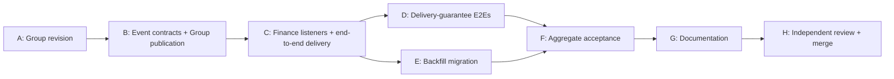

# P3.2b - Durable Group → Finance membership delivery: implementation plan

**Status:** Approved; implementation in progress. Follows the approved [specification](specification.md). Checkboxes denote verified and human-approved work, not merely written code. Follow the [AI development workflow](../../../development/ai-development-workflow.md) in its default human-gated form; no autonomous execution is authorized.

## Baseline and prerequisites

- [x] Maintainer approves the specification.
- [x] Maintainer approves this plan.
- [ ] P2.4a is merged into `main`. Until then, the maintainer merged `origin/task/p2.4a-iam-user-events` into this branch (`620e97b`) so implementation can proceed. Its registry migration, recovery configuration, `ContributingOperationDispatcher` usage and `FailedEventPublications` test patterns are prerequisites for Phases C–E.
- [x] Create `task/p3.2b-membership-delivery` from `main` at `6296c31` (P3.2a merged) and commit the approved specification and the draft plan for review.
- [ ] After plan approval and the P2.4a merge, update the branch from `main`, commit the approved plan and push before implementation begins.
- [ ] Run the unchanged Unit, Integration and E2E suites on the branch baseline and record the results, so later failures are not confused with pre-existing ones.

The agent works in the connected devcontainer, where Maven and the `postgres` service are available. It runs the Unit, Integration and E2E suites and the jOOQ generation profile itself. No POM change or new framework is needed, so the offline dependency handoff is unaffected. New Flyway versions are timestamped after the latest migration on `main` at branch creation (after P2.4a's `V202611251410`). Each phase ends with one focused change set staged for human review before it is committed. The human runs the Compose deployment smoke and the manual acceptance.



## Phase A - Group membership revision

Adds the source revision and its single write path, without events. Covers DLV-R01–R03.

- [x] Add a Group migration `groups/V<timestamp>__groups_membership_revision.sql`: create the domain `groups.bignatural1` (`bigint`, `CHECK (VALUE > 0)`) with the same `REVOKE`/`GRANT USAGE` pattern as `groups.natural1`, and add `groups.groups.membership_revision groups.bignatural1 NOT NULL DEFAULT 1`. Existing rows receive 1.
- [x] Regenerate the Group jOOQ metadata with `generate@groups` against the migrated devcontainer database, following the [development guide](../../../development.md#database). Commit only the generated diff for `groups`; never edit generated sources by hand.
- [x] Change `GroupMembershipPort.addMember` and `removeMember` to advance the revision and return the new value: after the existing row-count-checked insert or delete, `UPDATE groups.groups SET membership_revision = membership_revision + 1 WHERE id = :group RETURNING membership_revision`, requiring exactly one row. Document on the port that the revision is advanced only here and that the caller holds the group row lock.
- [x] Return the creation revision from `GroupCreationPort.createWithAdministrator` via `RETURNING membership_revision` (not a hard-coded 1), carried in an internal creation result so services can publish it in Phase B. `GroupDetails` and HTTP responses stay unchanged.
- [x] Integration tests in `GroupPersistenceIT` (or a focused new IT): creation returns 1; add and remove each return the previous value plus one; set role leaves it unchanged; the domain rejects 0.
- [x] E2E DLV-T05 in `GroupMembershipE2E`: the committed sequence create → join → leave → set role → `ALREADY_MEMBER` → rejected removal yields 1, 2, 3, 3, 3, 3. Add a concurrent-join case to the existing Group concurrency fixtures: two redemptions for one group commit distinct revisions 2 and 3. The implemented sequence promotes before leaving and yields 1, 2, 2, 3, 3, 3 (see findings).
- [ ] Run the Unit, Integration and E2E suites and `git diff --check`; stage for review. Focused runs passed and `git diff --check` is clean; the full suites are outstanding.

**Suggested commit:** `P3.2b-A: Advance a Group membership source revision with each membership change`

**Gate A:** Human reviews the migration, generated diff, port contract and revision SQL; all three suites pass.

## Phase B - Event contracts and Group publication

Publishes the facts inside the Group segments. With no listener registered yet, publication creates no registry rows; the state is buildable and inert. Covers DLV-R04–R07 at Unit level.

- [x] Create package `de.hsh.favs.sharewise.groups.events` with `@NamedInterface("events")` and the records `GroupCreatedV1`, `GroupMemberAddedV1` and `GroupMemberRemovedV1` as specified: compact constructors reject nulls and nonpositive revisions; Javadoc states that class names are persisted in the registry and that the type is the resulting state.
- [x] Add a Group-internal port `GroupEventPublisher` (`groupCreated(groupId)`, `memberAdded(groupId, userId, revision)`, `memberRemoved(groupId, userId, revision)`) and its adapter `SpringGroupEventPublisher` in `groups.internal.events` over `ApplicationEventPublisher`. The adapter generates `eventId` once per fact and sets `occurredAt` from the application clock.
- [x] Publish from the services, inside their existing segment and after the last write of the successful path: `GroupCreationService` publishes the created fact and the creator's added fact with the returned revision; `GroupInvitationService.redeemLocked` publishes an added fact only for `JOINED`, after consuming the invitation; `GroupMembershipService.remove` publishes a removed fact with `member.userId()` and the returned revision. `setRole` and every failure path publish nothing.
- [x] Unit tests DLV-T01 (record validation) and DLV-T02 (services with fake ports and a recording publisher: exactly the facts of the specification's operation table, none on other paths). Update existing service unit tests and test wiring for the new constructor dependency.
- [ ] Run the Unit and Integration suites and the Group E2E tests and `git diff --check`; stage for review. Focused Unit tests and the Group service E2Es passed and `git diff --check` is clean; the full Unit and Integration suites are outstanding.

**Suggested commit:** `P3.2b-B: Publish Group creation and membership facts`

**Gate B:** Human reviews the event contracts, which become a persisted format, and the publication points in each service.

## Phase C - Finance listeners and end-to-end delivery

Registers the real consumer and proves the main producer-to-consumer paths. Covers DLV-R08–R10, R13, R14, R16.

- [x] Add `groups::events` and `shared::di` to Finance's `allowedDependencies`.
- [x] Add `finance.internal.events.GroupEventListener` with three `@Async @TransactionalEventListener` handlers and the listener IDs `finance.group-activation.v1`, `finance.membership-added.v1` and `finance.membership-removed.v1`, each dispatching one `FinanceProjectionService` operation through an event-side `ContributingOperationDispatcher` without contributors, exactly as P2.4a's Group listener does. Map each event to its command, log the outcome at debug level with event ID, type and group ID, and let exceptions propagate. Javadoc records the persisted listener IDs and the drain-before-rename rule.
- [x] Unit tests DLV-T03 (mapping, single dispatch, outcome and exception propagation with a recording dispatcher) and DLV-T04 (existing Modulith verification passes with the new named interface and dependencies; add a fixture assertion if the existing structure tests do not already cover the new edge).
- [x] Add shared Finance delivery E2E support: bounded polling for Finance rows and for the publication count per listener ID, and inspection of stored listener IDs and serialized payloads. Extend existing Finance or messaging test support rather than copying P2.4a's private helpers.
- [x] E2E DLV-T09 and DLV-T10 in a new `GroupFinanceDeliveryE2E`: create, join, leave and rejoin through the Group services; assert Finance state and completed publications.
- [x] E2E DLV-T06 and DLV-T08: hold delivery by revoking the Finance privileges needed by the listener in the test's database, so committed publications remain observable as `FAILED` rows; assert the two creation publications, their listener IDs and payload fields. For the rollback half, inject a failure after publication and before the physical commit, reusing the technique of P2.4a's `UserRegisteredPublicationE2E`; assert no group, owner or publication.
- [x] E2E DLV-T07: extend the Phase A concurrent-join case to wait for delivery and assert both joiners' actors at the revisions committed with their membership rows.
- [ ] Make existing E2E tests robust to asynchronous Finance writes. Every committed group creation or membership change now triggers listeners after the test's transaction. Run the full E2E suite, including at the CI worker count, and fix any cleanup or assertion race in shared test support, not with sleeps or by disabling listeners. Every Group-mutating E2E and all Finance E2Es pass at 16 workers without changes; the shutdown race found there is follow-up P2.4d. The full-suite run is outstanding.
- [ ] Run the Unit, Integration and E2E suites, the E2E suite with `-DtestParallelism=16` and `git diff --check`; stage for review. Focused runs passed and `git diff --check` is clean; the full suites are outstanding.

**Suggested commit:** `P3.2b-C: Deliver Group membership facts to the Finance projection`

**Gate C:** Human reviews the listener, module dependency change, test support and end-to-end evidence.

## Phase D - Delivery-guarantee E2Es

Test-only phase proving ordering, idempotency and failure semantics through the real registry. Covers DLV-R10–R12.

- [x] Add a test-only fixture publisher that publishes Group event records inside a `Transactions` segment of the E2E context, without a production entry point. `TestEventPublisher` in shared test support accepts any event record (maintainer decision).
- [x] DLV-T11: the three delivery orders, each fact in its own committed producer segment with completion awaited before the next.
- [x] DLV-T12 and DLV-T13: identical redelivery (same event ID), stale revision, repeated creation and an unknown-member removal. Assert the outcomes through Finance state, unchanged `updated_at`, and deleted publications.
- [x] DLV-T14: consumer failure through a revoked `INSERT` on `finance.actors`, a Group join that still succeeds, a retained `FAILED` publication, then restored privilege, `FailedEventPublications.resubmit(...)` and completion.
- [x] DLV-T15: same-revision contradiction. The second publication remains incomplete across at least two resubmissions, and the actor is unchanged.
- [x] DLV-T16: completion failure through a revoked `DELETE` on `messaging.event_publication` after the Finance commit, then restored privilege and resubmission. Finance state is applied once and the publication is deleted.
- [x] Run each new test five consecutive times and the full E2E suite at the CI worker count; `git diff --check`; stage for review. The eight new tests passed five consecutive runs at 16 workers and `git diff --check` is clean; at the maintainer's request, the full suites run once at the end of the task.

**Suggested commit:** `P3.2b-D: Verify ordering, redelivery and recovery of membership delivery`

**Gate D:** Human reviews fault-injection techniques and evidence; no test is skipped, weakened or timing-dependent.

## Phase E - Backfill migration

Can be reviewed independently of Phase D. Covers DLV-R15.

- [ ] Add `platform/V<timestamp>__platform_bootstrap_finance_from_groups.sql` with the specification's two `INSERT … SELECT … ON CONFLICT DO NOTHING` statements, ordered after the Group revision migration. A header comment states the stop → migrate → start precondition and that it is a one-time deployment initialization.
- [ ] E2E DLV-T17, following the pattern of P2.4a's bootstrap test in `GroupMigrationE2E`: migrate to the version before the backfill, seed groups with several members, apply the remaining migrations, execute the statements again as the migrator, then join a new member through Group and await delivery.
- [ ] Check `BaselineMigrationE2E` and other migration-sequence tests for expectations that the new migrations change.
- [ ] Run the Unit, Integration and E2E suites and `git diff --check`; stage for review.

**Suggested commit:** `P3.2b-E: Initialize the Finance projection for pre-existing Groups`

**Gate E:** Human reviews the migration SQL and its ordering.

## Phase F - Aggregate implementation acceptance

- [ ] Agent self-review of the complete branch against the specification and the [review checklist](../../../../.agents/skills/engineering-quality/references/review-checklist.md); record findings and resolutions below.
- [ ] Human runs `cd deploy && ./scripts/test-compose.sh` on the integrated revision and records the result.
- [ ] Human performs manual acceptance DLV-T18 on the local Compose stack, including the stop → migrate → start upgrade of a database with pre-existing groups, and records the tested revision and observations below.
- [ ] CI pipeline green for the pushed revision, including `verify-backend-jooq-codegen`.
- [ ] Accepted findings are fixed in focused follow-up commits with affected checks rerun.

**Gate F:** Human accepts the implementation behavior before documentation is reconciled.

## Phase G - Steady-state documentation

- [ ] Reconcile the documents listed in the specification's [documentation reconciliation](specification.md#documentation-reconciliation): messaging implemented configuration (Group events, Finance listener IDs, contradiction resolution procedure), persistence architecture (Group revision, Finance consumer wiring, backfill), architecture overview module dependencies, Phase 2 foundation Group schema reference, Phase 3 foundation status, development guide (stop → migrate → start, inspecting the Finance projection), the recovery delay of a lost completion (Phase D finding) and backlog (P2.4b, P2.4c, P3.2b).
- [ ] Resolve the specification's open question on the yEd ERD: update the diagram, or record that the maintainer updates it separately.
- [ ] Search the documentation for statements that Group publishes no events, that Finance has no listener, or that the membership revision is a future requirement. Verify relative links and `git diff --check`; stage for review.

**Suggested commit:** `P3.2b-G: Document Group → Finance membership delivery`

**Gate G:** Human approves the documentation change.

## Phase H - Independent review and merge

- [ ] Independent agent review of the complete MR against the specification; findings and resolutions are recorded below, with affected scenarios re-verified.
- [ ] Final commit marking P2.4b, P2.4c and P3.2b complete in the backlog.
- [ ] Human merge authorization.

## Self-review and review findings

| Phase | Finding | Resolution |
| --- | --- | --- |
| A | In the order create → join → leave → set role, only the creator remains when the role change runs, so it cannot write. | DLV-T05 promotes the joiner before they leave: create → join → set role → leave → `ALREADY_MEMBER` → rejected removal yields 1, 2, 2, 3, 3, 3. Accepted by the maintainer. |
| A | The concurrent-join E2E cannot attribute revisions 2 and 3 to individual joiners before events exist. | Phase A asserts both joins and final revision 3; DLV-T07 in Phase C asserts the per-joiner revisions through delivery. Accepted by the maintainer. |
| C | `ConflictingMembershipFactException` has a package-private constructor, so the listener unit test cannot construct it. | DLV-T03 proves unchanged propagation with ordinary exceptions for all three handlers; the real contradiction path through the registry is DLV-T15 (Phase D). |
| C | Four E2E classes carried identical private polling loops, and two read the registry by hand. | Added `Eventually`, `EventPublications` and `CommitFailures` to shared test support and moved the P2.4a tests onto them; `GroupDeliveryFixture` observes Finance delivery for producer-side tests. |
| C | With live listeners, an E2E that ends right after a Group mutation can close its context while a Finance delivery is in flight; the delivery then fails with `EntityManagerFactory is closed` or `Socket closed`. Tests stay green because the fixture drops its database `WITH (FORCE)`, but the same ordering contradicts the `application.properties` note that shutdown waits for in-flight deliveries (inherited from P2.4a). | Maintainer decision: the production fix is follow-up P2.4d in the backlog; Phase C corrects the `application.properties` comment and the messaging configuration reference to state the actual shutdown behavior. Delivery stays at-least-once: an interrupted publication is republished on restart. |
| C | The full E2E suite was not run during Phase C, at the maintainer's request to limit test runs. | Ran every E2E class that mutates Groups, plus all Finance E2Es, at `-DtestParallelism=16`, and the messaging and IAM delivery E2Es serially. The full suites remain a Gate C prerequisite. |
| D | Spring Modulith completes a publication outside the listener's failure handling. A completion `DELETE` that fails after the Finance commit therefore leaves the publication `PROCESSING`, not `FAILED`, until the staleness monitor moves it after `staleness.processing` (10 minutes in production); only then can resubmission redeliver it. | Behavior as documented in the messaging configuration; no production change. DLV-T16 shortens only the processing staleness and its check interval in its own context, and recovers through the production staleness → resubmission path. Maintainer decision: accepted as configured; Phase G states the delay explicitly in the messaging documentation. |
| D | Self-review: DLV-T16 could pass without exercising a lost completion if the test restored `DELETE` before the listener thread attempted completion. | The test waits until the listener executor is idle (shared `AsyncDeliveries`), then asserts that the publication is still retained before restoring the privilege. |
| D | Self-review: expected actor lists were sorted with `UUID.compareTo`, which orders signed longs, unlike PostgreSQL's `uuid` order. | Expected actors are listed in the database's order, with fixed user IDs chosen accordingly, as in Phase C. |

## Verification commands and evidence

From `src/backend/sharewise` in the devcontainer:

```bash
./mvnw -B -ntp -Punit-tests clean verify
./mvnw -B -ntp -Pintegration-tests clean verify
./mvnw -B -ntp -Pe2e-tests clean verify
./mvnw -B -ntp -Pe2e-tests -DtestParallelism=16 verify
git diff --check
```

Focused `-Dtest` and `-Dit.test` runs are fine during development; the full suites run before each gate. Regenerating Group metadata:

```bash
./mvnw -Pjooq-codegen \
  -Djooq.codegen.jdbc.url=jdbc:postgresql://postgres:5432/sharewise \
  -Djooq.codegen.jdbc.user=sharewise_migrator \
  org.flywaydb:flyway-maven-plugin:migrate org.jooq:jooq-codegen-maven:generate@groups
```

The human runs the deployment smoke from the repository root with `cd deploy && ./scripts/test-compose.sh`.

| Evidence | Result |
| --- | --- |
| Specification approval | Approved by maintainer (2026-11-26) |
| Plan approval | Approved by maintainer (2026-11-26) |
| Baseline suites | Pending |
| Unit suite (including Modulith verification) | Focused runs green through Phase C, including Modulith verification and module-structure tests; full suite pending |
| PostgreSQL Integration suite | `GroupPersistenceIT` green (Phase A); full suite pending |
| PostgreSQL E2E suite, including at 16 workers | Group-mutating, Finance, messaging and IAM delivery E2Es green; Group and Finance classes also at 16 workers (Phase C, 64 tests); the eight Phase D tests (DLV-T11–T16) green in five consecutive runs at 16 workers, with the injected completion failure observed in each run; full suite pending, run by the maintainer at the end |
| jOOQ freshness (CI `verify-backend-jooq-codegen`) | Regenerated against a fresh and a recreated dev database with identical output (Phase A); CI pending |
| Disposable deployment smoke | Pending |
| Manual acceptance DLV-T18 | Pending |
| Independent MR review and resolutions | Pending |
| Human final diff review and merge authorization | Pending |

## Risks and notes

- **Persisted contracts.** The three event class names and listener IDs are stored in the registry from the first deployment. Review them at Gates B and C as persisted formats.
- **Asynchronous effects in existing E2E tests.** Phase C must make the whole E2E suite reliable with live listeners, at the CI worker count, without disabling delivery.
- **P2.4a drift.** If P2.4a changes before merging, recheck the listener pattern, test helpers and migration ordering before Phase C.
- **Single instance.** Restart republication assumes one backend instance, inherited from P2.4a.
