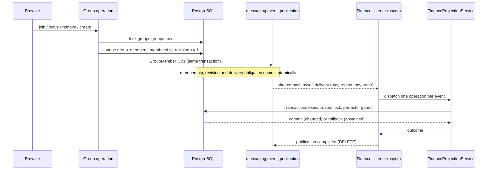

# P3.2b - Durable Group → Finance membership delivery: specification

**Status:** Approved by the maintainer (2026-11-26); see the [implementation plan](plan.md). This task combines three backlog items, as agreed during task discussion (2026-11-26): the Group-side producer of [P2.4b](../backlog.md#p24---durable-cross-context-event-integration), the Finance consumer wiring of [P3.2b](../backlog.md#phase-3---finance-actor-synchronization-and-accounting-foundations) and the joint delivery acceptance of P2.4c. It follows the precedent of P2.4a, which delivered its producer together with its first real consumer (P2.2d), and the P2.4a review decision (Q5) that moved P2.4b/P2.4c into Phase 3 with P3.2. The shared contract is the approved [Phase 3 foundation](../../integration/phase-3-foundation.md) (P3.0); the Finance operations are the implemented [P3.2a projection](../p3.2a-finance-projection/specification.md); the delivery infrastructure is [P2.4a](../../../stack/messaging.md#implemented-configuration). **Workflow:** [AI development workflow](../../../development/ai-development-workflow.md); the implementation plan follows after this specification is approved.

## Goal and scope

Every organizational membership change in Group Management reaches Finance's retained actor projection **automatically, durably and idempotently**. Group Management records each membership change, its group-local source revision and the delivery obligation in one PostgreSQL transaction; Finance applies the fact in its own, independent transaction through the P3.2a operations. Duplicate, delayed, reordered and retried delivery converges on the state implied by the highest source revision per actor. A consumer failure leaves a recoverable publication and never affects the Group mutation that produced it.

### Starting point

- **P2.4a** (task branch complete, review and acceptance open; not yet on `main`): Spring Modulith JDBC registry in schema `messaging`, `DELETE` completion, completion only after the listener returns, bounded async executor, restart republication, staleness monitor and `FailedPublicationResubmitter`. Its listener pattern is `@Async @TransactionalEventListener(id = …)` dispatching one operation through an event-side `ContributingOperationDispatcher` without contributors.
- **P2.2a–c** (`main`): Group creation inserts the group and its creator as administrator in one segment. Joining through an invitation, leaving and removal by an administrator change `groups.group_members` under the group's `SELECT … FOR UPDATE` row lock. Role changes update the member row. `groups.groups` has no membership revision.
- **P3.1/P3.2a** (`main`): `finance.groups`, `finance.actors`, the root lock and the operation-scoped `FinanceProjectionService` with `activate(ActivateFinancialGroup)` and `applyMembershipChange(ApplyMembershipChange)`. No listener invokes it.

**Implementation prerequisite:** P2.4a is merged into `main` before dependent implementation begins. This specification and its plan may be reviewed and committed earlier.

### Included

- **Group producer (P2.4b):** a Group-owned membership source revision on `groups.groups`, advanced atomically with every membership addition or removal; three versioned event contracts in a new published named interface `groups::events`; publication of those facts inside the existing Group mutation segments.
- **Finance consumer (P3.2b):** Finance-internal listeners that map each Group event to the corresponding P3.2a command and dispatch one projection operation per delivery.
- **Rollout:** a writes-suspended Flyway data migration that initializes Finance roots and actors for Groups that exist before the release.
- **Delivery acceptance (P2.4c):** PostgreSQL E2E evidence for producer atomicity, independent consumer commit, completion for changing and abstaining outcomes, failure retention and recovery, harmless redelivery and either delivery order of the creation facts; manual acceptance on the local Compose stack.
- Steady-state documentation reconciliation.

### Excluded

- Group-side "permission projections" for attestation issuance mentioned in P2.4b's backlog text. They have no consumer before P2.5 and belong there.
- Changes to the P3.2a operations, policy, commands or stores, other than what the consumer wiring strictly requires. Contradiction handling, lifecycle guards and idempotency remain as implemented.
- Group deletion, `GroupDeleted` events, account deletion (P2.1e, cut from the MVP), role propagation to Finance, snapshot reconciliation, periodic drift repair (P8.4), a Finance inbox or pending-event queue, broker externalization.
- Any HTTP API, frontend change or Finance business operation. The actor projection never becomes an authorization source.
- Changes to the P2.4a registry configuration, recovery settings or executor.

## Architectural solution



### Module boundaries

Group Management publishes the event records in a new package `de.hsh.favs.sharewise.groups.events`, declared as the named interface **`groups::events`**. It contains only the event records; Group's application, persistence and HTTP types stay internal. Finance adds `groups::events` and `shared::di` to its `allowedDependencies` and references no other Group type. Group Management does not depend on Finance. Spring Modulith verification enforces these rules.

| Package | Responsibility |
| --- | --- |
| `groups.events` (published) | `GroupCreatedV1`, `GroupMemberAddedV1`, `GroupMemberRemovedV1`. |
| `groups.internal.application…` | A Group-internal publishing port called by the creation, invitation and membership services on their successful mutation paths. |
| `groups.internal.persistence` | Revision advancement inside the existing membership write adapters. |
| `groups.internal.events` | The Spring adapter for the publishing port over `ApplicationEventPublisher`. |
| `finance.internal.events` | The Finance listeners and their event-to-command mapping. |
| `db/migration/groups`, `db/migration/platform` | The Group revision column and the cross-context backfill migration. |

### Event contracts

The events are immutable records whose fully qualified class names encode producer, type and version, as for `UserRegisteredV1`. They are persisted in the registry, so the class names and packages are part of the persistence contract.

```java
record GroupCreatedV1(UUID eventId, UUID groupId, Instant occurredAt) {}

record GroupMemberAddedV1(UUID eventId, UUID groupId, UUID userId, long membershipRevision, Instant occurredAt) {}

record GroupMemberRemovedV1(UUID eventId, UUID groupId, UUID userId, long membershipRevision, Instant occurredAt) {}
```

All fields are required; `membershipRevision` is positive. `eventId` is generated once when the fact is published and is identical across redeliveries. `occurredAt` is occurrence metadata, never an ordering authority. The **resulting membership state is the event type**: an added event means the user is an active member at that revision, a removed event means the user is not. Separate types keep the state explicit rather than a field whose omission could be misread, and keep the foundation's `GroupMemberAddedV1` name for the initial owner and later joins alike.

The payloads deliberately omit the group name, roles, membership row IDs and user profile data. Finance needs none of them, and the registry retains payloads until delivery completes. Role changes are not membership changes: they publish nothing and do not advance the revision.

### Group membership source revision

`groups.groups` gains `membership_revision`, a Group-owned positive `bigint` domain (`groups.bignatural1`, defined independently of Finance's domain), `NOT NULL DEFAULT 1`. A new group starts at 1, which is the revision of its initial owner membership. Existing rows receive 1 when the column is added.

The **membership write adapters own the revision invariant**: the operations that insert or delete a `group_members` row also advance `membership_revision` by exactly one in the same statement sequence and return the new value. No caller can change membership without advancing the revision, and no other path advances it. Every caller already holds the group row lock, which serializes concurrent changes of the same group, so each committed change receives a distinct revision and the published revision is the one committed with the membership row. Group creation does not advance the revision: the inserted group's default revision 1 is the owner's revision.

| Group operation | Membership effect | Revision | Published facts |
| --- | --- | --- | --- |
| Create group | group and administrator row inserted | 1 (default) | `GroupCreatedV1` and `GroupMemberAddedV1(creator, 1)` |
| Redeem invitation, `JOINED` | member row inserted | +1 | `GroupMemberAddedV1(user, n)` |
| Redeem invitation, `ALREADY_MEMBER` | none | unchanged | none |
| Leave or remove member | member row deleted | +1 | `GroupMemberRemovedV1(user, n)`, with the user ID read from the locked target before deletion |
| Set role, including no-op | none | unchanged | none |
| Any rejected or failed operation | rolled back | unchanged | none (rolled back) |

### Publication protocol

Each service publishes through a Group-internal port, backed by a Spring adapter over `ApplicationEventPublisher`, **inside its existing `Transactions.execute(...)` segment** and only on the path that returns a successful mutation, after its last write. The segment's commit makes the membership change, revision and registry rows durable together. A rollback, including a commit failure after publication, discards all of them. Creation publishes its two facts in the same transaction; their relative publication order carries no meaning, and Finance accepts either delivery order. The Group operation's result never depends on Finance processing.

### Finance consumer

A Finance-internal listener component handles the three event types, following the P2.4a listener pattern: each handler is `@Async` and `@TransactionalEventListener` with an explicit, stable listener ID, owns no transaction, and dispatches exactly one `FinanceProjectionService` operation through an event-side `ContributingOperationDispatcher` without contributors.

| Event | Listener ID | Command | Operation |
| --- | --- | --- | --- |
| `GroupCreatedV1` | `finance.group-activation.v1` | `ActivateFinancialGroup(groupId)` | `activate` |
| `GroupMemberAddedV1` | `finance.membership-added.v1` | `ApplyMembershipChange(groupId, userId, revision, ACTIVE)` | `applyMembershipChange` |
| `GroupMemberRemovedV1` | `finance.membership-removed.v1` | `ApplyMembershipChange(groupId, userId, revision, REMOVED)` | `applyMembershipChange` |

One listener ID per event type keeps each registry row attributable to exactly one handler and avoids relying on supertype listener matching during resubmission. The mapping is the only place where Group types meet Finance commands; P3.2a's commands and service stay free of Group types.

**Completion semantics follow from the listener returning or throwing.** Any returned outcome, whether committing (`ACTIVATED`, `INSERTED`, `SUPERSEDED`) or abstaining (`UNCHANGED`, `DUPLICATE`, `STALE`), returns normally, so the registry completes and deletes the publication. Abstaining outcomes physically roll back but are successful: committed Finance state already reflects the fact. Any exception, including `ConflictingMembershipFactException`, persistence, lock and commit failures, propagates out of the listener. The publication stays incomplete, the staleness monitor and resubmitter retry it with backoff, and it is never abandoned automatically. The listener neither catches, maps nor retries exceptions. It logs each handled event at debug level with event ID, type, group ID and outcome; failures are reported through the existing async exception logging and the retained `FAILED` publication.

Events of the same group can be delivered concurrently on different executor threads and in any order. The P3.2a root lock and per-actor revision guard make this safe without consumer-side ordering.

### Rollout and backfill of existing Groups

The registry cannot publish facts for Groups created before the listener exists. A one-time Flyway **data migration** under `db/migration/platform/`, ordered after the Group revision migration, initializes Finance from current Group state:

```sql
INSERT INTO finance.groups (id, state)
SELECT id, 'open' FROM groups.groups
ON CONFLICT (id) DO NOTHING;

INSERT INTO finance.actors (group_id, user_id, deleted, upstream_revision)
SELECT m.group_id, m.user_id, false, g.membership_revision
FROM groups.group_members m JOIN groups.groups g ON g.id = m.group_id
ON CONFLICT (group_id, user_id) DO NOTHING;
```

Each existing group gets an `open` root at financial revision zero, and each current member an active actor at the group's current membership revision (1 directly after the column migration). Every later change receives a higher revision, so the per-actor guard accepts it. Members who left before the release are not represented; no Finance history references them, and a later rejoin inserts their actor normally. The migration requires the established **stop → migrate → start** deployment order, so no Group write occurs between the backfill and listener registration. On a fresh database it inserts nothing. This is the controlled deployment-time initialization the [messaging architecture](../../../stack/messaging.md#recovery-and-retention) permits, not runtime cross-context access.

## Requirements and invariants

| ID | Requirement |
| --- | --- |
| DLV-R01 | `groups.groups.membership_revision` is a positive `bigint`, `NOT NULL`, default 1. New and pre-existing groups start at 1. |
| DLV-R02 | Every committed membership insertion or deletion advances its group's `membership_revision` by exactly one in the same transaction. Group creation, role changes, `ALREADY_MEMBER` redemptions and rejected or failed operations do not advance it. |
| DLV-R03 | Concurrent membership changes of one group commit distinct, consecutive revisions; each published event carries the revision committed with its membership change. |
| DLV-R04 | A committed group creation has exactly one durable `GroupCreatedV1` and one `GroupMemberAddedV1(creator, 1)` publication per registered listener, committed with the group and owner rows. |
| DLV-R05 | A committed join publishes one `GroupMemberAddedV1`; a committed leave or removal publishes one `GroupMemberRemovedV1` carrying the removed user's ID. Operations without a membership change publish nothing. |
| DLV-R06 | A rolled-back Group segment, including a commit failure after publication, leaves no publication, no membership change and no revision change. |
| DLV-R07 | Event records reject null fields and nonpositive revisions; payloads contain only the documented fields. `eventId` is stable across redeliveries. |
| DLV-R08 | Finance applies each event in a separate transaction owned by `FinanceProjectionService`; Group operation success never depends on Finance processing or availability. |
| DLV-R09 | Each delivery dispatches exactly one projection operation with the mapped command. The listener owns no transaction and does not catch, map or retry exceptions. |
| DLV-R10 | A publication is completed after the Finance operation returns any outcome, committing or abstaining. A publication whose Finance operation throws, including a same-revision contradiction, remains incomplete and recoverable, and is never abandoned automatically. |
| DLV-R11 | Redelivery of an applied event, delivery of a stale event and redelivery after a lost completion leave Finance state unchanged, including `updated_at`, and complete the publication. |
| DLV-R12 | `GroupCreatedV1` and the owner's `GroupMemberAddedV1` converge to an `open` root with the owner active at revision 1 in either delivery order; a later member event arriving before both also converges. |
| DLV-R13 | The stored listener IDs are `finance.group-activation.v1`, `finance.membership-added.v1` and `finance.membership-removed.v1`. |
| DLV-R14 | `groups::events` contains only the event records. Finance depends on Group only through `groups::events`; Group does not depend on Finance. Neither context reads or writes the other's tables at runtime; the backfill migration is the only deployment-time exception. |
| DLV-R15 | After the backfill migration, every pre-existing group has an `open` Finance root at revision zero and every current member an active actor at the group's membership revision. Re-executing the migration statements changes nothing. |
| DLV-R16 | Membership events never change `finance.groups.current_revision` or create financial history, as P3.2a guarantees. |

## Failure behavior

| Situation | Effect |
| --- | --- |
| Group operation rejected (for example last administrator) or rolled back | No membership change, no revision change, no publication. |
| Finance operation throws (database unavailable, lock or persistence failure) | Finance segment rolls back; publication stays `FAILED`; resubmission retries with backoff; the Group mutation remains committed. |
| Same-actor, same-revision contradiction | `ConflictingMembershipFactException`; actor unchanged; publication retained and retried until an operator resolves it. It indicates a producer defect and is not repaired automatically; resolution follows the operator procedure in the [messaging architecture](../../../stack/messaging.md#implemented-configuration). |
| Crash after Group commit, before delivery | Publication outstanding; republished on restart. |
| Crash or completion failure after the Finance commit | Publication redelivered; the operation returns `DUPLICATE` or `UNCHANGED` without writes; then completed. |
| Executor queue full | Inherited from P2.4a: publication stays `PUBLISHED` until the staleness monitor or a restart recovers it. |
| Listener ID renamed or an event record moved | Outstanding publications cannot be delivered. Drain first, as for `UserRegisteredV1`. |
| Revision overflow | Unreachable in practice; the domain check fails the Group operation, which rolls back. |

## Acceptance tests

Tests follow the [test architecture](../../../architecture/tests.md) and [test guide](../../../development/tests.md). Registry delivery depends on physical commits, so delivery cases are **E2E** against PostgreSQL 18. "Eventually" means a bounded poll on an independent connection; no sleeps. Fixture events for order and fault scenarios are published by test-only code inside a `Transactions` segment; tests add no production entry points. Each E2E test owns a disposable database, so privilege revocations used for fault injection are confined to that test.

| Test | Requirements | Setup and action | Expected observation | Level |
| --- | --- | --- | --- | --- |
| DLV-T01 | R07 | Construct each event record with null fields, revision 0, negative and `Long.MAX_VALUE`. | Invalid values rejected; maximum accepted. | Unit |
| DLV-T02 | R02, R05 | Group services with fake ports and a recording publisher: create; redeem `JOINED` and `ALREADY_MEMBER`; leave; remove; set role; each rejected path. | Exactly the facts in the operation table, with the revision returned by the port and the target's user ID; none on other paths. | Unit |
| DLV-T03 | R09 | Listener with a recording dispatcher: deliver each event type; let the operation return each outcome and throw. | Correct command per event and exactly one dispatch; outcomes return normally; exceptions propagate unchanged. | Unit |
| DLV-T04 | R14 | Spring Modulith verification. | `groups::events` published; Finance uses only it and its declared shared interfaces; no Group → Finance dependency. | Unit |
| DLV-T05 | R01, R02 | Migrate; create a group; join; leave; set role; redeem again while already member; attempt a rejected removal. Read the committed revision after each step. | 1, 2, 3, 3, 3, 3. The domain rejects 0. | E2E |
| DLV-T06 | R04, R06, R13 | Create a group with delivery held; inspect the registry from an independent connection. Repeat with an injected failure after publication and before the physical commit. | Committed: group, owner and exactly two publications with the documented listener IDs. Failed: no group, owner or publication. | E2E |
| DLV-T07 | R03, R12 | Two users concurrently redeem invitations for the same group; then let delivery complete. | Revisions 2 and 3 assigned to distinct users, each matching its published event; Finance ends with owner rev 1 and both joiners active at their revisions. | E2E |
| DLV-T08 | R07 | Read stored serialized payloads for each event type. | Only the documented fields; no group name, role, membership ID or profile data. | E2E |
| DLV-T09 | R08, R10, R16 | Create a group through the Group service; wait for delivery. | Finance root `open`, revision 0, owner active at rev 1; both publications deleted. | E2E |
| DLV-T10 | R05, R10 | Join, leave, then rejoin a user through Group services. | Actor active rev 2, then removed rev 3 (row retained), then active rev 4 in the same row; all publications deleted. | E2E |
| DLV-T11 | R12 | Fixture-publish in separate committed producer segments, awaiting completion between them: (a) created, then owner added rev 1; (b) owner added, then created; (c) member added rev 2, then (a). | All converge on `open`, owner active rev 1, member active rev 2 for (c); every publication deleted. | E2E |
| DLV-T12 | R10, R11 | After DLV-T09, re-publish an identical owner event (same event ID), an older revision for a superseded actor, and a second created event. | `DUPLICATE`, `STALE`, `UNCHANGED`; Finance rows including `updated_at` unchanged; all three publications deleted. | E2E |
| DLV-T13 | R10 | Fixture-publish a removal for an unknown user in an existing group. | Tombstone inserted; publication deleted. | E2E |
| DLV-T14 | R08, R10 | Make the Finance operation fail with a real database failure (for example revoked `INSERT` on `finance.actors`), then join a user through Group. Restore the privilege and let resubmission run. | Join succeeds; publication `FAILED` with attempts ≥ 1 and no actor; after recovery the actor is active and the publication deleted. | E2E |
| DLV-T15 | R10 | Fixture-publish an added event at rev 5, then a removed event at rev 5 for the same actor; trigger resubmission. | First deleted; second remains incomplete after repeated attempts; actor unchanged at active rev 5. | E2E |
| DLV-T16 | R11 | Let the Finance operation commit while registry completion fails (for example revoked `DELETE` on `messaging.event_publication`); restore and resubmit. | Finance state applied once; redelivery yields an abstaining outcome; publication deleted. | E2E |
| DLV-T17 | R15 | Seed groups with several members before the backfill migration (migration test harness); execute the backfill statements twice; then join a new user through Group. | Roots `open`, revision 0; actors active at rev 1; second execution no-op; new member arrives at rev 2 and applies. | E2E |
| DLV-T18 | All | Manual acceptance on the local Compose stack: create a group in the UI, invite and join with a second user, change a role, leave, remove. Inspect `finance.groups`, `finance.actors` and `messaging.event_publication` with `psql`. Then upgrade a database containing pre-existing groups with stop → migrate → start and inspect the backfill. | Finance reflects each membership change at the expected revision; role changes have no effect; no outstanding publications remain; pre-existing groups are backfilled. | Manual |

The implementation adds further Unit and Integration tests for adapter mapping, revision SQL and configuration as needed.

### Acceptance gate

The task is accepted when the requirements above hold, the Unit, Integration and E2E suites pass against PostgreSQL 18 in the development container or CI, Spring Modulith verification passes, the disposable deployment smoke (`cd deploy && ./scripts/test-compose.sh`) passes on the integrated revision, manual acceptance DLV-T18 is recorded with tested revision and observations, independent review findings are resolved, and the steady-state documentation is reconciled. Passing the offline Unit gate alone does not establish acceptance. The Group jOOQ model must be regenerated from the migrated schema, which is an external code-generation gate in the plan.

## Decisions

- **Combined task.** The producer and its first consumer are specified, implemented and accepted together, because neither proves the delivery guarantee alone and the backlog forbids unused consumers. The P3.0 contract remains the shared boundary.
- **Separate added and removed event types** rather than one event with a state field. The type carries the resulting state explicitly and matches the foundation's `GroupMemberAddedV1`. The cost is one more listener method and ID.
- **`occurredAt` on all events**, including `GroupCreatedV1`, which the foundation lists as `(eventId, groupId)`. It is additive occurrence metadata, consistent with `UserRegisteredV1`, and changes no semantics; approval of this specification confirms the extension without reopening P3.0.
- **The membership adapter owns revision advancement.** Coupling the increment to the row insert or delete in one port operation makes it impossible to change membership without advancing the revision. Services only receive and publish the returned value.
- **One listener ID per event type** rather than one listener on a shared supertype, so registry rows and resubmission map unambiguously to one handler.
- **Backfill instead of reset**, agreed during task discussion. It mirrors P2.4a's user bootstrap and keeps existing development and deployed Groups usable. Initializing all current actors at the group's current revision is sufficient because no Finance history exists yet.
- **No Finance inbox.** P3.2a's per-actor guard and lifecycle guard provide idempotency, as approved in P3.0.

## Risks

- **Asynchronous side effects in existing tests.** Every committed group creation or membership change in E2E tests now triggers Finance writes after the test's own transaction. Existing Group E2E tests and their cleanup must tolerate or await this delivery so that cleanup and assertions do not race the listeners.
- **Persisted type names.** The three event classes and listener IDs become part of the registry's persistence contract from the first deployment.
- **Contradiction loops.** A producer defect causing a contradiction retries indefinitely with backoff until an operator intervenes. This is the intended fail-closed behavior; it relies on log visibility.

## Open questions

- **ER asset.** The foundation notes that the authoritative yEd ERD does not yet show `groups.groups.membership_revision`. Should this task update the diagram, or is the maintainer updating it separately?
- **Archived roots and same-revision detection across actors** remain open from P3.2a and are unaffected by this task.

## Dependencies and handoffs

| Boundary | Handoff |
| --- | --- |
| **P2.4a → this task** | Registry, recovery configuration, listener pattern and event-side dispatcher are reused unchanged. Implementation starts after P2.4a is merged. |
| **P3.2a → this task** | `FinanceProjectionService` and its commands are the consumer contract; the listener maps and dispatches only. |
| **This task → P2.5** | `groups::events` is the published membership fact contract; attestation issuance defines its own Group-side projections. |
| **This task → P3.4/P4** | Actors are populated for all groups; financial writes keep using the root lock and their own revision sequence. |

## Documentation reconciliation

The final implementation step updates the [messaging architecture](../../../stack/messaging.md#implemented-configuration) (Group events, Finance listener IDs, contradiction resolution), the [persistence architecture](../../../architecture/persistence.md) (Group membership revision, Finance consumer wiring and backfill), the [architecture overview](../../../architecture.md) module dependencies, the [Phase 2 foundation](../../integration/phase-2-foundation.md) Group schema reference, the [Phase 3 foundation](../../integration/phase-3-foundation.md) status line, the [development guide](../../../development.md) (stop → migrate → start for the backfill, inspecting the Finance projection) and the [backlog](../backlog.md) entries for P2.4b, P2.4c and P3.2b.
