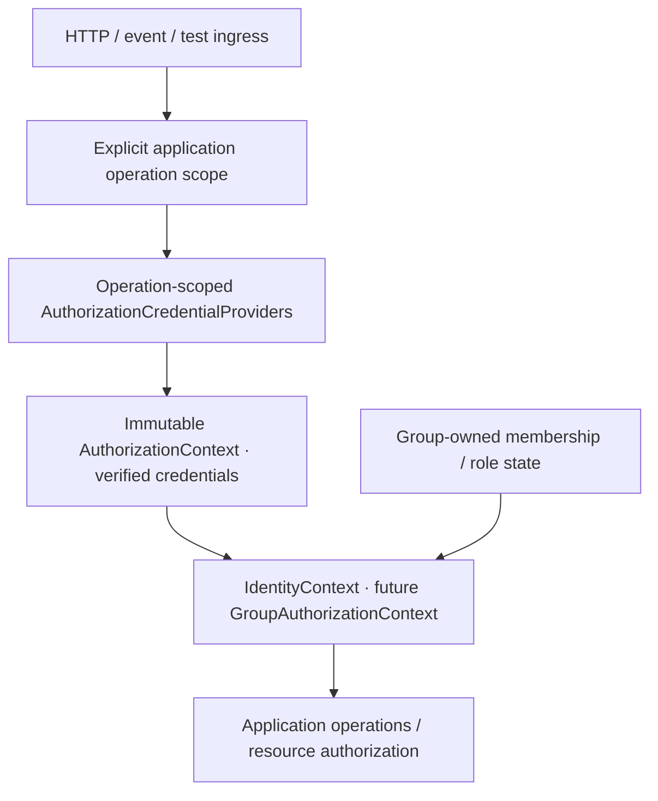
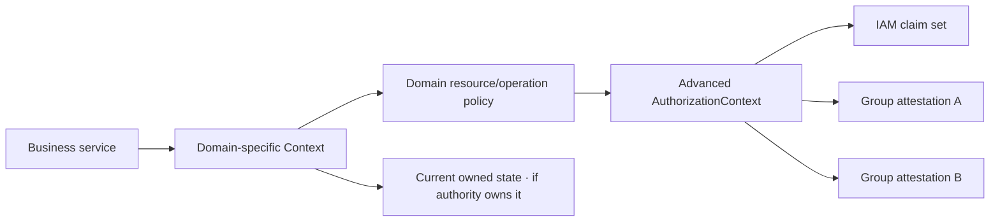

# Verified claims and semantic security contexts: proposed architecture

**Status:** **Design reference** for P2.1.0 and P2.5, not authoritative steady-state implementation documentation. The generic operation-input bridge and authorization-evidence contracts are implemented under P2.1.0 phases A/B. Production JWT processing, IAM identity wiring and Group attestations remain future work.

**Audience:** Engineers implementing the IAM security foundation, inbound adapters and future domain-attestation consumers. Group Management's initial P2.2 operations need only [the published identity contract](../internal/integration/phase-2-foundation.md#boundaries-and-the-first-usable-application-operation), not the components designed here.

The [security architecture](security.md) owns the required issuer, credential/session, trust and attestation rules. This document proposes **how application code can consume evidence** without coupling to JWT, Spring Security, HTTP, or a specific authority. It is an implementation direction requiring the P2.1.0 specification/review gate before it becomes a public contract.

## Trust model and application surface

A credential's valid signature proves that the configured authority issued it; it does not by itself authorize a business operation. Three questions occur at different levels:

| Level | Question | Responsibility |
| --- | --- | --- |
| **Evidence verification** | Did a trusted issuer make these assertions, for this token profile, audience and validity window? | Source-specific operation-scoped claim provider and JOSE verification dependencies. |
| **Evidence correlation** | Does this Group attestation belong to the *authenticated IAM issuer, user and session*, and concern the intended resource? | Reusable principal-binding/domain policy services. |
| **Business authorization** | Is this caller allowed to perform this action on current owned state? | Resource-owning application service; Group uses live membership/role state for its own mutations. |

The first two levels support verification of downstream attestations without a synchronous Group database query on every request. The third level remains authoritative within each context. A resource consumer may accept a short-lived attestation that has become stale after a role change; token expiration bounds ordinary staleness under [the documented security model](security.md#revocation-distributed-services-and-verification).



This depicts the intended application dependencies, not an implemented universal security pipeline. Source-specific primary identity/session binding happens **before** a provider publishes a credential to the context. The `IdentityContext` interface is currently backed only by explicitly imported test wiring; production security providers and policies are future work. The two semantic context names demonstrate the `<Concept>Context` convention and **do not require** a common inheritance hierarchy.

## Evidence model: lean claims, not another authorization engine

A small immutable model inspired by [.NET `System.Security.Claims`](https://learn.microsoft.com/en-us/dotnet/api/system.security.claims?view=net-11.0) is sufficient for the documented IAM token and Group attestation. The central unit is an **application-level authorization credential**, representing verified evidence from one source, preserving correlation between facts that belong together. Values may share a claim name across issuers, resource scopes or distinct attestations without becoming interchangeable.

| Proposed concept | Contents and meaning | Consumer boundary |
| --- | --- | --- |
| `Claim` | Immutable claim kind/name, value and `ClaimOrigin`; repeated kinds remain possible. | Preserves credential provenance even when passed independently; not a permission decision. |
| `ClaimOrigin` | Verified issuer and credential profile, intended audiences, and applicable token identity/validity metadata. | Attached to each claim; constructing origin metadata does not by itself establish trust. |
| `AuthorizationCredential` | Application-level verified credential: one origin plus its immutable, ordered list of matching-origin claims; facts such as `group_id` and `role` must be evaluated **within this credential**. | Construction rejects claims with different origins; verified evidence alone is not a permission grant, and claims from distinct credentials cannot be combined to authorize a request. |
| `AuthorizationContext` | Read-only, operation-local facade over verified credentials. Queries return `Claim` with its origin; `credentials()` preserves grouping. | Advanced evidence/policy API; not a substitute for semantic authorization. |
| `AuthorizationCredentialProvider` | No-argument service method producing verified credentials from constructor-injected dependencies. | Infrastructure SPI, operation-scoped through Spring DI. |
| `<Concept>Context` | Domain-facing semantic service backed by evidence and/or current domain state. | Normal application-service dependency. |

The Phase B Java model uses these public contracts (omitting record validation and full origin fields for brevity):

```java
public record Claim(String type, String value, ClaimOrigin origin) {}

public record AuthorizationCredential(ClaimOrigin origin, List<Claim> claims) {}

public interface AuthorizationCredentialProvider {
    List<AuthorizationCredential> credentials();
}

public interface AuthorizationContext {
    List<AuthorizationCredential> credentials();
    List<Claim> find(String claimType);
    List<Claim> find(String issuer, String profile, String claimType);
}
```

An `AuthorizationCredential` constructor validates that every claim's origin equals its own origin (record value equality). `ClaimOrigin` includes trusted issuer, verified profile, audiences, and applicable token metadata (`aud`, `iat`, `nbf`, `exp`, optional `jti`). Returning a `Claim` from a query therefore cannot strip its origin. The credential grouping remains essential for correlating claims from the **same** credential, since separate credentials may have equal origin metadata. The generic model intentionally avoids mutable claim properties, delegated identities, serialization infrastructure, a policy/query DSL, and global role unions. Verification, binding and business authorization remain separate concerns.

Issuer/profile-qualification is useful for inspection, **but does not establish permission**. Two valid Group attestations might both say `role=admin` or `role=member` for different groups. A domain consumer must match the group ID and role from the same correlated collection, after checking its authority/profile and requested operation. Domain-specific policy services own that interpretation.

## JWT and attestation mapping

The table maps the [security design's required or illustrative claims](security.md#issuing-and-using-domain-attestations) into the proposed representation. **“Defined”** below means required by the security behavior, not necessarily that its final wire spelling or Java type has already been standardized.

| Token element | Primary IAM JWT | Group attestation | Proposed representation / obligation |
| --- | --- | --- | --- |
| `iss` | Trusted IAM authority | Trusted Group authority | Verified `ClaimOrigin.issuer`; the configured authority/profile, not a self-asserted string, determines trust. |
| `sub` | Stable IAM user ID | Same subject as primary IAM token | `Claim` plus semantic `IdentityContext.userId()` for the primary principal; binding policy matches subjects. |
| `sid` | Stable login-session ID | Not a replacement primary login session | IAM claim; its semantic value is the session binding, preserved through refresh. |
| `principal_iss` | Not applicable | Primary IAM issuer | Attestation claim; illustrative spelling in security design; correlate against verified primary source. |
| `principal_sid` | Not applicable | Primary session binding | Attestation claim; illustrative spelling; correlate with verified IAM `sid`. |
| `group_id` | Not an IAM permission | Group resource/scope | Illustrative Group claim; Group-specific policy interprets it alongside the role/permission in the **same** claim set. |
| Role / permission | Not present as Group membership in IAM | Narrow domain authorization fact | Claim kind and encoding finalized by Group attestation contract; no global `isInRole` union. |
| `aud` | Validated target API/audience | Validated consuming resource/audience | Normalized source audiences, not a free-form application permission. |
| `typ` | Primary access profile | Distinct attestation profile | Protected JOSE header; validated by source-specific provider before producing evidence. |
| `iat`, `nbf`, `exp` | Short validity (required expiry; exact optional fields subject to token profile) | Independent short validity | Normalized `Instant` metadata when present; provider enforces required timestamps/skew. |
| `jti` | Not required in current primary-token specification | Unique attestation token ID | Optional source metadata for primary; mandatory for Group profile. |
| `alg`, `kid`, signature | Validated JOSE input | Independently validated JOSE input | Verifier/key-selection details, **not** ordinary authorization claims or trusted client-supplied issuer URLs. |

The physical session ID may also be its `identity.sessions.id` UUIDv7; the identifier is a non-secret session reference, whereas the rotating refresh token is a bearer credential. Claims must retain **primary issuer, subject and session binding** across independent JWT issuance and refresh lifecycles. Downstream consumers always require a valid primary IAM JWT in addition to a matching attestation; an attestation cannot authenticate a user alone or authorize issuing another attestation.

A protected operation must validate issuer, allowed algorithm/key, profile, audience, time bounds, resource scope and the correlation to primary identity **before treating attestation contents as usable permission evidence**. `AuthorizationContext` must not automatically decide or merge permissions. The precise boundary between an **internal** collection of independently verified, but not yet cross-correlated, evidence and any **application-visible advanced claims API** is a P2.1.0/P2.5a review item. The existing [security specification](security.md#issuing-and-using-domain-attestations) requires identity/session binding before exposing accepted attestation claims to application consumers. No public convenience API should allow an unbound attestation to be treated as an authorized grant.

## Composition and lifetime

Each `AuthorizationCredentialProvider` is intended to be an **operation-scoped Spring bean**, created by ordinary DI rather than held as an application singleton. Its `credentials()` method has no general-purpose `CredentialInput` argument. Instead, a provider's constructor expresses exactly which operation-local inputs, verified security framework objects, decoders or other providers it needs. A Group attestation provider may depend on verified primary identity evidence to validate the required session binding. A source provider either returns verified evidence for that operation or raises an explicit validation failure; malformed supplied credentials are not silently treated as absent.

The operation-scoped context receives a DI-populated collection of providers, invokes each once to take an immutable evidence snapshot, and exposes read-only lookup methods. There is **no lazy request-time re-verification** on each application query and no hidden authoritative IAM/Group lookup inside `AuthorizationContext`. Current-state checks are separate published capabilities with visible availability/freshness semantics.

The [implemented operation DI scope](../architecture/dependency-injection.md) is independent of HTTP requests and of PostgreSQL transaction segments. Middleware may validate the inbound bearer credential, but application services cannot depend on servlet requests, `SecurityContextHolder`, or a particular token transport. P2.1.0 must specify how **trusted, externally established** ingress information enters scope construction and becomes injectable before provider resolution. The `OperationDispatcher` supports explicitly registered typed operation inputs and ordered initializers for scoped configurations. Ingress-specific security configuration and verification are implemented in later P2.1.0 phases. Avoid a second container or a mutable global current principal.

Background jobs and event consumers begin their own operations, without inheriting the identity from the HTTP operation that originally published an event. An event's initiating user ID is historical event data, not new verified caller authentication. Tests must prove isolation between parallel operations, stable snapshots within an operation, no scope leakage and fail-closed behavior when a trusted provider is missing.

## Domain contexts and provenance-aware policies

Application services should normally consume **semantic `<Concept>Context` services**, not inspect raw claims. P2.0a publishes `identity.IdentityContext` with `Optional<UUID> userId()`, `UUID requireUserId()` and `boolean isAuthenticated()`. The test-only provider establishes the identity explicitly for a dispatch; the real P2.1.0 provider will derive it from verified primary IAM evidence without changing Group consumers.

A later `GroupAuthorizationContext` is a **candidate Group-owned semantic contract**, not a P2.0a interface. Its implementation may combine a matching attestation with the current operation's primary identity for downstream authorization, exposing `isMember(groupId)`/`requireAdmin(groupId)`-style methods only after their semantics and audience are reviewed. In Group Management itself, those methods must use its authoritative local membership state for mutations. Domain policies consume provenance-aware claim sets and enforce subject/session, issuer/profile, resource and permission relationships; they do not silently elevate claims or mix separate group attestations. Resource-owning consumers retain their own business invariants.



For example, a Group admin claim on group A cannot grant access to group B even if another attestation names group B. A valid Group attestation bound to a different IAM session cannot authorize any operation for the current user. Failures of verification, binding or resource checks must remain distinguishable from absence of optional evidence so that a caller cannot silently fall back to weaker permissions.

## Implementation increments and review criteria

The contract-first approach keeps Phase 2 teams independent:

| Delivery boundary | What is actually needed | What remains deferred |
| --- | --- | --- |
| **P2.0a (implemented contract and test support)** | Published `IdentityContext`, explicit missing-caller failure, isolated test-only operation fixture and module boundary tests. | All generic claims types, production provider and ingress. |
| **P2.2a–c (Group vertical)** | Constructor-inject identity context; use Group-owned membership/role state and seeded local IAM IDs. | IAM/JWT runtime, Group attestation and durable user replication. |
| **P2.1.0 (IAM security foundation)** | Review the actual claim/provider/context model; implement trusted JWT verification, production `IdentityContext`, operation-scope ingress bridge and essential tests. | Do not require a comprehensive generic authorization-policy engine or implement Group's business rules. |
| **P2.4a / P2.2d / P2.1d / P2.2e** | Registration-event projection, recovery and later authoritative IAM lookup on projection misses. | No implicit synchronous lookup in generic claims APIs. |
| **P2.5a/b (Group attestation)** | Group issuance from live state, verified attestation provider, binding/resource policies and downstream consumer integration. | No per-attestation DB table or token-driven Group membership mutations. |

The security foundation's acceptance tests must cover verified issuers/types/audiences, expired credentials, multiple claim sets with overlapping names, mismatched primary subject/issuer/session, cross-group role confusion, missing primary identity, independent operation scopes, and invalid-provider failure propagation. PostgreSQL and HTTP/browser tests subsequently establish the real session/refresh and transport guarantees; claims-only unit tests cannot prove those.

The **security design constraint** on the advanced authorization facade is the exposure boundary: credential providers verify individual sources, including required primary identity/session binding, before subordinate claims reach ordinary application consumers. P2.1.0 establishes the provider boundary; P2.5a must prove subordinate identity/session binding with negative tests before Group credentials are published. This document proposes the structure; it does not authorize an implementation that weakens the existing trust model.
