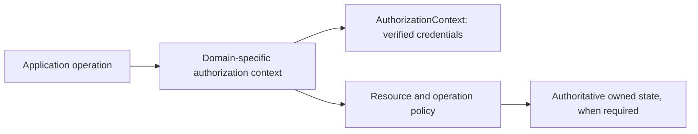

# Domain authorization contexts and attestations: design proposal

**Status:** Design reference for future domain-specific authorization, especially P2.5a/b. The implemented claims, verified-credential, and primary IAM identity foundations are documented in [verified credentials and operation identity](../architecture/authorization.md). This proposal does not describe a deployed Group attestation provider or Group authorization policy.

**Audience:** Engineers implementing domain attestations and services that authorize operations using them. The [security design](security.md) defines the intended authority, session, issuance, and revocation rules; the [domain model](../data-model-design.md) defines the permissions and business invariants that resource owners enforce.

## Evidence and semantic authorization

The implemented `AuthorizationContext` preserves individually verified credentials, their claim origins and per-credential grouping. Its providers must validate the trust and primary-identity/session binding required by their source before publishing evidence. Neither the context nor a successful signature check decides whether a resource operation is allowed.

The proposed **domain-specific `<Concept>Context` pattern** gives application services semantic operations backed by verified evidence and, when necessary, authoritative domain state. `IdentityContext` is the implemented IAM example: it interprets the verified primary credential as an optional stable user ID. A `GroupAuthorizationContext` is a candidate Group-owned contract for downstream consumers, not a current published Group API or a required common interface for all contexts.

A domain context might expose membership or permission checks such as `isMember(groupId)` or `requireAdmin(groupId)` after their policy and failure semantics have been reviewed. It must select claims belonging to an appropriate trusted issuer/profile and **the same authorization credential**, so unrelated credentials cannot contribute a group ID and an administrator role to one fabricated grant. Contextual authorization also interprets the resource and requested action; the generic evidence layer does not.

## Proposed Group attestation integration

Group Management owns its current membership and roles. For its **own mutations**, those facts must be checked against its authoritative state inside the relevant operation; a previously issued attestation is not authoritative for a membership change. For downstream consumers such as Finance, the intended design allows Group Management to issue short-lived, resource-qualified attestations from current state, subject to [the security trust hierarchy](security.md#trust-and-responsibility-boundaries).

The eventual Group credential source must verify the attestation's signature, allowed algorithm and local key, protected type, issuer, audience, lifetime and unique token ID. It must also correlate its primary IAM issuer, subject and session binding with a still-valid verified primary credential **before publishing** the subordinate credential through an `AuthorizationCredentialProvider`. The shared JOSE foundation already provides a generic subordinate verification/binding capability; the real Group provider, wire profile, transport and issuance rules remain unimplemented.

The proposed Group claims include an explicit group/resource identifier, a narrowly defined role or permission, and primary-identity/session binding information (illustratively `principal_iss` and `principal_sid`). The final names and values require the Group attestation contract to be approved. Domain policy then evaluates the role, group and requested operation **within one credential**; a credential for group A never grants permission to group B. A subordinate token does not authenticate the caller alone and cannot issue another subordinate token.

A resource consumer may need additional authoritative checks where the permitted staleness of a signed attestation is insufficient. That is an explicit domain integration decision, not a hidden database lookup in `AuthorizationContext` or in generic claim providers. Group state changes can make an already issued attestation stale until it expires; the intended [revocation model](security.md#revocation-distributed-services-and-verification) describes this tradeoff.

## Ownership and extension boundaries

The current operation-input and [dependency-injection foundation](../architecture/dependency-injection.md) is generic. Inbound adapters compose caller-side contributors, while operation-scoped initializers seed only narrowly defined configuration holders. A domain authorization context consumes `AuthorizationContext` through normal DI; it does not need its own initialization input or a dependency on HTTP middleware. Non-HTTP operations acquire their own identity and evidence; initiating-user metadata on an event is not a new authenticated principal.

Additional domain providers must remain independently verifiable and fail closed when supplied invalid evidence. An absent optional attestation differs from a supplied invalid attestation. Provider failure prevents the context from publishing a partial accepted snapshot; domain policy can distinguish lack of a required credential from lack of a valid permission. The generic API has no global role union, automatic cross-credential joins, or generic resource-policy engine.

The remaining design/review work belongs to the relevant vertical slices:

- **P2.5a:** Group-specific provider and trusted JWT profile, binding and resource/operation policies, semantic context contract, negative tests for cross-group and cross-session confusion.
- **P2.5b:** Group attestation issuance from current authoritative membership and role state, with audited lifetimes and token contracts.
- **P2.2:** Group-owned membership mutation policies and current-state authorization; these do not rely on previously issued Group attestations.
- **P2.1d and P2.2e:** Current IAM account/session eligibility checks and local-projection miss handling where stronger freshness is required.

The implemented evidence and identity boundaries are authoritative in [the architecture documentation](../architecture/authorization.md). This proposal cannot extend their trust guarantees merely by introducing another semantic context.
