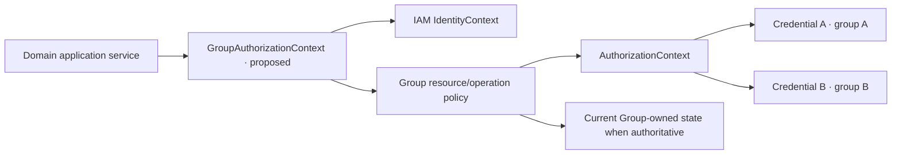

# Domain authorization contexts and attestations: design proposal

**Status:** Design reference for future domain-specific authorization, especially P2.5a/b. The implemented claims, verified-credential, and primary IAM identity foundations are documented in [verified credentials and operation identity](../architecture/authorization.md). This proposal does not describe a deployed Group attestation provider or Group authorization policy.

**Audience:** Engineers implementing domain attestations and services that authorize operations using them. The [security design](security.md) defines the intended authority, session, issuance, and revocation rules; the [domain model](../data-model-design.md) defines the permissions and business invariants that resource owners enforce.

## Evidence and semantic authorization

The implemented `AuthorizationContext` preserves individually verified credentials, their claim origins and per-credential grouping. Its providers must validate the trust and primary-identity/session binding required by their source before publishing evidence. Neither the context nor a successful signature check decides whether a resource operation is allowed.

The proposed **domain-specific `<Concept>Context` pattern** gives application services semantic operations backed by verified evidence and, when necessary, authoritative domain state. `IdentityContext` is the implemented IAM example: it interprets the verified primary credential as an optional stable user ID. A `GroupAuthorizationContext` is a candidate Group-owned contract for downstream consumers, not a current published Group API or a required common interface for all contexts.

A domain context might expose membership or permission checks such as `isMember(groupId)` or `requireAdmin(groupId)` after their policy and failure semantics have been reviewed. It must select claims belonging to an appropriate trusted issuer/profile and **the same authorization credential**, so unrelated credentials cannot contribute a group ID and an administrator role to one fabricated grant. Contextual authorization also interprets the resource and requested action; the generic evidence layer does not.

## JWT profiles and proposed Group claim mapping

The [implemented evidence model](../architecture/authorization.md#credential-evidence-model) is deliberately domain-agnostic. It can preserve claims from several sources without deciding whether any of them entitles the caller to act. The proposed Group integration adds **source-specific meaning** to that model: one attestation asserts a narrow fact about one resource and is correlated with the current primary IAM identity before domain policy interprets it.

The table retains the credential information required by the [security design](security.md#issuing-and-using-domain-attestations) and distinguishes existing JWT primitive contracts from the still-proposed Group wire contract. The Group claim names are illustrative unless specifically identified as part of the shared codec's current binding mechanism. In particular, **`iam-access` and `group-attestation` are configuration-side profile names, not JWT fields**. Their issuer-qualified identities distinguish accepted credential categories, while signed `iss`/`aud` claims and the protected `typ` header determine whether a token satisfies the selected profile. A Group attestation's subordinate profile would explicitly trust the primary `(IAM issuer, iam-access)` profile, not every token profile issued by IAM.

| JWT element | Primary IAM credential | Proposed Group attestation | Evidence and policy interpretation |
| --- | --- | --- | --- |
| `iss` | Configured, trusted IAM issuer | Independently trusted Group issuer | Verified `ClaimOrigin.issuer`; trust derives from the selected issuer/profile and keys, not token text alone. |
| `sub` | Canonical, stable IAM user UUID | Same IAM user UUID as the primary | Verified subject in `ClaimOrigin` and a claim; the primary yields `IdentityContext.userId()`. |
| `sid` | Non-empty stable IAM login-session binding | Not a second primary login session | Present only in the primary profile; binding persists across access-JWT renewal and refresh-token rotation. |
| `principal_iss` | Absent | Issuer of the primary IAM credential | The shared subordinate codec checks this field against the verified primary issuer; Group profile and transport still require review. |
| `principal_sid` | Absent | Primary IAM session binding | The shared subordinate codec checks this field against the verified primary `sid`. |
| `group_id` | Not an IAM membership claim | Explicit target group/resource identifier | Illustrative Group-specific claim; interpreted together with authorization facts **within the same credential**. |
| Role or permission | No Group membership or Finance permission in the IAM token | Narrow Group-owned role/permission assertion | Claim name and encoding belong to the eventual Group contract; never combined into a global `isInRole` union. |
| `aud` | Explicit intended API audience | Explicit downstream consumer/resource audience | Validated against the selected profile, preserved in `ClaimOrigin.audiences`. |
| `typ` | Distinct primary access-token type | Distinct attestation type | Protected JOSE header validated before credential publication, not an ordinary application claim. |
| `iat`, `nbf`, `exp` | Required issue, validity-start and expiry timestamps | Required independent short validity window | Shared JWT codec enforces timestamps, maximum profile lifetime and bounded skew; origins retain the times. |
| `jti` | Required by the current JWT codec | Required unique attestation token ID | Recorded in origin metadata; the generic `ClaimOrigin` allows omission for other credential kinds. |
| `alg`, `kid`, signature | Verified using the configured primary key set | Verified using the authority's separate trusted keys | JOSE verification inputs, not authorization claims; token-supplied key locations never expand trust. |

An IAM session ID may correspond to `identity.sessions.id` (UUIDv7), but remains a **non-secret binding identifier**, unlike the rotating refresh-token bearer secret. Domain attestations bind to the principal and session, not to one particular access JWT's token ID or issuance time. The security model therefore requires an authenticated primary credential for each accepted subordinate credential. A new external admission verifies the primary JWT, while subsequent operations in the same admitted workflow may reuse its verified evidence even after that JWT expires.

The shared subordinate codec requires an accepted issuer-qualified primary profile and matching subject, `principal_iss` and `principal_sid`. It verifies the subordinate JWT's own validity at admission without rechecking the previously admitted primary credential's expiration. The profile name is checked against the locally verified primary evidence, not against another token-supplied field. The eventual Group provider must supply the right configured profile, token input and accepted evidence to the operation; it must not treat direct construction of an `AuthorizationCredential` as verification. Group-specific resource and permission checks remain separate from cryptographic and session binding.

## Potential multi-profile token routing

An ingress whose contract already identifies the expected credential kind can select its configured verifier directly, as the primary IAM bearer path does. A future ingress accepting several kinds of JWTs without a predetermined source could instead use the protected JOSE `typ` header, together with the payload `iss`, as **pre-verification routing hints**. The router would select candidate handlers from a fixed, locally trusted registry of issuer-qualified profiles, rather than letting token content define a verification policy or key source. Each candidate must still verify the signature, expected `typ`, issuer, audience, lifetime and any primary-session binding before publishing an `AuthorizationCredential`.

`typ` expresses an intended JWT media type, not the local `JwtCredentialProfile` name. It follows [JOSE media-type conventions](https://www.rfc-editor.org/rfc/rfc7515.html#section-4.1.9), which commonly omit the `application/` prefix; custom values are not automatically globally unique or issuer-qualified. For ShareWise-issued credential categories, a canonical lowercase convention such as `sw-iam-access+jwt` or `sw-group-attestation+jwt` would make their purpose recognizable. The issuer-qualified profile remains the trusted application identity, while a distinct `typ` for each credential category helps keep validation policies mutually exclusive, as recommended by [JWT Best Current Practices](https://www.rfc-editor.org/rfc/rfc8725.html#section-3.11). No separate `profile` payload claim is needed merely for routing.

The matching policy would need an explicit ambiguity rule: **zero matching trusted profiles rejects the token; multiple matches for different credential categories also reject it**, rather than selecting the first successful verifier. An application may deliberately apply different consumer policies to the same underlying token type, so a future registry should distinguish credential categories from consumer-specific validation constraints. This is a possible extension to source-specific ingress, not a requirement to introduce a generic router for the existing explicit IAM and proposed Group sources.

## Proposed Group attestation integration

In the proposed issuance flow, Group Management would issue short-lived, resource-qualified attestations from its **current owned membership and role state**. It must validate the primary IAM credential and the requester's eligibility before issuance. An attestation cannot authorize issuing another attestation. Attestation issuance, transport and the final Group claim contract belong to the Group vertical, not to the shared credential model.

The eventual Group credential provider independently verifies the attestation against its configured authority, audience, protected type, validity and unique token ID. Its source-specific binding checks match the subject, primary issuer and session to the primary evidence admitted for the same workflow **before returning the credential for publication**. Invalid evidence fails; a genuinely absent optional attestation contributes no credential. The operation snapshot is then available to the semantic domain context for its own decisions, without per-query JWT decoding or implicit Group database access.

Resource consumers may require additional authoritative checks when the permitted staleness of short-lived attestations is insufficient. That choice belongs to the resource operation, with the availability and latency tradeoffs described in [revocation and distributed verification](security.md#revocation-distributed-services-and-verification).

## Correlating evidence into domain decisions

A domain policy answers a question about **one requested operation and its target resource**, not whether an arbitrary claim of the right name exists. The general `AuthorizationContext.find(...)` methods are useful for inspection, but a Group authorization policy must select the appropriate issuer/profile and then correlate claims belonging to one `AuthorizationCredential`.

For example, consider two individually valid attestations carried in one operation:

| Attestation | Group claim | Role claim |
| --- | --- | --- |
| Credential A | Group A | `admin` |
| Credential B | Group B | `member` |

A request to administer Group B must not combine the `admin` claim from A with the group identifier from B. The policy examines a single credential containing both the requested group and qualifying role, applies the resource/operation rules, and checks any current authority-owned state required for the decision. A valid attestation bound to a **different IAM session** is rejected even earlier, during source verification, and never reaches the domain context.

The proposed `<Concept>Context` convention is deliberately **semantic, not an inheritance hierarchy**. `IdentityContext` exposes primary caller identity; a Group-owned `GroupAuthorizationContext` would offer reviewed domain-specific operations rather than a generic role-check API. Group Management authorizes its own membership mutations against current owned state. A downstream consumer such as Finance may use a short-lived attestation as evidence while separately enforcing its financial invariants.

## Ownership and extension boundaries

The current operation-input and [dependency-injection foundation](../architecture/dependency-injection.md) is generic. Inbound adapters compose caller-side contributors, while operation-scoped initializers seed only narrowly defined configuration holders. A domain authorization context consumes `AuthorizationContext` through normal DI; it does not need its own initialization input or a dependency on HTTP middleware. Non-HTTP operations acquire their own identity and evidence; initiating-user metadata on an event is not a new authenticated principal.

Additional domain providers must remain independently verifiable and fail closed when supplied invalid evidence. An absent optional attestation differs from a supplied invalid attestation. Provider failure prevents the context from publishing a partial accepted snapshot; domain policy can distinguish lack of a required credential from lack of a valid permission. The generic API has no global role union, automatic cross-credential joins, or generic resource-policy engine.

The remaining design/review work belongs to the relevant vertical slices:

- **P2.5a:** Group-specific provider and trusted JWT profile, binding and resource/operation policies, semantic context contract, negative tests for cross-group and cross-session confusion.
- **P2.5b:** Group attestation issuance from current authoritative membership and role state, with audited lifetimes and token contracts.
- **P2.2:** Group-owned membership mutation policies and current-state authorization; these do not rely on previously issued Group attestations.
- **P2.1d and P2.2e:** Current IAM account/session eligibility checks and local-projection miss handling where stronger freshness is required.

The implemented evidence and identity boundaries are authoritative in [the architecture documentation](../architecture/authorization.md). This proposal cannot extend their trust guarantees merely by introducing another semantic context.
