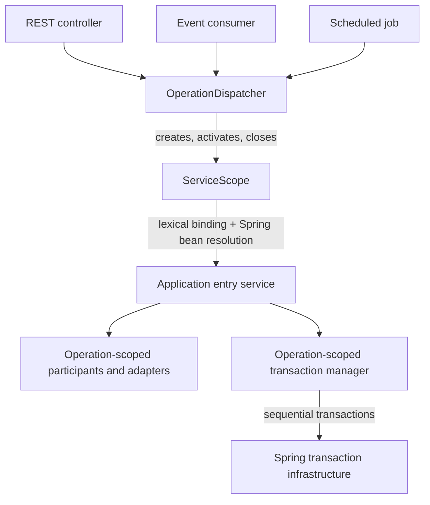

# Dependency injection and application-operation scopes

**Status:** Intended architecture; the custom scope and dispatcher are not implemented in the starter. The [P1.3a specification](../internal/tasks/p1.3a-di-scope/specification.md) defines its acceptance contract. The [application architecture](../architecture.md) defines module ownership and application services; [transactions](persistence.md#transactions-and-failure-behavior) define physical database consistency.

ShareWise's hexagonal architecture has multiple inbound ports (REST, event consumers and scheduled jobs), so no single transport lifecycle can define the lifetime of application services consistently. An explicitly dispatched operation supplies that common lifetime; the [selection criteria and alternatives](dependency-injection-alternatives.md#selection-criteria) explain the rationale.



## Responsibility and ownership

ShareWise uses Spring's existing container for dependency registration, constructor injection, bean creation, initialization and framework-managed lifetimes. Stateless services and infrastructure factories normally remain Spring singleton beans. A custom **operation** bean scope adds an explicitly bounded lifetime for services and adapters that share mutable operation-local state, independently of REST request handling, message listeners and the lifetime of any particular database transaction.

An **operation** is one invocation of an application entry service, selected by an inbound adapter through an `OperationDispatcher`. The dispatcher is a singleton service and the sole production entry point for application operations. It creates a `ServiceScope` using a `ServiceScopeFactory`, activates it for one callback, resolves the entry service, invokes it and closes the scope on success or failure. The business service owns its workflow and chooses any necessary database transactions; starting an operation does not itself start a database transaction.

Operation scopes supply dependency lifetime and identity, **not** permission to access another module's data or an implicit business transaction. The module's application ports and dependency-direction rules remain unchanged. A REST controller, event listener, scheduled job or test can dispatch the same application entry service without defining its DI lifetime.

## Resolution and lifetime

Spring beans marked with the operation scope (for example, `@Scope("operation")`) are created by the ordinary Spring bean factory and retained once per bean name per `ServiceScope` instance. Spring resolves their constructor dependencies as usual; two participating services that request the same operation-scoped dependency receive the same instance. Bean scope registration selects a *lifetime kind*; the active scope binding identifies the particular instance. Singleton beans remain owned and cached by the application context, and prototype beans retain Spring's normal prototype semantics.

An operation-scoped entry service may depend directly on operation-scoped application services, adapters, and a transaction manager. There is no need for per-call `ObjectProvider` lookups in this graph. Singleton inbound adapters and singleton services must not capture a concrete operation-scoped instance: they dispatch into an active scope or, where justified, use Spring's scoped-proxy/deferred-resolution facilities. This is a composition and code-review rule, not an automatic guarantee of the Spring `Scope` SPI. Best-effort lifetime graph validation may be added separately; it is not part of the initial scoping foundation. Stateless shared components remain singleton beans; creating an operation scope does not force all objects to be re-created.

The [Microsoft.Extensions.DependencyInjection (MEDI)](https://learn.microsoft.com/en-us/dotnet/core/extensions/dependency-injection/service-lifetimes)-inspired API expresses ownership without replacing Spring's dependency resolution. The example below is illustrative; exact package placement and exception types are implementation decisions:

```java
interface ServiceScopeFactory {
    ServiceScope createScope();
}

interface ServiceScope extends AutoCloseable {
    <T> T run(Function<ServiceProvider, T> action);
    void close();
}

interface ServiceProvider {
    <T> T getRequiredService(Class<T> serviceType);
}

interface OperationDispatcher {
    <S, R> R dispatch(Class<S> serviceType, Function<S, R> operation);
}

// In any inbound adapter:
Result<Thing, ThingError> result = dispatcher.dispatch(
    ThingService.class,
    service -> service.rename(thingId, newName));
```

`ServiceScope` owns operation-scoped bean identity and cleanup; its provider is bound to that specific scope. `ServiceProvider` is a narrow facade over the **same Spring `BeanFactory`** for the application context, not another registry or a recursive constructor activator. The provider is usable only while its own scope is currently activated and must reject resolution under another scope. All bean selection, qualifiers, `@Bean` methods, initialization, proxies, constructor injection and singleton caching remain Spring responsibilities. Application services use constructor injection rather than injecting a provider or factory to locate dependencies at runtime. The transaction port is independently specified in [P1.3b](../internal/tasks/p1.3-transactions/specification.md).

## Activation, nesting and cleanup

The `ServiceScopeFactory` is a singleton **per Spring application context**. It creates independent scope instances, each with its own cache and destruction callbacks. The factory owns a private Java 25 `ScopedValue<ServiceScope>` key; the registered Spring `Scope` adapter consults that binding to select the current scope during bean creation and dependency resolution. Binding a new value is lexical and automatically restores any outer binding. The key is not a global static registry, and neither the factory nor the adapter infers ownership from thread IDs.

An operation runs through this lifecycle:

1. The dispatcher creates a fresh `ServiceScope` through the factory.
2. `ServiceScope.run(...)` lexically binds that instance. Its `ServiceProvider` delegates to Spring's bean factory, whose custom scope adapter caches scoped beans in that instance.
3. Spring resolves the entry-service graph normally. The entry service may execute zero or more explicit database transaction segments.
4. The callback completes or fails and the lexical binding unwinds. The dispatcher closes the owned scope in a `finally`-equivalent path, irrespective of the callback result.
5. Scope closure attempts all registered destruction callbacks, releases the bean cache and registrations, and makes the instance permanently unavailable for future resolution or activation.

Closure is a **scope-owner responsibility** rather than an effect of the `ScopedValue` binding. `ServiceScope` supports one activation on the thread that created it and deterministic explicit closure, including a never-activated scope. A provider captured from a scope cannot resolve services outside that activation, while another scope is active, or after closure. Spring's `Scope.remove(...)` contract is respected separately from whole-scope destruction: a removed bean and its callback are no longer owned by the scope; the caller handles individual destruction where applicable.

Cleanup callbacks run on the owner thread in reverse registration order. Closure rejects new scoped bean resolution and continues through remaining registered callbacks if one fails, retaining diagnosable failures without masking the original operation failure. It must remain possible to close a scope after an exceptional callback without keeping a stale binding or cached bean. The container's own Spring destruction processing determines which lifecycle methods are invoked (`@PreDestroy`, `DisposableBean`, configured destroy methods); `ServiceScope` executes the registered destruction callbacks, not a parallel generic `AutoCloseable` sweep. Java object references that escape a scope are not automatically invalidated; retaining and invoking them is a caller misuse documented in the [development guidelines](../development.md#development-conventions).

**Nesting:** independently created DI scopes can be activated lexically inside one another. Each has a fresh cache, shares only application-context singletons, and does not inherit the parent's scoped objects or require a parent pointer. When the child binding ends, the parent's binding is restored. An already-created parent's dependencies are not rebound to the child, and accessing a parent's provider while the child is active is rejected. Recursive **application-operation dispatch** remains prohibited: a second business operation inside an active operation does not silently acquire transaction or authorization propagation semantics. Nested `Transactions.execute(...)` is governed separately by [P1.3b](../internal/tasks/p1.3-transactions/specification.md).

Each scope is confined to its owning thread for mutable beans and database work. Parallel operations have independent contexts. Java's `ScopedValue` can be inherited by structured child tasks, but an inherited binding does not confer permission to resolve or mutate a scope from another thread. Independent asynchronous work dispatches a new operation; virtual threads are supported only when the operation remains on its owning thread. Closing an operation with an active physical transaction remains a transaction-contract violation: P1.3b must roll back rather than leak resources.

## Relationship to transactions and persistence

The operation-scoped transaction manager remains a stable bean across the operation, including periods with **no active physical transaction**. It may execute zero or more **sequential** transactional segments; each segment is started and physically finalized explicitly through Spring's `PlatformTransactionManager` (normally via `TransactionTemplate`). Database transactions are not created by bean resolution or by the dispatcher. A later segment does not reverse an earlier committed one.

Persistence adapters can be operation-scoped, with ordinary business-oriented methods and constructor-injected, operation-scoped resource-access capabilities. A `JooqAccess`, for example, resolves the jOOQ `DSLContext` or connection provider associated with the **currently active transaction segment** and rejects database access when no valid segment is active. Transaction-specific handles must not be cached or silently rebound for use in a later segment. Actual connections remain under Spring's transaction manager and the configured persistence infrastructure; transaction identity, capability validity and session state are verified before SQL execution, not merely when a facade is acquired.

Application service and data-port interfaces do not expose `DSLContext`, `EntityManager`, JDBC connections, or Spring transaction status. Expected business results remain separate from commit/rollback decisions. Spring Modulith event publication uses the same physical producer transaction as the corresponding business mutation, with consumer processing in a separate committed transaction. See [messaging](messaging.md) and the [P1.3 transaction specification](../internal/tasks/p1.3-transactions/specification.md).

## Enforcement and validation

P1.3a verifies the scope in a real Spring context without requiring PostgreSQL: Spring-managed construction and destruction; shared bean identity within one scope; fresh instances across sequential, nested and concurrent scopes; shared application-context singleton identity; rejected unbound, wrong-scope, closed-scope and wrong-thread resolution; lexical binding restoration; and reliable cleanup and failure diagnostics. The dispatcher rejects recursive business dispatch. A test-facing harness can use the **same** `ServiceScopeFactory` and Spring scope adapter to resolve multiple beans inside one scope before closure, without installing a second DI mechanism. Integration with real physical transactions is verified separately when P1.2/P1.3b are available.

Automatic detection of singleton-to-scoped capture, arbitrary escaped-object invalidation, asynchronous scope transfer and a second dependency-resolution container are excluded from P1.3a. Lifetime-capture prevention relies on development conventions and review, with optional later best-effort checks. The [P1.3a specification](../internal/tasks/p1.3a-di-scope/specification.md) provides the test cases and remaining implementation boundaries.
