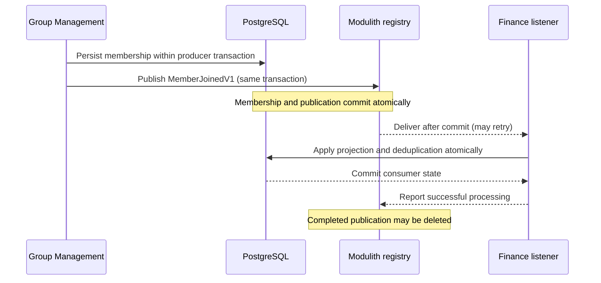

# Cross-context messaging architecture

**Status:** Preliminary architecture decision, subject to review and refinement during integration. This describes the intended event-messaging system, not an implemented feature of the starter. The [application architecture](../architecture.md) defines module and transaction boundaries; the [domain model](../data-model-design.md) defines the consistency and authorization contracts; the [persistence architecture](persistence.md) defines schema ownership and database validation.

**Contents:**

<!-- @import "[TOC]" {cmd="toc" depthFrom=2 depthTo=6 orderedList=false} -->

<!-- code_chunk_output -->

- [Communication boundaries](#communication-boundaries)
- [Event publication and delivery](#event-publication-and-delivery)
- [Consumption and idempotency](#consumption-and-idempotency)
- [Recovery and retention](#recovery-and-retention)
- [Service extraction](#service-extraction)
- [Verification and design refinement](#verification-and-design-refinement)

<!-- /code_chunk_output -->

## Communication boundaries

Cross-context changes that can propagate **eventually** use durable, asynchronous integration events. A producer publishes a fact after establishing its own authoritative business state, without knowing which consumers react to it. Each consumer owns its state, processing policy and transaction. The modular monolith initially uses **Spring Modulith application events with a PostgreSQL-backed Event Publication Registry**; external brokers are introduced when independently deployed services require transport between processes. The [technology alternatives](messaging-alternatives.md) explain why other delivery models were not selected.

Not every interaction is asynchronous. A bounded context may expose a narrow, synchronous published Java API for an operation that needs an immediate response or authoritative authorization decision. Such calls are explicit dependencies, not a general substitute for replicating business facts. A local Java call does not imply that the dependency can later become a network call without changes to timeout, availability and consistency semantics. Do not introduce synchronous cross-context database writes or join another context's tables, even when PostgreSQL is shared.

The [domain model](../data-model-design.md) already establishes the important boundaries: Group Management owns organizational membership; Finance keeps an eventually synchronized, retained `FinancialActor` representation; Finance's revisions and ChangeRecords commit atomically within one FinancialGroup; notification delivery does not roll back the originating financial operation. Caller authorization is distinct from a replicated actor's eligibility, and current-authority decisions must not silently trust a stale asynchronous projection. Additional distributed authorization attestations remain an [unaccepted proposal](../scoped-authorization-attestations-proposal.md).

An integration event is a **versioned, immutable business fact**, not a command to another module. The producer owns its published contract and emits it through an application-owned publication capability; Spring dispatch is an infrastructure concern, not a dependency that other bounded contexts must import from the producer's internals. Events carry only logical identifiers and information required to interpret the fact, not ORM entities, SQL records or an internal domain graph. Each event has a stable event ID across retries, an event type/version, producer identity, relevant entity/group IDs, and authoritative revision or ordering metadata where applicable. Include occurrence metadata, but do not use wall-clock timestamps as an ordering or deduplication authority. Contract changes retain compatibility with outstanding serialized publications and independently deployed consumers.

## Event publication and delivery

A producer publishes the integration fact **within the same Spring-managed transaction** as the state change it represents. Spring Modulith's Event Publication Registry records a publication for each participating transactional listener in that transaction. An aborted producer operation leaves neither authoritative data nor a committed publication. After a successful commit, an asynchronous transactional module listener handles the event in a **separate consumer transaction**. This is a deliberately eventual boundary: the producer's success does not mean its consumers have completed.

The registry is **framework-managed transport infrastructure**, not a shared business-data model. Select the JDBC-backed Spring Modulith registry initially: its persistence is internal to the framework, works alongside jOOQ/JPA, and avoids introducing Hibernate-managed publication entities into otherwise SQL-oriented operations. The JPA-backed registry is not prohibited, but a change requires an integration reason. Flyway owns the registry's physical PostgreSQL schema; framework auto-DDL is disabled. Framework schema upgrades are reviewed as migrations. Registry records are not Finance's ChangeRecord journal, a broker queue, or a historical event store.

Only publication mechanisms tracked by the persistent registry qualify as durable delivery. Ordinary synchronous Spring events, untracked `@Async` listeners and arbitrary in-memory executor queues do not supply the same failure guarantees. Listener failures and crashes must leave recoverable publications; resubmission is an explicit, observable operational responsibility, not an assumption that all failures retry forever automatically. Use the registry's lifecycle, recovery and resubmission facilities with bounded concurrency, backoff and diagnostics. Repeatedly failing or incompatible publications require operator-visible resolution; never silently discard them to restore a healthy-looking queue.

## Consumption and idempotency

The consumer's responsibility is to apply the business effect **at least once safely**. Producer retries, listener recovery, crashes after a consumer commit and eventual broker redelivery can all cause duplicates. The registry tracks **delivery**, but does not guarantee exactly-once updates to a consumer's business data. Event acknowledgment or registry completion occurs only after the consumer transaction commits; an acknowledgment cannot be atomically combined with an unrelated broker transaction, so a retry after commit must be harmless.

For consumers with persistent, nontrivial side effects, the **default is a small transactional inbox** owned by the consuming context. A record keyed by `(consumer identity, event ID)` indicates that a specific consumer operation has successfully applied that event. The inbox insert/uniqueness check and the business mutation run in **one local PostgreSQL transaction**: if the event was already processed, the handler returns success without repeating its effects; if the transaction fails, neither the business effect nor the completion marker commits. The same event may legitimately be processed by multiple independent consumers, so deduplication is per consumer, not globally per event.

An application-specific idempotency invariant may **replace a dedicated inbox** when it provably supplies equivalent or stronger protection. Examples include a unique origin-event identifier on a created Notification or a version-guarded, idempotent update of `FinancialActor`. Such choices must cover duplicate, delayed and out-of-order events, including rejoin/reactivation; a version comparison alone cannot safely skip missing deltas when events require ordered application. Prefer an authoritative state snapshot or an explicit gap-detection/reconciliation protocol when ordering cannot be guaranteed. Whether to mandate a uniform inbox for every persistent consumer remains a design-review choice; don't introduce duplicate ledgers without a concrete benefit, and don't omit deduplication without proving the alternative.

Inbox storage is a context-owned table defined through a Flyway migration, not an ad hoc replay cache or an extra shared messaging database. A listener is a thin inbound adapter that delegates to a consumer-owned application operation; the operation's business semantics do not depend on Spring listener annotations or broker acknowledgments. Consumer-side inbox storage and operations follow the [persistence adapter conventions](persistence.md#data-access-adapters) and stay inside the consuming context. Unit tests exercise the operation with fake ports; PostgreSQL-backed tests establish atomic deduplication under concurrency and crash/retry conditions. A transactional inbox prevents repeated **database** effects, not exactly-once effects in external systems such as SMTP; those require separate delivery-attempt, provider-idempotency or reconciliation policies.

## Recovery and retention

The producer registry retains **outstanding or failed publications** until successful delivery or explicit, audited resolution. Select the registry's **`DELETE` completion mode** as the initial policy: a publication completed by its local listener is removed, rather than retained indefinitely. When externalizing to a broker, completion must represent **durable broker acceptance confirmed by the transport**, not just a successful call that schedules an asynchronous send. Producer-side completion is distinct from downstream consumer acknowledgment. If transport confirmation is uncertain, a retry can duplicate the event; stable event IDs and idempotent consumers handle that case.

Inbox rows normally need only the consumer key, stable event ID and processing timestamp (plus any narrowly justified recovery metadata), not entire event payloads. They can be cleaned up **only when their deduplication horizon is no shorter than the longest permitted retry, replay, dead-letter redrive, or backfill horizon** for that consumer. If arbitrary replay is allowed, a short time-to-live is not sufficient; retain a durable business key, an appropriate consumption checkpoint, or longer-lived inbox data. Define retention and archival policy for each consumer before enabling cleanup. PostgreSQL does not automatically expire ordinary rows; use an application-managed cleanup job or explicitly provisioned database scheduler with safe batching and observability. Cleanup must not erase failed or outstanding producer publications.

Monitor outstanding/failed publication age, repeated attempts, listener lag, inbox growth, cleanup failures and replication convergence. Recovery after long outages or a new subscriber requires an **authoritative bootstrap/reconciliation path**; the registry is a delivery log for registered consumers, not a complete replayable history. Restrict access to serialized event payloads and avoid retaining sensitive data longer than necessary.

## Service extraction

The producer's event contract and consumer's application operation remain stable when a bounded context is extracted. Spring Modulith can externalize selected events to a broker such as RabbitMQ/AMQP or Kafka. An externalization adapter supplies routing, serialization and transport-specific acknowledgments; a consumer transport adapter invokes the same idempotent application operation in the extracted service. This preserves business semantics, **not** the illusion that an in-process callback and distributed delivery have identical ordering, latency or failure behavior.

Broker acknowledgments and consumer offsets track transport progress, but neither generally commits atomically with the consumer's PostgreSQL writes. The consumer's inbox or business idempotency therefore survives extraction. Before cutover, verify event schema/version compatibility, pending-publication recovery, durable broker publisher confirmation, ordering per logical aggregate, consumer registration, replay/backfill, and absence of duplicate effects when old and new delivery paths overlap. The first extraction must also establish isolated data ownership and service-specific migration lifecycles; no cross-service database transactions are introduced.

The initial modulith does not require a broker container, Kafka infrastructure, a custom actor bus or application-wide distributed transactions. Use externalization when a real deployment boundary justifies it; evaluate a dedicated outbox if broker handoff requires guarantees not supplied by Modulith's normal listener-based externalization. This architecture is **at-least-once delivery with idempotent effects**, not a promise of exactly-once delivery or processing.

## Verification and design refinement

Unit tests for publishers and consumers use mocked or in-memory event ports, no live database, broker or Spring context. Integration tests against PostgreSQL verify producer rollback leaves no publication, committed writes have a durable publication, consumer commit and deduplication commit together, concurrent duplicate delivery is safe, stale/out-of-order events converge correctly, and failures are recoverable. Failure-injection tests cover crashes between producer commit, consumer commit and completion/acknowledgment. Broker-facing tests are added when externalization is installed; simulated transports are not evidence of broker durability.

The event registry, inbox table conventions, recovery scheduling, retention horizons and transport configuration require implementation validation before they become operational guarantees. The starter does not yet include Spring Modulith, Flyway-managed publication storage, consumer inboxes or a message broker. The [alternative technologies and tradeoffs](messaging-alternatives.md) are documented separately; detailed setup and runtime commands belong in developer documentation once implemented. See [Spring Modulith's event reference](https://docs.spring.io/spring-modulith/reference/events.html) for the framework's publication, recovery and externalization facilities.
