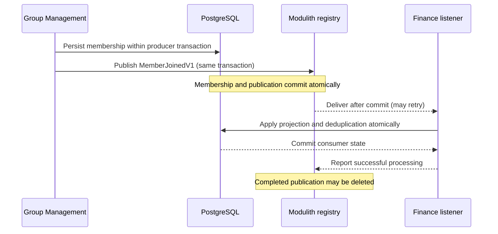
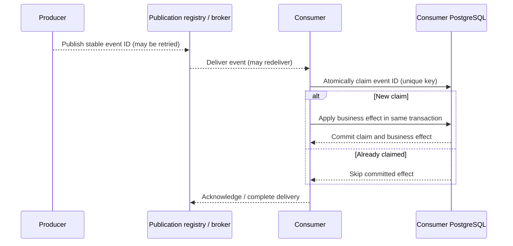
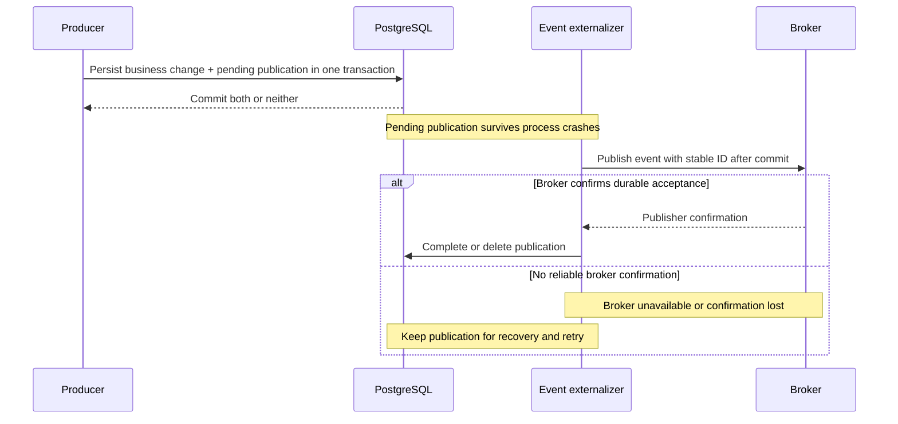

# Cross-context messaging architecture

**Status:** Preliminary architecture decision, subject to review and refinement during integration. This describes the intended event-messaging system, not an implemented feature of the starter. The [application architecture](../architecture.md) defines module and transaction boundaries; the [domain model](../data-model-design.md) defines the consistency and authorization contracts; the [persistence architecture](persistence.md) defines schema ownership and database validation.

**Contents:**

<!-- @import "[TOC]" {cmd="toc" depthFrom=2 depthTo=6 orderedList=false} -->

<!-- code_chunk_output -->

- [Communication boundaries](#communication-boundaries)
- [Event publication and delivery](#event-publication-and-delivery)
- [Consumption and idempotency](#consumption-and-idempotency)
- [Recovery and retention](#recovery-and-retention)
- [Service extraction](#service-extraction)
- [Verification and design refinement](#verification-and-design-refinement)

<!-- /code_chunk_output -->

## Communication boundaries

Cross-context changes that may propagate **eventually** use durable, asynchronous integration events. A producer publishes a fact after it has established its own authoritative business state, without knowing which consumers react to it. Each consumer owns its state, processing policy and transaction. The modular monolith initially uses **Spring Modulith application events with a PostgreSQL-backed Event Publication Registry**. External brokers are introduced when independently deployed services require transport between processes. The [technology alternatives](messaging-alternatives.md) explain why other delivery models were not selected.

Not every interaction is asynchronous. A bounded context may expose a narrow, synchronous published Java API for an operation that needs an immediate response or an authoritative authorization decision. Such calls are explicit dependencies, not a general substitute for propagating business facts. A local Java call also does not imply that the dependency can later become a network call without changes to timeout, availability and consistency semantics. Database writes and joins remain within each context's owned tables, including in the shared PostgreSQL deployment.

The [domain model](../data-model-design.md) already fixes the most important consistency boundaries: Group Management owns organizational membership; Finance keeps an eventually synchronized, retained `FinancialActor` representation; Finance's revisions and ChangeRecords commit atomically within one FinancialGroup; notification delivery does not roll back the originating financial operation. Caller authorization is distinct from a replicated actor's eligibility, and current-authority decisions must not silently trust a stale asynchronous projection. The [security architecture](security.md) defines issuer-qualified domain attestations; the [generic file ACL design](../file-management-acl-proposal.md) is optional.

An integration event is a **versioned, immutable business fact** published through a context-owned application port. Its JSON-compatible data contract carries a stable event ID across retries, logical type and version, producer identity, relevant entity/group IDs and authoritative revision or ordering metadata where applicable. Events contain the facts needed by consumers without exposing ORM entities or domain object graphs. Wall-clock timestamps provide occurrence metadata, not ordering authority. Breaking contract changes introduce a new logical event version; internal Java refactoring alone does not. Spring Modulith's persistent registry records serialized event data with a Java event type and listener identity. Stable published event DTO packages and explicit listener IDs preserve recovery across ordinary implementation refactors; renaming a persisted event class requires draining or migrating outstanding publications before removing its previous type.

## Event publication and delivery

A producer publishes its integration fact **inside the application operation's `Transactions` boundary**, together with the authoritative state change. The Spring Modulith Event Publication Registry records a delivery obligation for each registered transactional listener within the same Spring-managed database transaction. Producer rollback discards both business changes and publication records. After commit, an asynchronous listener invokes the consumer application operation, which owns a **separate transaction**. The producer can succeed before any consumer completes.

**Consumer transaction ownership.** The listener is a thin ingress adapter registered through `@Async` and `@TransactionalEventListener` with an explicit, stable listener ID (for example, `finance.membership.v1`). Its handler delegates to the consuming context's application operation; `Transactions.execute(...)` starts and finishes the PostgreSQL transaction. Listener success means that operation completed, including the physical commit. Rollback-only decisions, deferred constraint violations and commit failures prevent publication completion.

Spring Modulith's `@ApplicationModuleListener` additionally applies `@Transactional(REQUIRES_NEW)`, so using it around the application-owned transaction could delay the physical commit until after the facade returns. The ingress adapter therefore does not own an outer business transaction. Registry completion may occur separately after the consumer commit, making duplicate delivery possible and consumer idempotency essential. The selected Modulith version and listener configuration are integration-tested together, especially completion behavior in `DELETE` mode.

The JDBC-backed Spring Modulith registry is framework-managed delivery infrastructure. It participates in the same local Spring transaction as application-owned persistence, whether adapters use jOOQ or JPA; no additional custom outbox is required for local listeners. Flyway owns the registry's physical PostgreSQL schema, with framework auto-DDL disabled. Registry schema upgrades are reviewed as migrations. Registry records track delivery obligations and are separate from Finance's business-visible ChangeRecord journal.

Only publication mechanisms tracked by the persistent registry qualify as durable delivery. Ordinary synchronous Spring events, untracked `@Async` listeners and arbitrary in-memory executor queues do not provide the same failure guarantees. Listener failures and crashes must leave recoverable publications. Recovery and resubmission are observable operational responsibilities. The registry's recovery facilities operate with bounded concurrency, backoff and diagnostics. Repeatedly failing or incompatible publications remain available for operator-visible resolution instead of being silently discarded.

## Consumption and idempotency

The consumer's job is to apply the business effect **at least once safely**. Producer retries, listener recovery, crashes after a consumer commit and eventual broker redelivery can all cause duplicates. The registry tracks **delivery**, but it does not guarantee exactly-once updates to a consumer's business data. Completion or acknowledgment happens only after the consumer transaction commits. Because that acknowledgment cannot be committed atomically with an unrelated broker transaction, a retry after commit must be harmless.

For consumers with persistent, nontrivial side effects, the **default is a small transactional inbox** owned by the consuming context. A record keyed by `(consumer identity, event ID)` indicates that a specific consumer operation has already been applied. The consumer **atomically claims** the event through the database uniqueness constraint, for example with PostgreSQL `INSERT ... ON CONFLICT DO NOTHING` and its inserted-row result. Only the successful claimant applies the business mutation, in **the same local PostgreSQL transaction**. A duplicate returns success after the competing transaction's outcome is known, without repeating the effect. A preliminary read followed by insertion is insufficient under concurrency; catching a uniqueness violation and continuing within an aborted PostgreSQL transaction is also invalid. If the transaction fails, neither the business effect nor the completion marker commits.

The combined producer-and-consumer model is shown below. The producer side gives **at-least-once publication**; the consumer side makes duplicate delivery harmless and therefore yields **effectively-once database effects**.

An application-specific idempotency invariant may **replace a dedicated inbox** when it provably provides equivalent or stronger protection. Examples include a unique origin-event identifier on a created Notification or a version-guarded, idempotent update of `FinancialActor`. Such choices must cover duplicate, delayed and out-of-order events, including rejoin and reactivation. A consumer ignores old or duplicate versions; a stale `MemberLeft` cannot deactivate a more recently reactivated actor. A full-state update may supersede earlier versions when its source revision is authoritative. For delta events, skipping an intermediate revision loses information: the consumer detects gaps and reconciles or waits for the missing events instead of blindly applying the newest delta. Whether to mandate a uniform inbox for every persistent consumer remains a design-review choice. Do not introduce duplicate ledgers without a concrete benefit, and do not omit deduplication without proving the alternative.

Inbox storage is a context-owned table defined through a Flyway migration, not an ad hoc replay cache or a separate shared messaging database. A listener is a thin inbound adapter that delegates to a consumer-owned application operation; the operation's business semantics do not depend on Spring listener annotations or broker acknowledgments. Consumer-side inbox storage and operations follow the [persistence adapter conventions](persistence.md#data-access-adapters) and stay inside the consuming context. Unit tests exercise the operation with fake ports; PostgreSQL-backed tests establish atomic deduplication under concurrency and crash-retry conditions. A transactional inbox prevents repeated **database** effects, not exactly-once effects in external systems such as SMTP. Those require separate delivery-attempt, provider-idempotency or reconciliation policies.

## Recovery and retention

The producer registry retains **outstanding or failed publications** until successful delivery or explicit, audited resolution. The registry uses **`DELETE` completion mode** initially: a publication completed by its local listener is removed. When externalizing to a broker, completion must mean **durable broker acceptance confirmed by the transport**, not merely a successful call that schedules an asynchronous send. Producer-side completion is distinct from downstream consumer acknowledgment. If transport confirmation is uncertain, a retry can duplicate the event; stable event IDs and idempotent consumers handle that case.

Inbox rows normally need only the consumer key, stable event ID and processing timestamp, plus narrowly justified recovery metadata where needed. They can be cleaned up **only when their deduplication horizon is no shorter than the longest permitted retry, replay, dead-letter redrive or backfill horizon** for that consumer. Arbitrary replay requires a durable business key, an appropriate consumption checkpoint or longer-lived inbox data. Each consumer defines its retention and archival policy before cleanup begins. PostgreSQL requires an application-managed cleanup job or explicitly provisioned scheduler for ordinary rows, with safe batching and observability. Failed and outstanding producer publications are excluded from cleanup.

Monitoring covers outstanding and failed publication age, repeated attempts, listener lag, inbox growth, cleanup failures and replication convergence. The registry registers listeners present at publication time and does not retain a complete historical event stream.

During a coordinated modulith deployment, a Finance projection introduced after Group Management data exists can be initialized by a one-time Flyway data migration from authoritative membership tables while application writes are suspended. This controlled deployment migration is separate from runtime cross-context database access. Because Finance has no pre-existing financial history at first introduction, current membership is sufficient for its initial `FinancialActor` population. After startup, versioned membership events maintain the projection. If independently deployed services or concurrent writes later require online initialization, an authoritative snapshot and a gap-free event/reconciliation protocol become part of that migration. Access to serialized event payloads is restricted and their retention bounded.

## Service extraction

The producer's event contract and the consumer's application operation remain stable when a bounded context is extracted. Spring Modulith can externalize selected events to a broker such as RabbitMQ/AMQP or Kafka. An externalization adapter supplies routing, serialization and transport-specific acknowledgments; a consumer transport adapter invokes the same idempotent application operation in the extracted service. This preserves business semantics, **not** the illusion that an in-process callback and distributed delivery have identical ordering, latency or failure behavior.

**Broker handoff requires durable local publication intent, committed atomically with the producer's business change.** Committing the business change first and only then sending to the broker or recording a publication creates an unrecoverable gap if the process crashes or the broker is unavailable. The pending publication therefore acts as a transactional **outbox**: an application-level write-ahead delivery record. The sender retries after commit and completes the local publication only after the broker confirms durable acceptance. A broker outage must delay delivery, not invalidate the already-committed business change or lose its event.

The local publishing port, versioned event contracts and consumer operations remain stable across service extraction. Spring Modulith provides a path to broker externalization without an initial custom dispatcher or outbox. At extraction, delivery uses **registry-backed externalization**, a **supported outbox integration** such as Namastack Outbox or JobRunr, or a **custom outbox** if required by publisher confirmation, concurrent dispatch, ordering, recovery or operational requirements. Broker acceptance and local completion remain separate operations, so duplicate publication remains possible and consumers remain idempotent.

Broker acknowledgments and consumer offsets track transport progress independently from the consumer's PostgreSQL writes. The same inbox or business idempotency mechanism survives extraction. **The replacement broker delivery path is proven operational before the local listener is disabled.** The extraction plan then addresses outstanding publications, duplicate-safe overlap, state reconciliation, rollback and independent data ownership. Its detailed cutover procedure belongs to the extraction task.

The initial modulith does not require a broker container, Kafka infrastructure, a custom actor bus or application-wide distributed transactions. Broker externalization accompanies a justified service deployment boundary. This architecture is **at-least-once delivery with idempotent effects**, not a promise of exactly-once delivery or processing.

## Verification and design refinement

Unit tests for publishers and consumers use mocked or in-memory event ports. PostgreSQL integration tests verify that producer rollback leaves no publication, committed writes have a durable publication, and atomic inbox claims prevent duplicate effects. The selected Spring Modulith listener and transaction configuration is tested for rollback-only decisions, deferred constraints, physical commit failure, and registry-completion failure in `DELETE` mode: failed business commits retain recoverable publications and failed completion may cause harmless redelivery. Projection tests cover stale, duplicate and missing versions and leave/rejoin behavior. Initial projection data migrations are validated against existing membership data. Persisted event compatibility is tested when published types, listener identities or serialized contracts change; ordinary package refactoring does not require a new logical event version.

Once broker externalization is installed, test an unreachable broker, process crashes after the local commit, lost or uncertain publisher confirmations, recovery after restart and duplicate broker acceptance. A test must prove that a committed business change retains recoverable publication intent throughout an outage; simulated transports alone are not evidence of broker durability.

The event registry, inbox table conventions, recovery scheduling, retention horizons and transport configuration require implementation validation before they become operational guarantees. Spring Modulith is installed only for module structure verification; the backend does not yet include its event publication registry, Flyway-managed publication storage, consumer inboxes or a message broker. The [alternative technologies and tradeoffs](messaging-alternatives.md) are documented separately; detailed setup and runtime commands belong in developer documentation once implemented. See [Spring Modulith's event reference](https://docs.spring.io/spring-modulith/reference/events.html) for the framework's publication, recovery and externalization facilities.
