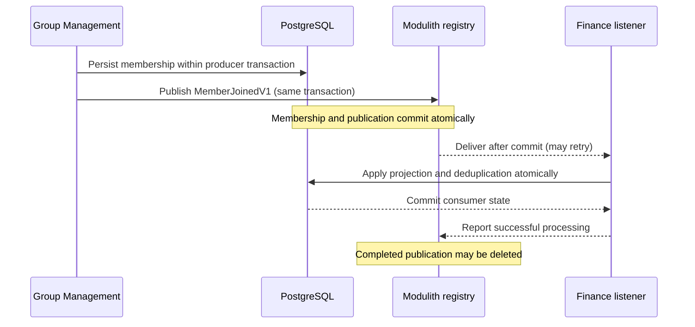
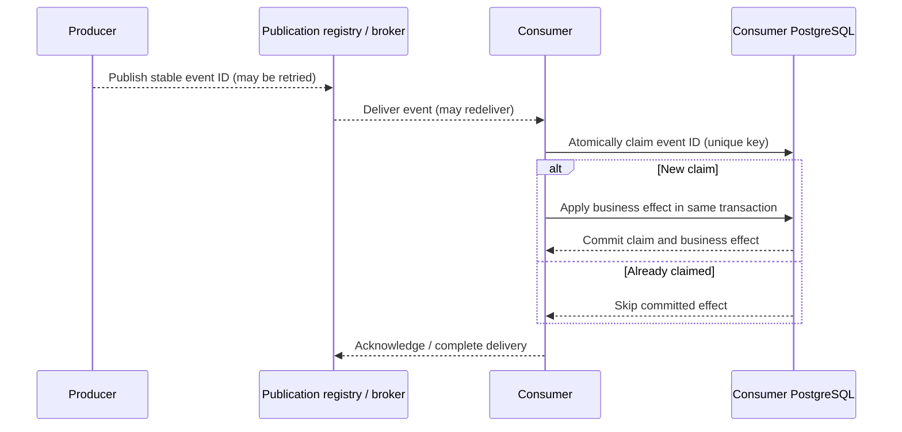
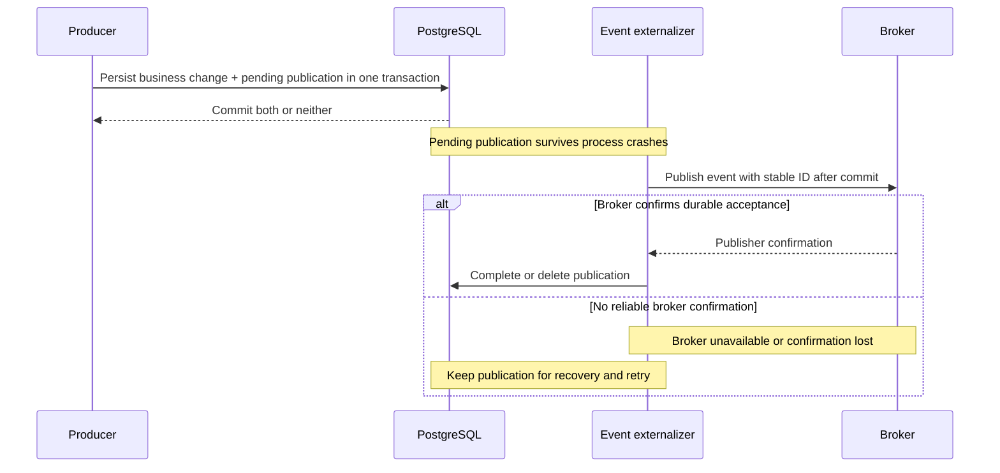

# Cross-context messaging architecture

**Status:** Preliminary architecture decision, subject to review and refinement during integration. This describes the intended event-messaging system, not an implemented feature of the starter. The [application architecture](../architecture.md) defines module and transaction boundaries; the [domain model](../data-model-design.md) defines the consistency and authorization contracts; the [persistence architecture](persistence.md) defines schema ownership and database validation.

**Contents:**

<!-- @import "[TOC]" {cmd="toc" depthFrom=2 depthTo=6 orderedList=false} -->

<!-- code_chunk_output -->

- [Communication boundaries](#communication-boundaries)
- [Event publication and delivery](#event-publication-and-delivery)
- [Consumption and idempotency](#consumption-and-idempotency)
- [Recovery and retention](#recovery-and-retention)
- [Service extraction](#service-extraction)
- [Verification and design refinement](#verification-and-design-refinement)

<!-- /code_chunk_output -->

## Communication boundaries

Cross-context changes that may propagate **eventually** use durable, asynchronous integration events. A producer publishes a fact after it has established its own authoritative business state, without knowing which consumers react to it. Each consumer owns its state, processing policy and transaction. The modular monolith initially uses **Spring Modulith application events with a PostgreSQL-backed Event Publication Registry**. External brokers are introduced when independently deployed services require transport between processes. The [technology alternatives](messaging-alternatives.md) explain why other delivery models were not selected.

Not every interaction is asynchronous. A bounded context may expose a narrow, synchronous published Java API for an operation that needs an immediate response or an authoritative authorization decision. Such calls are explicit dependencies, not a general substitute for propagating business facts. A local Java call also does not imply that the dependency can later become a network call without changes to timeout, availability and consistency semantics. Do not introduce synchronous cross-context database writes or join another context's tables, even while PostgreSQL is shared.

The [domain model](../data-model-design.md) already fixes the most important consistency boundaries: Group Management owns organizational membership; Finance keeps an eventually synchronized, retained `FinancialActor` representation; Finance's revisions and ChangeRecords commit atomically within one FinancialGroup; notification delivery does not roll back the originating financial operation. Caller authorization is distinct from a replicated actor's eligibility, and current-authority decisions must not silently trust a stale asynchronous projection. Additional distributed authorization attestations remain an [unaccepted proposal](../scoped-authorization-attestations-proposal.md).

An integration event is a **versioned, immutable business fact**, not a command to another module. The producer owns its published contract and emits it through an application-owned publication capability; Spring dispatch is an infrastructure concern, not a dependency that consumers import from the producer's internals. Events carry only logical identifiers and the information required to interpret the fact, not ORM entities, SQL records or an internal domain graph. Each event has a stable event ID across retries, an event type/version, producer identity, relevant entity/group IDs, and authoritative revision or ordering metadata where applicable. Include occurrence metadata, but do not use wall-clock timestamps as the ordering or deduplication authority. Contract changes must remain compatible with outstanding serialized publications and independently deployed consumers. Persistent registry entries may contain Java type names alongside event payloads; package moves, class renames and serializer changes therefore require stable serialized type mappings, legacy readers/upcasters, or a migration of pending publications before the old reader disappears.

## Event publication and delivery

A producer publishes the integration fact **within the same Spring-managed transaction** as the state change it represents. Spring Modulith's Event Publication Registry records a publication for each participating transactional listener in that same transaction. If the producer operation rolls back, neither the authoritative state change nor the publication is committed. After a successful commit, an asynchronous transactional module listener handles the event in a **separate consumer transaction**. This is a deliberately eventual boundary: the producer's success does not imply that its consumers have already completed.

**Consumer transaction ownership.** The consuming context's application operation owns and finalizes the PostgreSQL transaction through the `Transactions` port. The asynchronous listener adapter delegates to that operation and reports success only after its commit has completed. A rollback-only decision, deferred constraint violation or commit failure propagates as a listener failure, leaving a recoverable publication.

`@ApplicationModuleListener` itself starts a transaction, so combining it with `Transactions` can shift the physical commit outside the operation's return. The selected listener annotation, transaction propagation and Spring Modulith completion behavior are therefore verified together. A non-transactional asynchronous transactional-event listener delegating to a transaction-owning operation is one candidate; the implementation is selected through PostgreSQL integration tests rather than assuming annotation defaults provide the required ordering. Spring Modulith 2.2 changes the default completion transaction behavior compared with 2.1, reinforcing the need to validate the actual version.

The registry is **framework-managed transport infrastructure**, not a shared business-data model. Select the JDBC-backed Spring Modulith registry initially: its persistence is internal to the framework, works alongside jOOQ/JPA, and avoids introducing Hibernate-managed publication entities into otherwise SQL-oriented operations. The JPA-backed registry is not prohibited, but changing to it requires an integration reason. Flyway owns the registry's physical PostgreSQL schema; framework auto-DDL is disabled. Framework schema upgrades are reviewed as migrations. Registry records are not Finance's ChangeRecord journal, a broker queue, or a historical event store.

Only publication mechanisms tracked by the persistent registry qualify as durable delivery. Ordinary synchronous Spring events, untracked `@Async` listeners and arbitrary in-memory executor queues do not provide the same failure guarantees. Listener failures and crashes must leave recoverable publications. Recovery and resubmission are explicit, observable operational responsibilities, not an assumption that all failures retry forever automatically. Use the registry's lifecycle, recovery and resubmission facilities with bounded concurrency, backoff and diagnostics. Repeatedly failing or incompatible publications require operator-visible resolution; never silently discard them to restore a healthy-looking queue.

## Consumption and idempotency

The consumer's job is to apply the business effect **at least once safely**. Producer retries, listener recovery, crashes after a consumer commit and eventual broker redelivery can all cause duplicates. The registry tracks **delivery**, but it does not guarantee exactly-once updates to a consumer's business data. Completion or acknowledgment happens only after the consumer transaction commits. Because that acknowledgment cannot be committed atomically with an unrelated broker transaction, a retry after commit must be harmless.

For consumers with persistent, nontrivial side effects, the **default is a small transactional inbox** owned by the consuming context. A record keyed by `(consumer identity, event ID)` indicates that a specific consumer operation has already been applied. The consumer **atomically claims** the event through the database uniqueness constraint, for example with PostgreSQL `INSERT ... ON CONFLICT DO NOTHING` and its inserted-row result. Only the successful claimant applies the business mutation, in **the same local PostgreSQL transaction**. A duplicate returns success after the competing transaction's outcome is known, without repeating the effect. A preliminary read followed by insertion is insufficient under concurrency; catching a uniqueness violation and continuing within an aborted PostgreSQL transaction is also invalid. If the transaction fails, neither the business effect nor the completion marker commits.

The combined producer-and-consumer model is shown below. The producer side gives **at-least-once publication**; the consumer side makes duplicate delivery harmless and therefore yields **effectively-once database effects**.

An application-specific idempotency invariant may **replace a dedicated inbox** when it provably provides equivalent or stronger protection. Examples include a unique origin-event identifier on a created Notification or a version-guarded, idempotent update of `FinancialActor`. Such choices must cover duplicate, delayed and out-of-order events, including rejoin and reactivation. A consumer ignores old or duplicate versions; a stale `MemberLeft` cannot deactivate a more recently reactivated actor. A full-state update may supersede earlier versions when its source revision is authoritative. For delta events, skipping an intermediate revision loses information: the consumer detects gaps and reconciles or waits for the missing events instead of blindly applying the newest delta. Whether to mandate a uniform inbox for every persistent consumer remains a design-review choice. Do not introduce duplicate ledgers without a concrete benefit, and do not omit deduplication without proving the alternative.

Inbox storage is a context-owned table defined through a Flyway migration, not an ad hoc replay cache or a separate shared messaging database. A listener is a thin inbound adapter that delegates to a consumer-owned application operation; the operation's business semantics do not depend on Spring listener annotations or broker acknowledgments. Consumer-side inbox storage and operations follow the [persistence adapter conventions](persistence.md#data-access-adapters) and stay inside the consuming context. Unit tests exercise the operation with fake ports; PostgreSQL-backed tests establish atomic deduplication under concurrency and crash-retry conditions. A transactional inbox prevents repeated **database** effects, not exactly-once effects in external systems such as SMTP. Those require separate delivery-attempt, provider-idempotency or reconciliation policies.

## Recovery and retention

The producer registry retains **outstanding or failed publications** until successful delivery or explicit, audited resolution. Select the registry's **`DELETE` completion mode** as the initial policy: a publication completed by its local listener is removed instead of being retained indefinitely. When externalizing to a broker, completion must mean **durable broker acceptance confirmed by the transport**, not merely a successful call that schedules an asynchronous send. Producer-side completion is distinct from downstream consumer acknowledgment. If transport confirmation is uncertain, a retry can duplicate the event; stable event IDs and idempotent consumers handle that case.

Inbox rows normally need only the consumer key, stable event ID and processing timestamp, plus narrowly justified recovery metadata where needed. They can be cleaned up **only when their deduplication horizon is no shorter than the longest permitted retry, replay, dead-letter redrive or backfill horizon** for that consumer. If arbitrary replay is allowed, a short time-to-live is not sufficient; retain a durable business key, an appropriate consumption checkpoint or longer-lived inbox data. Define retention and archival policy for each consumer before enabling cleanup. PostgreSQL does not automatically expire ordinary rows; use an application-managed cleanup job or an explicitly provisioned database scheduler with safe batching and observability. Cleanup must not erase failed or outstanding producer publications.

Monitor outstanding and failed publication age, repeated attempts, listener lag, inbox growth, cleanup failures and replication convergence. The registry creates delivery obligations for listeners registered at publication time; it is not a complete replayable history.

A subscriber introduced later, including Finance's initial `FinancialActor` projection, therefore bootstraps from an authoritative Group Management snapshot. The initialization protocol durably captures concurrent membership changes before taking a consistent snapshot with a source version/watermark, then applies newer buffered events and detects missing revisions. A gap requires another authoritative reconciliation rather than assuming the registry can replay historical changes. The same mechanism rebuilds a projection after a long outage. Restrict access to serialized event payloads and avoid retaining sensitive data longer than necessary.

## Service extraction

The producer's event contract and the consumer's application operation remain stable when a bounded context is extracted. Spring Modulith can externalize selected events to a broker such as RabbitMQ/AMQP or Kafka. An externalization adapter supplies routing, serialization and transport-specific acknowledgments; a consumer transport adapter invokes the same idempotent application operation in the extracted service. This preserves business semantics, **not** the illusion that an in-process callback and distributed delivery have identical ordering, latency or failure behavior.

**Broker handoff requires durable local publication intent, committed atomically with the producer's business change.** Committing the business change first and only then sending to the broker or recording a publication creates an unrecoverable gap if the process crashes or the broker is unavailable. The pending publication therefore acts as a transactional **outbox**: an application-level write-ahead delivery record. The sender retries after commit and completes the local publication only after the broker confirms durable acceptance. A broker outage must delay delivery, not invalidate the already-committed business change or lose its event.

Spring Modulith's registry can track transactional externalization, including failures communicating with the broker. At extraction, the delivery implementation is selected from **registry-backed externalization**, a **supported outbox integration** such as Namastack Outbox or JobRunr, and a **custom outbox** only if justified. The chosen implementation must demonstrate durable publisher confirmation, concurrent dispatch/claiming, ordering, retry, recovery and operational visibility. Broker acceptance and subsequent local completion remain separate operations: a lost confirmation or crash between them can trigger duplicate publication, so consumers remain idempotent.

Broker acknowledgments and consumer offsets track transport progress, but they generally do not commit atomically with the consumer's PostgreSQL writes. The consumer's inbox or business idempotency therefore survives extraction. The broker publisher and extracted consumer are established and tested **before** any local listener is removed or production delivery is redirected. The cutover protocol accounts for outstanding registry obligations bound to the old listener, permits idempotent overlap between old and new paths, reconciles consumer state, and includes rollback. Its acceptance gate covers version compatibility, transactional publication intent, broker-outage recovery, durable publisher confirmation, per-aggregate ordering, registration, replay/backfill and duplicate-safe concurrent delivery. The first extraction also establishes isolated data ownership and service-specific migration lifecycles; no cross-service database transactions are introduced.

The initial modulith does not require a broker container, Kafka infrastructure, a custom actor bus or application-wide distributed transactions. Introduce externalization when a real deployment boundary justifies it. This architecture is **at-least-once delivery with idempotent effects**, not a promise of exactly-once delivery or processing.

## Verification and design refinement

Unit tests for publishers and consumers use mocked or in-memory event ports, with no live database, broker or Spring context. Integration tests against PostgreSQL verify that producer rollback leaves no publication, committed writes have a durable publication, and the consumer's atomic inbox claim and business effect commit together under concurrent delivery. With the selected Spring Modulith version and actual listener configuration, failure-injection tests cover rollback-only operations, deferred constraints, commit-time failure, and registry-completion failure, including `DELETE` mode: no failed consumer commit may be acknowledged or lose its publication, and a completion failure may cause a harmless retry. Projection tests cover stale, duplicate and missing versions, leave/rejoin history, pre-existing groups, and membership changes concurrent with subscriber bootstrap.

Upgrade tests persist publications with the previous Java event type/schema, restart on the new application version, and verify deserialization and recovery after class/package changes.

Once broker externalization is installed, test an unreachable broker, process crashes after the local commit, lost or uncertain publisher confirmations, recovery after restart and duplicate broker acceptance. A test must prove that a committed business change retains recoverable publication intent throughout an outage; simulated transports alone are not evidence of broker durability.

The event registry, inbox table conventions, recovery scheduling, retention horizons and transport configuration require implementation validation before they become operational guarantees. The starter does not yet include Spring Modulith, Flyway-managed publication storage, consumer inboxes or a message broker. The [alternative technologies and tradeoffs](messaging-alternatives.md) are documented separately; detailed setup and runtime commands belong in developer documentation once implemented. See [Spring Modulith's event reference](https://docs.spring.io/spring-modulith/reference/events.html) for the framework's publication, recovery and externalization facilities.
