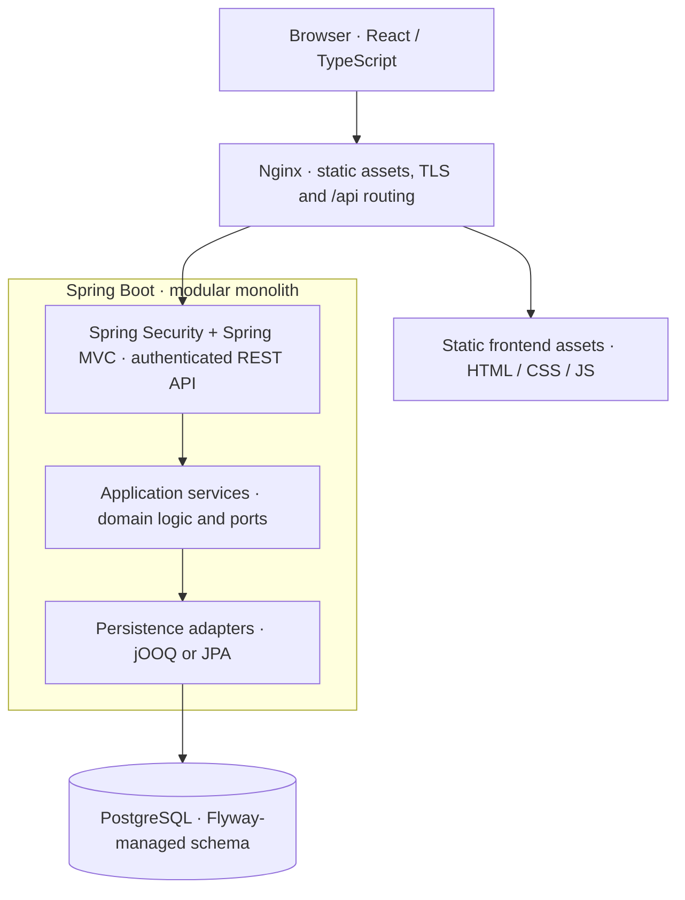

# Technical stack overview

**Status:** Technical overview of the preliminary target architecture. The implementation status of each technology is listed below; the [development guide](../development.md) describes the runnable starter.

ShareWise's frontend uses **Next.js, React and TypeScript** to build a static browser application. **Nginx** serves the generated assets, terminates TLS and routes `/api/*` requests to the **Java/Spring Boot API**. The backend runs initially as a **modular monolith**, with independently owned modules and ports-and-adapters boundaries. **PostgreSQL** provides local transactional storage; **Spring Modulith** coordinates durable asynchronous communication between modules. Separately deployed services and a message broker are supported extraction options, not dependencies of the modulith.

## Runtime architecture

The diagram shows a representative request path, not a required synchronous call chain between business modules. The application core defines its own ports; infrastructure implements them.

The frontend consists of static files generated by the Next.js build; production requests do not require a Next.js server. Nginx serves those files and forwards same-origin API requests to **Spring Security** for authentication and **Spring MVC** for HTTP dispatch. Spring MVC delegates to module-owned application operations, keeping business rules and persistence models out of HTTP contracts. See [security](security.md) for login, tokens and scoped authorization; the [development guide](../development.md) covers the starter's server-side greeting proxy and the build/deployment prerequisites.

For changes that may propagate asynchronously, a producer commits its business data together with **Spring Modulith publication records** in PostgreSQL. A transactional listener subsequently applies the event in a separate local transaction, using a consumer-owned inbox or an equivalent business-data idempotency rule. This is local, durable delivery rather than direct cross-module database writes; a broker is introduced only when separately deployed services require it. See [messaging](messaging.md) for the reliability, recovery, and service-extraction model.

## Technologies by responsibility

| Area | Technologies and responsibility | State |
| --- | --- | --- |
| Web UI | **Next.js 16**, **React 19**, **TypeScript**, **CSS Modules**; Mantine + SCSS Modules selected for [P2.0e](../internal/tasks/p2.0e-frontend-design/specification.md) | **Current:** Mantine and Sass/SCSS Modules installed with a neutral theme foundation; selected landing-page design and static-export deployment pending |
| Backend and HTTP | **Java 25**, **Spring Boot 4.1**, **Spring MVC**; REST endpoints and dependency-injected application services within a modular monolith | **Starter:** installed; business modules and application services planned |
| Module boundaries | **Spring Modulith** application modules: top-level package as published API, named interfaces, declared `allowedDependencies`, build-time verification of module dependencies | **Implemented:** [module structure](../architecture.md#module-structure-and-published-apis) and verification tests; `shared` is the only module |
| DI and operation lifetime | **Spring beans**, custom application-operation `Scope`, Java 25 `ScopedValue` and an inbound-agnostic dispatcher; scoped state independent of physical transactions | **Implemented:** [DI architecture](../architecture/dependency-injection.md) |
| Authentication and authorization | **Spring Security** for password authentication, bearer JWT validation and method/request guards; IAM-managed refresh sessions and short-lived identity JWTs; issuer-qualified domain attestations | **Preliminary design:** [security](security.md); not installed |
| Database and schema | **PostgreSQL** for authoritative, module-owned relational state; **Flyway** for reviewed SQL migrations | **Planned:** starter currently uses H2 |
| Transaction management | **Spring `TransactionTemplate`**, application-owned `Transactions` port and sequential physical segments | **Implemented and H2-tested:** [transaction architecture](../architecture/transactions.md); PostgreSQL verification pending |
| Persistence adapters | **jOOQ** for typed, dialect-aware SQL operations; **Spring Data JPA / Hibernate** for managed entities; guarded segment-bound facades | **Implemented framework accessors:** jOOQ and JPA dependencies present; PostgreSQL, Flyway, schema generation and business adapters pending |
| Asynchronous integration | **Spring Modulith**, JDBC-backed **Event Publication Registry**, transactional listeners and consumer-owned inbox/idempotency | **Planned:** Spring Modulith is installed only for module verification; no registry, listeners or broker installed |
| Edge / deployment | **Nginx** serves static assets, terminates TLS and proxies `/api/*` to the backend or an API gateway | **Planned** |
| External integrations | Adapter-owned file storage, notification delivery and other external services; no provider or storage technology is selected by this overview | **To be selected** per integration |

Backend modules retain ownership of their tables, public contracts, queries and business transactions within the shared PostgreSQL deployment. Cross-module state propagation uses versioned integration facts where eventual consistency is appropriate; immediate authoritative decisions may use deliberately narrow published interfaces. These module-boundary rules are described in the [application architecture](../architecture.md), and business consistency requirements are owned by the [domain model](../data-model-design.md).

## Development, verification and deployment

**Maven 3.10** builds and tests the Java application; **Node.js 24 and npm** manage the Next.js application. The checked-in Maven wrapper and npm lockfile establish repeatable dependencies. **JUnit/Spring tests** are present in the starter; **Mockito/fakes** are intended for database-independent application tests, with real **PostgreSQL integration tests** (normally using Testcontainers) required for migrations, transactions, and event-processing correctness. H2 is not a substitute for those PostgreSQL guarantees.

Development tooling includes **Dockerfiles**, a **VS Code Dev Container**, and **GitLab CI** jobs for backend verification, frontend lint/typecheck/build, SAST and secret detection. The existing frontend Dockerfile runs a Next.js server; the Nginx/static-asset deployment and PostgreSQL-backed runtime are not yet configured. For commands, ports, container networking and the offline dependency handoff, use the [development guide](../development.md). The [implementation backlog](../internal/tasks/backlog.md) tracks remaining work.

## Detailed architecture and decisions

The detailed architecture and technology decisions are documented in:

- [Application architecture](../architecture.md): modular monolith, dependency direction, published APIs, application services and transaction boundaries.
- [Operation-scope DI architecture](../architecture/dependency-injection.md), [pending integrations](dependency-injection.md) and [selection rationale](dependency-injection-alternatives.md): explicit service lifetime, Spring bean resolution and cleanup.
- [Transaction management architecture](../architecture/transactions.md): application-owned outcomes, sequential segments, failure semantics and guarded jOOQ/JPA access.
- [Persistence architecture](persistence.md) and [alternatives](persistence-alternatives.md): PostgreSQL, Flyway, jOOQ/JPA, schema generation, coordinated transactions and database tests.
- [Messaging architecture](messaging.md) and [alternatives](messaging-alternatives.md): Spring Modulith, durable publication, inboxes, idempotency, retention and later broker externalization.
- [Identity and authorization architecture](security.md) and [alternatives](security-alternatives.md): Spring Security, IAM sessions and JWTs, scoped attestations, trust boundaries, refresh and revocation.
- [Domain model](../data-model-design.md): bounded-context ownership, business invariants and consistency contracts; not a technology specification.
- [Development guide](../development.md): actual dependencies, local setup, build/test commands and container configuration.

Security token profiles and deployment configuration require implementation validation. File storage, notification transport and any future message broker are selected through their own integration requirements.
