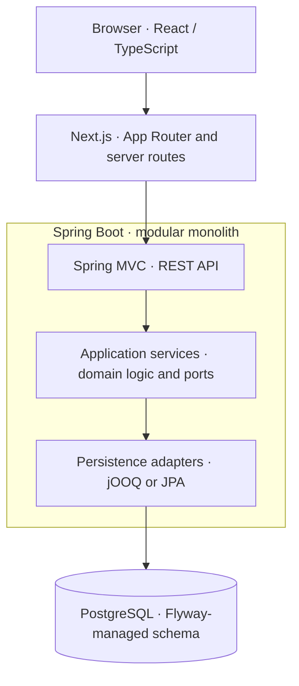

# Technical stack overview

**Status:** Technical orientation for ShareWise's early implementation baseline and preliminary target architecture. The repository currently contains a Spring Boot and Next.js starter, not the complete system described below. Technologies marked **planned** have not necessarily been added to the build; follow the linked design documents for their contracts and review status.

ShareWise is developed as **two web applications**: a Next.js frontend and a Java/Spring Boot backend. The backend is intended to remain **one deployable modular monolith** initially, with independently owned modules and ports-and-adapters boundaries. PostgreSQL provides local transactional storage; Spring Modulith provides durable, asynchronous communication between modules. Independent services and a message broker are future extraction options, not prerequisites for running the modulith.

## Runtime architecture

The diagram shows a representative request path, not a required synchronous call chain between business modules. The application core defines its own ports; infrastructure implements them.

The **Next.js** server can serve the UI and forward requests to Spring. The starter demonstrates this with a Next.js route handler calling the backend greeting endpoint; the eventual browser-to-backend authentication flow and whether Next.js acts as a broader backend-for-frontend (BFF) are still open. **Spring MVC** is the HTTP boundary, not the owner of business rules. Each backend module contains its own application operations and outward-facing ports, keeping framework-specific persistence models out of module contracts.

For changes that may propagate asynchronously, a producer commits its business data together with **Spring Modulith publication records** in PostgreSQL. A transactional listener subsequently applies the event in a separate local transaction, using a consumer-owned inbox or an equivalent business-data idempotency rule. This is local, durable delivery rather than direct cross-module database writes; a broker is introduced only when separately deployed services require it. See [messaging](messaging.md) for the reliability, recovery, and service-extraction model.

## Technologies by responsibility

| Area | Technologies and responsibility | State |
| --- | --- | --- |
| Web UI | **Next.js 16**, **React 19**, **TypeScript**, **Tailwind CSS 4**; App Router UI, browser/server rendering boundaries and frontend route handlers | **Starter:** installed; example UI and proxy route only |
| Backend and HTTP | **Java 25**, **Spring Boot 4.1**, **Spring MVC**; REST endpoints and dependency-injected application services within a modular monolith | **Starter:** installed; module and application-service structure planned |
| Authentication and authorization | **Spring Security** is the projected backend security integration; identity, access/refresh lifecycle, CSRF and Next.js/BFF boundaries need a separate implementation decision | **Undecided:** not yet implemented |
| Database and schema | **PostgreSQL** for authoritative, module-owned relational state; **Flyway** for reviewed SQL migrations | **Planned:** starter currently uses H2 |
| Persistence adapters | **jOOQ** for typed, dialect-aware SQL operations; **Spring Data JPA / Hibernate** where managed entities are useful; **Spring transactions** coordinate local commits behind application-owned ports | **Mixed:** JPA starter present; jOOQ, PostgreSQL and transaction ports planned |
| Asynchronous integration | **Spring Modulith**, JDBC-backed **Event Publication Registry**, transactional listeners and consumer-owned inbox/idempotency | **Planned:** no registry, listeners or broker installed |
| External integrations | Adapter-owned file storage, notification delivery and other external services; no provider or storage technology is selected by this overview | **To be selected** per integration |

The stack is **not an application-wide shared data model**. Backend modules own their tables, public contracts, queries and business transactions even while using one PostgreSQL deployment. Cross-module state propagation uses versioned integration facts where eventual consistency is appropriate; immediate authoritative decisions may use deliberately narrow published interfaces. These module-boundary rules are described in the [application architecture](../architecture.md), and business consistency requirements are owned by the [domain model](../data-model-design.md).

## Development, verification and deployment

**Maven 3.10** builds and tests the Java application; **Node.js 24 and npm** manage the Next.js application. The checked-in Maven wrapper and npm lockfile establish repeatable dependencies. **JUnit/Spring tests** are present in the starter; **Mockito/fakes** are intended for database-independent application tests, with real **PostgreSQL integration tests** (normally using Testcontainers) required for migrations, transactions, and event-processing correctness. H2 is not a substitute for those PostgreSQL guarantees.

The repository includes **Dockerfiles** for separate frontend/backend images, a **VS Code Dev Container** for local tooling, and **GitLab CI** jobs for backend verification, frontend lint/build, SAST and secret detection. Full PostgreSQL-backed deployment, observability, and selective service extraction are planned work, not properties of the starter. For commands, ports, container networking, and the optional offline dependency handoff, use the [development guide](../development.md); for work sequencing, use the [implementation backlog](../internal/tasks/backlog.md).

## Detailed architecture and decisions

This overview is the starting map, not a second specification. Follow the authoritative documents for the details behind each layer:

- [Application architecture](../architecture.md): modular monolith, dependency direction, published APIs, application services and transaction boundaries.
- [Persistence architecture](persistence.md) and [alternatives](persistence-alternatives.md): PostgreSQL, Flyway, jOOQ/JPA, schema generation, coordinated transactions and database tests.
- [Messaging architecture](messaging.md) and [alternatives](messaging-alternatives.md): Spring Modulith, durable publication, inboxes, idempotency, retention and later broker externalization.
- [Domain model](../data-model-design.md): bounded-context ownership, business invariants and consistency contracts; not a technology specification.
- [Development guide](../development.md): actual dependencies, local setup, build/test commands and container configuration.

The intended stack is intentionally independent of any particular business feature. Only technologies with a concrete architectural role are selected here; the identity/session flow, file-storage provider, notification transport and eventual broker technology remain open until their integration requirements are established.
