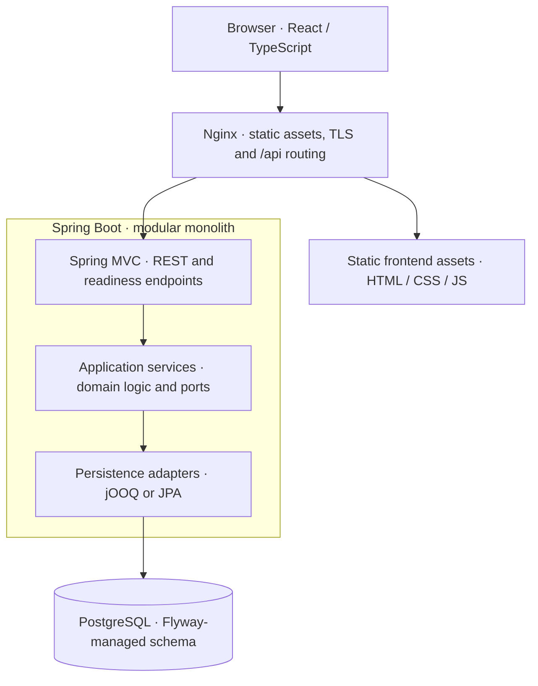

# Technical stack overview

**Status:** Technical overview of the preliminary target architecture. The implementation status of each technology is listed below; the [development guide](../development.md) describes the current local runtime.

ShareWise's frontend uses **Next.js, React and TypeScript**. The local production-style deployment serves its static export through **Nginx**, which terminates TLS and routes `/api/*` requests to the **Java/Spring Boot API**. The backend runs initially as a **modular monolith**, with independently owned modules and ports-and-adapters boundaries. **PostgreSQL** provides local transactional storage; durable asynchronous communication through **Spring Modulith** remains part of the agreed, not-yet-implemented target design. Separately deployed services and a message broker are supported extraction options, not dependencies of the modulith.

## Runtime architecture

The diagram shows a representative request path, not a required synchronous call chain between business modules. The application core defines its own ports; infrastructure implements them.

In the production-style stack, Nginx serves exported frontend files without a Next.js server and forwards same-origin API requests to **Spring MVC** without rewriting their paths. Spring Security protects the implemented IAM registration, login, refresh/logout, account profile and password-change APIs; Group and Finance business operations remain planned. See [security](security.md) for implemented identity behavior and proposed domain authorization, and the [deployment guide](../../deploy/README.md) for runtime configuration and local startup.

For changes that may propagate asynchronously, a producer commits its business data together with **Spring Modulith publication records** in PostgreSQL. A transactional listener subsequently applies the event in a separate local transaction, using a consumer-owned inbox or an equivalent business-data idempotency rule. This is local, durable delivery rather than direct cross-module database writes; a broker is introduced only when separately deployed services require it. See [messaging](messaging.md) for the reliability, recovery, and service-extraction model.

## Technologies by responsibility

| Area | Technologies and responsibility | State |
| --- | --- | --- |
| Web UI | **Next.js 16**, **React 19**, **TypeScript**, Mantine, Phosphor icons and SCSS Modules | **Implemented:** [Quiet clarity](../design/sharewise-design-foundation.md) design, public landing page, authenticated demonstration workspace and Account page, IAM session coordinator and shared API client; production static export served by Nginx |
| Backend and HTTP | **Java 25**, **Spring Boot 4.2**, **Spring MVC**; REST endpoints, RFC 9457 `ProblemDetail` error handling, `@ConfigurationProperties`, health probes (`/api/system/v1/health`), `Result<T, E>` outcomes, and dependency-injected application services within a modular monolith | **Implemented:** HTTP error/validation and DI conventions in `shared`, system health in `system`, IAM account/credential/session services and HTTP routes; Group and Finance business APIs pending |
| Module boundaries | **Spring Modulith** application modules: top-level package as published API, named interfaces, declared `allowedDependencies`, build-time verification of module dependencies | **Implemented:** [module structure](../architecture.md#module-structure-and-published-apis) and verification tests; `shared`, `identity` and the host-local `system` module are present |
| DI and operation lifetime | **Spring beans**, custom application-operation `Scope`, Java 25 `ScopedValue` and an inbound-agnostic dispatcher; scoped state independent of physical transactions | **Implemented:** [DI architecture](../architecture/dependency-injection.md) |
| Authentication and authorization | **Spring Security** and JOSE for primary IAM JWT verification and signing, operation-scoped identity, password login/change, durable refresh sessions, CSRF/Origin and request policies; domain attestations remain planned | **Implemented IAM flows:** [verified credentials](../architecture/authorization.md), registration/login, refresh/logout, profile editing and password changes; domain attestations and authoritative Group-facing eligibility remain planned in [security](security.md) |
| Database and schema | **PostgreSQL** for authoritative, module-owned relational state; **Flyway** for reviewed SQL migrations | **Implemented:** PostgreSQL 18 in the dev container, Flyway baseline with one schema per context, migration and application roles; PostgreSQL Integration (`*IT`) and E2E (`*E2E`) tests in separate CI gates; no H2 dependency |
| Transaction management | **Spring `TransactionTemplate`**, application-owned `Transactions` port and sequential physical segments | **Implemented:** [transaction architecture](../architecture/transactions.md); independent PostgreSQL acceptance remains under P1.5 |
| Persistence adapters | **jOOQ** for typed, dialect-aware SQL operations; **Spring Data JPA / Hibernate** for managed entities; guarded segment-bound facades | **Implemented:** transaction-bound jOOQ/JPA accessors, Flyway-managed IAM tables and generated jOOQ account/profile/session adapters; other context-owned business persistence pending |
| Asynchronous integration | **Spring Modulith**, JDBC-backed **Event Publication Registry**, transactional listeners and consumer-owned inbox/idempotency | **Planned:** Spring Modulith is installed only for module verification; no registry, listeners or broker installed |
| Edge / deployment | **Nginx** serves static assets, terminates TLS and proxies `/api/*` to Spring; **Compose** runs the application and PostgreSQL 18 with health-gated startup and separate secret volumes | **Implemented local production-style Compose stack**; host provisioning, real certificate issuance and rollout/rollback remain P2.6c/d |
| External integrations | Adapter-owned file storage, notification delivery and other external services; no provider or storage technology is selected by this overview | **To be selected** per integration |

Backend modules retain ownership of their tables, public contracts, queries and business transactions within the shared PostgreSQL deployment. Cross-module state propagation uses versioned integration facts where eventual consistency is appropriate; immediate authoritative decisions may use deliberately narrow published interfaces. These module-boundary rules are described in the [application architecture](../architecture.md), and business consistency requirements are owned by the [domain model](../data-model-design.md).

## Development, verification and deployment

**Maven 3.10** builds and tests the Java application; **Node.js 24 and npm** manage the Next.js application. The checked-in Maven wrapper and npm lockfile establish repeatable dependencies. Backend test execution has independent Unit, Integration and E2E gates using JUnit/Spring, mocks/fakes where appropriate and PostgreSQL for persistence correctness. See the [test architecture](../architecture/tests.md) for coverage boundaries and the [developer test guide](../development/tests.md) for commands and environment setup.

Development tooling includes **Dockerfiles**, a **VS Code Dev Container**, and **GitLab CI** jobs for source checks, backend/frontend builds, Unit/Integration/E2E testing, SAST and secret detection. The production-style Compose stack packages the static frontend, Spring Boot and PostgreSQL with runtime-provided TLS/secrets, first-start roles and health-gated startup. GitLab uses a daemonless Kaniko builder to publish backend/frontend images from protected `main` pushes or explicit protected `dev-*` Git tags, and verifies their matching registry digests in a paired release artifact. Promotion of the mutable `latest` aliases is restricted to `main`; deploying or rolling back that pair is a separate task. See [local deployment](../../deploy/README.md), [CI and tests](../development/tests.md#ci-and-diagnostics), and the [development guide](../development.md). The [implementation backlog](../internal/tasks/backlog.md) tracks remaining work.

## Detailed architecture and decisions

The detailed architecture and technology decisions are documented in:

- [Application architecture](../architecture.md): modular monolith, dependency direction, published APIs, application services and transaction boundaries.
- [Frontend architecture](../architecture/frontend.md): Next.js route ownership, shared UI, browser API boundary and intended domain-first service organization.
- [Frontend development guide](../development/frontend.md): practical implementation, testing and UI conventions.
- [Operation-scope DI architecture](../architecture/dependency-injection.md), [pending integrations](dependency-injection.md) and [selection rationale](dependency-injection-alternatives.md): explicit service lifetime, Spring bean resolution and cleanup.
- [Transaction management architecture](../architecture/transactions.md): application-owned outcomes, sequential segments, failure semantics and guarded jOOQ/JPA access.
- [Persistence architecture](../architecture/persistence.md), [implementation status](persistence.md) and [alternatives](persistence-alternatives.md): PostgreSQL, Flyway, schema ownership, roles, adapter access and transaction participation.
- [Messaging architecture](messaging.md) and [alternatives](messaging-alternatives.md): Spring Modulith, durable publication, inboxes, idempotency, retention and later broker externalization.
- [Verified-credential architecture](../architecture/authorization.md), [security design](security.md) and [alternatives](security-alternatives.md): current primary IAM/JOSE foundation and proposed sessions, attestation, refresh and revocation workflows.
- [Domain model](../data-model-design.md): bounded-context ownership, business invariants and consistency contracts; not a technology specification.
- [Development guide](../development.md): actual dependencies, local setup, build/test commands and container configuration.

IAM token profiles, session lifecycle and account updates have dedicated backend and frontend tests; final browser acceptance is tracked under P2.1c, while public-host provisioning requires its own verification. File storage, notification transport and any future message broker are selected through their own integration requirements.
