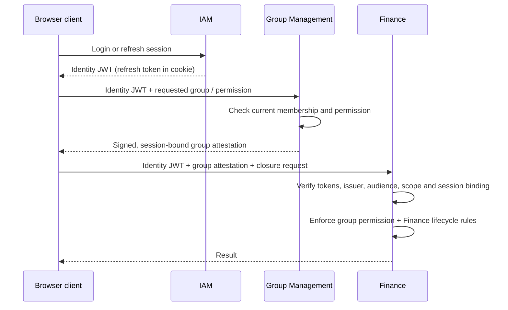

# Identity and authorization design

**Status:** JWT/JOSE verification, operation-scoped identity, IAM registration/login, account profiles, password changes, durable sessions, transactional refresh rotation and logout are implemented. Authoritative live account/session eligibility, Group membership administration and bearer invitations are implemented. IAM-to-Group local-miss integration and domain attestation issuance/authorization remain proposed. The [implemented identity architecture](../architecture/authorization.md), [application architecture](../architecture.md), [domain model](../data-model-design.md) and [persistence architecture](../architecture/persistence.md) own their respective contracts. See [security alternatives](security-alternatives.md) for the selection rationale.

**Contents:**

<!-- @import "[TOC]" {cmd="toc" depthFrom=2 depthTo=6 orderedList=false} -->

<!-- code_chunk_output -->

- [Trust and responsibility boundaries](#trust-and-responsibility-boundaries)
- [Credentials, sessions and refresh](#credentials-sessions-and-refresh)
- [Group invitations](#group-invitations)
- [Issuing and using domain attestations](#issuing-and-using-domain-attestations)
- [Request routing and framework integration](#request-routing-and-framework-integration)
    - [API boundaries and client behavior](#api-boundaries-and-client-behavior)
- [Revocation, distributed services and verification](#revocation-distributed-services-and-verification)

<!-- /code_chunk_output -->

## Trust and responsibility boundaries

**IAM authenticates principals; domain authorities attest domain-specific permissions; resource-owning contexts authorize operations.** Each authority owns the facts it signs. An IAM access JWT carries identity and session information, not copies of group memberships or financial permissions. In the proposed attestation model, Group Management issues signed group-role assertions that Finance can verify without querying Group Management on every request, while Finance continues to enforce its own business invariants.

The trust hierarchy has **two levels**: a primary IAM identity JWT may be used to request subordinate domain attestations; an attestation cannot be used to mint another attestation. Subordinate attestations supplement the primary JWT and never authenticate a caller by themselves. Authorities have independently managed signing keys and explicitly configured trust relationships; this is a logical trust hierarchy, not a derived signing-key chain.

| Owner | Owns | Does not own |
| --- | --- | --- |
| IAM | Accounts, credentials, login sessions, refresh-token families, identity JWTs, global account state | Group membership, financial authorization or file ACLs |
| Domain authority (initially Group Management) | Current domain permissions, attestation eligibility and issuance, optional authoritative revalidation | IAM identity, credentials or refresh sessions |
| Resource consumer (for example Finance) | Verification of trusted assertions, resource-specific authorization and business invariants | Other contexts' identity or permission tables |
| Shared security infrastructure | JWT/JWS profiles, signing and verification adapters, trusted-issuer configuration, session binding and provenance-preserving claim representation | Domain policies or account and membership data |

The implemented operation-scoped identity contract establishes the caller from verified primary IAM evidence; it does not grant group or financial permissions. In the proposed domain-authorization model, published Java capabilities supply authoritative checks where required, and resource-owning contexts apply their own policies. Attestation-based reads and stronger current-state checks remain separately planned.

## Credentials, sessions and refresh

IAM registration and password login create a durable session and issue a **short-lived, signed access JWT** plus an **opaque refresh credential**. The browser receives the refresh credential in a host-only, `Secure`, `HttpOnly`, `SameSite=Strict` cookie and keeps the access JWT only in tab memory. The same credential family supports transactional refresh rotation and logout through IAM cookie-backed endpoints. Domain attestations remain a later extension of bearer-authenticated API calls.

IAM owns account, session and refresh-verifier history in PostgreSQL. Registration and successful login commit account/session changes before releasing credentials; failed-login counters and lockout updates commit even when authentication is denied. Plaintext refresh secrets are not stored. A refresh operation locks the session, rechecks the presented generation, consumes the verified active token and commits exactly one successor with an updated idle deadline. A correctly verified consumed-token reuse revokes the family, while an incorrect secret never does.

Login lockout restricts password-based authentication and password changes, but does not suspend an already established session: a valid refresh credential can still rotate while the login lock is active. Logout and explicit session revocation prevent further refresh, and account disablement independently denies renewal.

An authenticated account profile exposes the registered email read-only and stores an optional display name separately from credentials. A password change requires the current password and an eligible bearer-bound session. IAM updates the password verifier and revokes every other session in one physical transaction, preserving the caller session and its refresh generation. Incorrect current passwords participate in the existing account lockout policy; password recovery is not implemented.

Sessions record independent **idle and absolute expiration** deadlines. A refresh remains eligible until the current effective deadline and can extend the sliding idle deadline; the renewed effective deadline must leave at least two seconds for a usable replacement cookie. Refresh cookies are normally capped at that deadline, although a response delayed after commit can emit a one-second replacement cookie that outlasts an already expired session; the cookie cannot restore session eligibility. Ordinary bearer-authenticated requests do not extend the session. IAM checks authoritative session state on refresh, extends idle expiry no further than the absolute deadline and revokes sessions on logout or verified refresh reuse. Consumed-token history is retained for replay detection; scheduled history cleanup is deferred. Consumers requiring stronger freshness use [synchronous IAM verification](../architecture/authorization.md#synchronous-authority-verification).

Each new login has a stable, unique **session-binding identifier** (`sid`) carried by the access JWT and returned in the authentication response; it identifies the committed session but is not itself a secret or an authentication credential. Refresh rotation preserves this identifier. Under the proposed attestation model, domain tokens bind to the verified primary issuer, user ID and session (`principal_iss`, `sub`, `principal_sid`) rather than one particular access JWT. Consumers must verify both tokens and their binding on external admission; admitted operation evidence remains stable within that operation.

The browser serializes **registration, login, refresh and logout** through an exclusive same-origin Web Lock, acquiring a fresh CSRF token only after obtaining the lock. If Web Locks are unavailable, it fails closed instead of sending an uncoordinated credential mutation. In-tab single-flight bounds simultaneous renewal; an uncertain refresh outcome requires reauthentication instead of a second mutation attempt. Browser coordination does not substitute for the server's transactional replay protection.

**Cookie-backed registration, login, refresh and logout enforce CSRF and exact same-origin `Origin` checks.** `GET /api/iam/v1/auth/csrf` returns a non-cacheable masked token paired with a host-only `__Host-sharewise-csrf` cookie (`Secure`, `HttpOnly`, `SameSite=Strict`, path `/`). Spring Security validates the token/header pair and rejects invalid proof before dispatch. Successful authentication clears the CSRF cookie; bearer-only API calls cannot authenticate using the refresh cookie. Authentication denials avoid account-existence disclosures, and secrets are excluded from logging. Successful refresh returns a replacement cookie and clears the CSRF cookie; successful logout revokes the verified session and clears both cookies. The bearer-only password command is exempt from those cookie-mutation checks for its exact HTTP method and path, but still requires a valid primary IAM bearer; it returns no credential or cookie. Rate limiting beyond account lockout remains a deployment/public-exposure requirement, not an implemented guarantee.

## Group invitations

Group Management issues shareable bearer capabilities to current administrators. The link secret is disclosed only on creation; listing exposes nonsecret metadata, and revocation deletes the record. The [opaque application token mechanism](../architecture/authorization.md#opaque-application-tokens) protects the stored verifier independently of IAM refresh credentials. A link carries no authenticated identity, membership role or downstream authorization grant.

Both preview and redemption require a verified IAM bearer and a locally known caller. The invitation token travels in a JSON request body, not a path or query parameter. Preview verifies the token and availability and returns only the group name, without changing membership or consuming a use. Redemption independently repeats validation under the group-root lock and creates only regular membership. An existing member keeps their role and does not consume a use on a valid repeat redemption. Invalid, revoked, expired or exhausted tokens have the same unavailable outcome. Group administrators authorize management operations from current membership rather than issued attestations. The [frontend architecture](../architecture/frontend.md#invitation-acceptance) explains how the browser keeps the invitation out of HTTP request URLs and authentication return paths.

## Issuing and using domain attestations

The following is the **proposed P2.5 attestation flow**, not an implemented P2.1a endpoint. Domain authorities issue short-lived, signed JWT/JWS **attestations** only after validating a primary IAM token and checking the *current authoritative state they own*. For example, Group Management refuses a new administrator attestation immediately after a role downgrade, even if the caller still has a valid IAM access JWT. No domain token may serve as an input credential for another issuance operation. Attestations have independent lifetimes and refresh by requesting a new attestation, not by using the IAM refresh cookie.

Each attestation has a stable issuer, a distinct protected token type, intended audience, subject/session binding, narrowly scoped resource identifiers and domain claims, issue/validity times, and a unique token ID. An authority signs only claim types it is permitted to assert. Consumers validate signature, trusted issuer/key, allowed algorithm, token type, `aud`, `nbf`/`exp`, clock skew and identity/session binding **before** exposing claims to application code. The subordinate's trust policy identifies accepted primary credentials by **issuer and configured profile name** (for example, IAM's access-token profile), rather than accepting every primary token from that issuer. Profile names are application-side verification identities, not JWT fields. Key selection uses configured trust relationships; token-supplied URLs cannot introduce trusted authorities. Signing-key management supports rotation, overlapping verification windows and emergency removal.

**Claims retain provenance.** A verified authorization context contains the primary identity and distinct issuer-qualified attestations, rather than flattening every claim into one set of global roles. Duplicate claim names are valid across authorities but never interchangeable. A permission check binds the *issuing authority, claim kind, resource ID and requested operation* together: `ADMIN` for group A must not authorize a mutation in group B, and Group Management cannot overwrite IAM's identity claims. Domain policies use typed verified assertions, not untrusted raw JWT payloads or a global `hasRole('ADMIN')` shortcut.

Group attestations establish **caller authorization**. Finance independently validates group lifecycle, financial state and participant eligibility. Its eventually synchronized `FinancialActor` data does not establish current group-administrator authority. Additional file-specific ACL machinery remains a [separate, unaccepted design](../file-management-acl-proposal.md).

## Request routing and framework integration

The browser loads **static Next.js-generated assets from Nginx** and calls the Spring Boot API through the same origin at `/api/*`. Nginx terminates TLS and forwards API requests directly to the Spring backend over the private application network. A separate API gateway would be a future deployment option. The browser sends primary bearer credentials to ordinary API operations, while IAM refresh/logout use its separately issued secure HttpOnly cookie. A successful refresh rotates the durable token generation and issues another primary JWT without exposing the refresh secret to JavaScript. Browser requests reach Spring Boot through Nginx without an application-server BFF. Same-origin routing lets IAM scope refresh and CSRF cookies to the API origin without requiring cross-origin browser credentials. The development rewrite and production Nginx static-export/TLS proxy both preserve same-origin `/api/*` routing; an ingress serving the application must preserve these origin and cookie boundaries. See the [stack overview](overview.md) for the runtime topology and the [development guide](../development.md) for the currently runnable starter.

Spring Security supplies the framework enforcement primitives, while IAM application operations own account/session creation, lockout, refresh rotation and revocation. Their implemented boundaries and remaining extensions are distinct:

| Concern | Implemented mechanism | Deferred capability |
| --- | --- | --- |
| Password authentication and change | IAM account/lockout services with Spring Security `Pbkdf2PasswordEncoder` (fixed PBKDF2-HMAC-SHA256 profile); a password change atomically revokes other sessions | Password recovery, migration/upgrade policy and stronger public-exposure throttling |
| HTTP authentication | Application-owned ordered `SecurityFilterChain` beans; IAM-owned `IamBearerIngressFilter` verifies through the shared credential codec and passes trusted evidence to operation ingress | Alternative authentication authorities and service extraction |
| JWT issuance and validation | Shared `JwtCredentialCodec` and ES256 signing/verification services built on Spring Security JOSE (`NimbusJwtEncoder`/decoder); IAM composes the primary-token profile | JWKS distribution and other domain credential issuers |
| Application authorization | Operation-scoped `IdentityContext` supplies admitted evidence; `IdentityPort` checks authoritative account/session eligibility; owning application services enforce resource policies | Group attestations and domain authority checks |
| CSRF and cookies | Spring Security `CsrfFilter`, `CookieCsrfTokenRepository`, masked tokens and strict Origin checks on IAM registration/login/refresh/logout; host-prefixed secure cookie issuance/clearing | Session/device administration and history cleanup |
| Durable session state | IAM-owned jOOQ session/refresh adapters and Spring-managed operation transactions serialize rotation, consumed-generation replay revocation and logout | Scheduled history cleanup |

IAM does **not** use the generic `JdbcUserDetailsManager` or Spring's `DaoAuthenticationProvider` as its registration/login orchestration. Spring servlet security does not replace domain authorization: operation-scoped identity and business rules remain authoritative. Framework method-security annotations may be useful for future Spring-intercepted entry points, but they are not the current Group authorization model.

The application composition root owns two ordered, framework-managed Spring Security `SecurityFilterChain` beans behind one Boot-registered `springSecurityFilterChain` servlet proxy. Its `/api/**` chain covers all bounded-context endpoints and receives IAM's published `identity::transport` contribution: primary bearer verification, plus credential-entry CSRF and Origin filters. IAM owns credential trust and its HTTP authentication policy, but does not construct or register a global chain; Group, Finance and other contexts do not register competing API bearer chains. The bearer filter is owned by the API chain, not registered separately as a servlet filter bean. Missing credentials remain anonymous at the HTTP transport boundary and protected application operations still require an authenticated, operation-scoped `IdentityContext`. Invalid supplied bearers are rejected before dispatch rather than being downgraded to anonymous. The API health route bypasses bearer verification. A lower-priority non-API chain retains public routing without enabling Spring form login or HTTP Basic. Both chains are stateless and do not promote a Spring thread-local principal into the application identity context.

The API chain also installs a Spring Security `CookieCsrfTokenRepository` and masked request-token handler for unsafe requests under `/api/iam/v1/auth/**`, excluding exactly `POST /api/iam/v1/auth/password`. The CSRF cookie is host-prefixed, Secure, HttpOnly, SameSite=Strict and path `/`; GET `/api/iam/v1/auth/csrf` returns the masked header token in a non-cacheable JSON body. An exact same-origin `Origin` check and CSRF verification precede cookie-backed auth dispatch; the password command instead requires the usual verified primary bearer and is not admitted through its refresh cookie. Successful registration/login clears the CSRF cookie and returns a session-bounded host-prefixed refresh cookie with the same secure attributes, while the primary access JWT is returned only in JSON. Cookie state never authenticates bearer-only operations. The non-API fallback remains stateless. Refresh/logout use the same CSRF/Origin boundary without a primary bearer; cookie state never authenticates ordinary bearer-protected operations.

Every mapped `/api/**` controller declares an HTTP admission policy with `@ApiAccess` on its class or method. The default requires verified primary IAM identity; `ANONYMOUS` explicitly permits callers without a bearer, and `CUSTOM` names an additional registered policy that still requires verified IAM identity. The route authorization manager rejects unclassified mapped endpoints, and an architecture test catches missing declarations. This guard governs HTTP admission; application operations remain responsible for resource-owned authorization.

In the shipped Compose deployment, Nginx enforces a 1 MiB body limit before forwarding requests to Spring MVC, including chunked bodies. Larger or streaming endpoints require an explicitly reviewed location override; alternative ingress deployments must provide equivalent request-size enforcement. The shipped backend is not exposed directly.

The implemented shared JWT/JOSE and evidence primitives provide trusted token profiles, signing and verification, session binding, and immutable provenance-preserving claims. The [architecture chapter](../architecture/authorization.md) describes their current runtime integration. Domain authorization policies and refresh-token state remain with their owning contexts. Verified claims retain issuer and resource provenance instead of being collected in a mutable global claims bag. The modulith shares this code in-process; extracted services use the same library with independently configured trust keys.

### API boundaries and client behavior

The IAM authentication/account and Group routes below are implemented; attestation and Finance examples remain proposed capabilities:

| Capability | API path | Authentication |
| --- | --- | --- |
| CSRF bootstrap | `GET /api/iam/v1/auth/csrf` | Anonymous, same-origin request; issues cookie/token pair |
| Registration / login | `POST /api/iam/v1/auth/{register,login}` | Anonymous credential entry with CSRF and strict Origin; issues primary JWT, stable `sessionId` and session-bounded refresh cookie |
| Refresh | `POST /api/iam/v1/auth/refresh` | CSRF/Origin-protected cookie authentication; optional expected session binding; rotates and issues a new JWT/cookie on success; `401 refresh_unavailable` or `409 session_context_changed` on failure |
| Logout | `POST /api/iam/v1/auth/logout` | CSRF/Origin-protected cookie authentication; optional expected session binding; revokes the verified session and clears refresh/CSRF cookies; idempotent without a usable cookie; `409 session_context_changed` preserves the other session's cookie |
| Account profile | `GET` and `PATCH /api/iam/v1/account` | Verified IAM bearer; reads email, user ID and nullable display name; `PATCH` sets or clears only the display name using required `displayName` and `clear` fields; returns an uncached account projection |
| Password change | `POST /api/iam/v1/auth/password` | Verified IAM bearer with a live owned session, not refresh-cookie authentication; JSON current/new passwords; `204` without replacement tokens or cookies; exact-route CSRF/Origin exception and non-cacheable responses |
| Group workspace and administration | `/api/groups/v1/groups` and its group-scoped resources | Verified IAM bearer, local admission and current Group membership/role as required by the operation |
| Invitation preview and redemption | `POST /api/groups/v1/invitations/{preview,redeem}` | Verified IAM bearer, local admission and valid invitation token in JSON; preview returns the group name, redemption requires explicit submission |
| Domain attestation issuance *(planned P2.5)* | `POST /api/groups/v1/attestations` (illustrative) | Valid primary IAM JWT; authority checks current group state |
| Authorized domain operation *(planned)* | For example `POST /api/finance/v1/groups/{groupId}/close` | Primary JWT + matching group attestation, plus Finance rules |

The profile update requires `clear` to agree with whether `displayName` is null, and rejects unknown fields and type coercion. Password change returns `current_password_invalid` for an incorrect current password or lockout, `credential_changed` when its initial verifier became stale, `account_unavailable` for a disabled/missing account, and `session_unavailable` for an ineligible bearer-bound session. The last denial is a **post-dispatch** `401`, not a signal to refresh and replay the command. Credentials are never included in responses or logs, and a lost password-change response must not trigger an automatic retry.

IAM refresh and logout validate the opaque presented credential before touching durable session state: wrong secrets do not revoke an account, verified consumed-token reuse revokes the token family, and a valid active credential with a mismatched expected session is rejected without mutation. Rotation, idle-deadline extension and revocation are serialized per session in PostgreSQL. The browser cannot inspect the HttpOnly cookie and therefore may attempt one lazy refresh with no cookie; a missing cookie yields a normal authentication failure rather than a client-side prerequisite check.

The future attestation and Finance HTTP schemas, error codes and token transport details require their own approved specifications.

**Optional extension: authoritative introspection.** If a specific distributed operation requires fresher authorization than token expiry provides, the responsible authority may expose a current-state check such as `POST /api/iam/v1/tokens/introspect` or `POST /api/groups/v1/attestations/introspect`. IAM checks its sessions; Group Management checks its own membership and permissions. Neither endpoint is part of the initial modulith API. Published Java capabilities provide local authoritative checks where needed.

If remote introspection is introduced, its endpoints are private to authenticated, authorized services. Nginx denies public introspection routes, with no publicly reachable backend bypass. Proxy filtering controls exposure, but does not replace service authentication when an endpoint is reachable across processes. A candidate service-authentication design reuses the existing JWT/JWS claim, verification-profile and per-context signing-key infrastructure: each workload signs a short-lived, audience-restricted **service credential** under a distinct issuer/type/profile, and the receiving authority checks the trusted service identity and its permission to invoke the requested capability. Service credentials authenticate the workload, not the user being checked, and remain separate from IAM primary identity JWTs and Group-issued domain attestations. Requests representing a user also need an authenticated, authorized principal/session binding; bare `userId` and `sessionId` values are not proof. Key ownership, rotation, service authorization and replay/expiry policy require a separate reviewed specification when a remote adapter is introduced. This is a candidate extension, **not** an implemented service-to-service trust model or an automatic consequence of P2.5. mTLS remains an optional transport-security mechanism, not a required independent application-identity system. [RFC 7662](https://www.rfc-editor.org/rfc/rfc7662.html) informs introspection semantics; the illustrative endpoints do not assert standards compliance.

The browser identity coordinator distinguishes verified ingress `401` responses (`invalid_credential` and `authentication_required`) from operation-level errors. Eligible, repeatable protected operations can be retried once after coordinated refresh; a later ingress rejection ends recovery, while an ordinary operation-generated `401` or authorization `403` does not invalidate an otherwise valid bearer or trigger another rotation. The IAM password command's `401 session_unavailable` is an explicit exception: it invalidates the still-current originating session without replay, even if its access bearer has since rotated. A terminal ingress rejection remains specific to the attempted bearer, and the same operation-level code on a different route has no IAM lifecycle effect. Workspace APIs are bound to the lifetime of the authenticated application subtree so retained asynchronous workflows cannot submit under a replacement login. In-tab single-flight and cross-tab Web Locks serialize cookie mutations; broadcasts carry only non-secret session changes. Refresh requests with uncertain outcomes are never blindly retried, because the browser cannot know whether the server consumed the prior generation. P2.5 separately introduces renewal of domain attestations. Browser behavior is explained in [frontend architecture](../architecture/frontend.md#browser-api-boundary).

## Revocation, distributed services and verification

**Token expiry bounds the staleness of locally verified primary IAM credentials.** The implemented access JWT defaults to five minutes (with a configurable, bounded lifetime and verifier skew), and each new HTTP admission verifies its trusted profile; a valid signature does not recheck the account or session in PostgreSQL. IAM denies refreshes from revoked, disabled, idle-expired or absolute-expired sessions. The future domain authorities must likewise refuse fresh attestations after a membership or permission change; previously issued credentials can remain locally valid until expiry.

**Optional extensions for faster revocation.** A future service may subscribe to versioned IAM-session revocations or domain permission changes through [messaging](messaging.md), maintaining local state that rejects affected credentials before expiry. These events provide best-effort early rejection and are not required for the initial system. Correctness continues to depend on authoritative issuance checks and token expiry even if events are delayed or lost. If implemented, revocation state is idempotently updated, distinguishes newer permission restorations from stale events, and expires or reconciles consistently with token validity. Event propagation has no guaranteed upper latency bound.

Credential validity and authority-state validity are distinct checkpoints. **Admission-time credential validity** means a fresh external request or workflow admission verifies the primary JWT's signature, trusted profile, binding and expiration; within an admitted workflow, the immutable operation identity may remain available even if that JWT expires during execution. **Call-time domain validity** means an application service explicitly asks the owning authority for its current account/session or permission state through a synchronous `<Concept>Port`, rather than assuming a still-valid JWT implies unchanged state. The [implemented IAM contracts](../architecture/authorization.md#synchronous-authority-verification) illustrate this distinction: `IdentityContext` supplies admitted evidence, while `IdentityPort` checks authoritative state. A proposed `GroupAuthorizationContext` and `GroupAuthorizationPort` would apply the same separation to Group permissions. Resource-owning services separately authorize their own mutations against current local business invariants.

A future network adapter may replace the local authority call with a private authenticated endpoint without changing the business-facing port. The same [transaction boundaries](../architecture/transactions.md#architectural-boundaries) apply to either transport: synchronous calls take place outside active consumer transactions, and mutable local preconditions are revalidated before a subsequent write. Remote communication introduces additional failure modes but no distributed atomicity; consumers fail closed when a reliable decision is unavailable.

More stringent authorization freshness remains a per-operation design decision: Group is expected to consult IAM on a local user-projection miss; especially consequential writes may also require fresh verification according to their own business rules. The optional remote introspection contract above preserves point-in-time authority checks but introduces latency and availability coupling; serializing concurrent changes across contexts would require a separate protocol. A revocation committed after a successful read can therefore remain a legitimate time-of-check/time-of-use race under the agreed call-time model.

After service extraction, each resource service validates configured issuers and audiences locally, while IAM and each domain authority retain their own state and signing keys. Every accepted token has an explicitly validated audience. Transport identity, internal endpoint authorization, key rotation, gateway forwarding and cross-service timeouts are deployment responsibilities when the corresponding integrations exist. Token exchange ([RFC 8693](https://www.rfc-editor.org/rfc/rfc8693.html)) is a potential standardized issuance protocol; the two-level trust model does not depend on it.

The identity lifecycle is tested at several boundaries: Unit tests establish credential and renewal policy, PostgreSQL tests exercise transaction serialization and replay history, HTTP tests establish CSRF/Origin and cookie handling, and frontend tests exercise bounded recovery and tab coordination. The account endpoints provide real protected operations for browser-side bearer rejection and renewal checks. Password-change concurrency, rollback and cookie/bearer separation have dedicated PostgreSQL and HTTP tests; browser restoration, account switching and mutation uncertainty require live HTTPS acceptance in addition to mocked tests. Future domain attestation behavior requires its own verification, as does multi-instance deployment when introduced. If optional revocation events or introspection are implemented, tests must also cover delayed, missing and out-of-order messages, route isolation and authenticated remote calls. Unit tests verify local policy rules; PostgreSQL and HTTP/browser integration tests establish stateful and transport guarantees. See [Spring Security password storage](https://docs.spring.io/spring-security/reference/features/authentication/password-storage.html), [JWT resource servers](https://docs.spring.io/spring-security/reference/servlet/oauth2/resource-server/jwt.html), [method authorization](https://docs.spring.io/spring-security/reference/servlet/authorization/method-security.html), [CSRF protection](https://docs.spring.io/spring-security/reference/servlet/exploits/csrf.html), [JWT best practices](https://www.rfc-editor.org/rfc/rfc8725.html) and [Next.js static export constraints](https://nextjs.org/docs/app/guides/static-exports).
