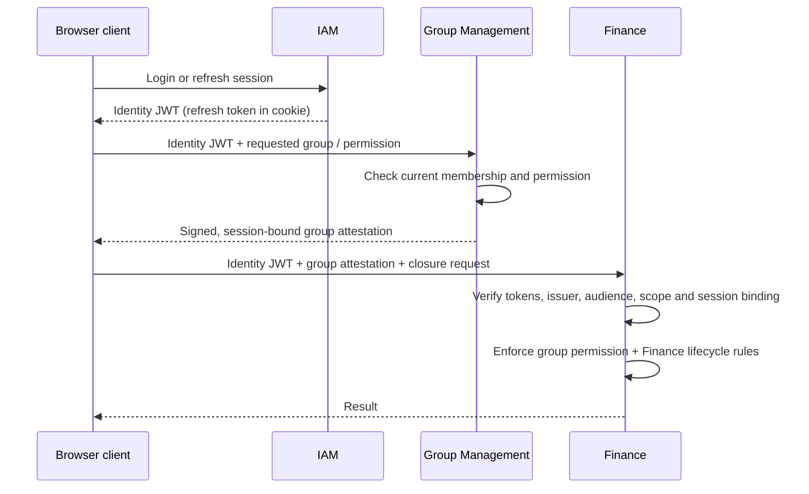

# Identity and authorization architecture

**Status:** Preliminary security architecture, subject to implementation validation. The [application architecture](../architecture.md) defines context ownership; the [domain model](../data-model-design.md) defines business authorization constraints; the [persistence architecture](persistence.md) defines transactional storage. See [security alternatives](security-alternatives.md) for the selection rationale.

**Contents:**

<!-- @import "[TOC]" {cmd="toc" depthFrom=2 depthTo=6 orderedList=false} -->

<!-- code_chunk_output -->

- [Trust and responsibility boundaries](#trust-and-responsibility-boundaries)
- [Credentials, sessions and refresh](#credentials-sessions-and-refresh)
- [Issuing and using domain attestations](#issuing-and-using-domain-attestations)
- [Request routing and framework integration](#request-routing-and-framework-integration)
  - [API boundaries and client behavior](#api-boundaries-and-client-behavior)
- [Revocation, distributed services and verification](#revocation-distributed-services-and-verification)

<!-- /code_chunk_output -->

## Trust and responsibility boundaries

**IAM authenticates principals; domain authorities attest domain-specific permissions; resource-owning contexts authorize operations.** Each authority owns the facts it signs. An IAM access JWT carries identity and session information, not copies of group memberships or financial permissions. Group Management can issue a signed attestation of a caller's group role or permission. Finance can validate that attestation without querying Group Management on every request, while continuing to enforce its own financial invariants.

The trust hierarchy has **two levels**: a primary IAM identity JWT may be used to request subordinate domain attestations; an attestation cannot be used to mint another attestation. Subordinate attestations supplement the primary JWT and never authenticate a caller by themselves. Authorities have independently managed signing keys and explicitly configured trust relationships; this is a logical trust hierarchy, not a derived signing-key chain.

| Owner | Owns | Does not own |
| --- | --- | --- |
| IAM | Accounts, credentials, login sessions, refresh-token families, identity JWTs, global account state | Group membership, financial authorization or file ACLs |
| Domain authority (initially Group Management) | Current domain permissions, attestation eligibility and issuance, optional authoritative revalidation | IAM identity, credentials or refresh sessions |
| Resource consumer (for example Finance) | Verification of trusted assertions, resource-specific authorization and business invariants | Other contexts' identity or permission tables |
| Shared security infrastructure | JWT/JWS profiles, signing and verification adapters, trusted-issuer configuration, session binding and provenance-preserving claim representation | Domain policies or account and membership data |

The initial modulith can use published Java authorization capabilities for immediate authoritative decisions, including File Management's resource-access checks. The same typed authorization contract should work with locally verified attestations as those capabilities are introduced, and remain usable after service extraction. Synchronous checks are **optional, explicit exceptions** for operations whose required freshness exceeds token expiration guarantees, not a dependency of every request.

## Credentials, sessions and refresh

IAM issues a **short-lived, signed access JWT** and a **rotating opaque refresh token** after authenticating a user. The refresh token belongs to a server-side login session and is delivered to the browser in a `Secure`, `HttpOnly`, appropriately `SameSite` cookie. The access JWT and any domain attestations are kept in client memory and sent as bearer credentials; they are not stored in browser local storage. The browser's normal `/api/*` requests use the access JWT and, where required, a domain attestation.

IAM owns durable session and refresh-family state in PostgreSQL. Store refresh-token verifiers rather than plaintext tokens, rotate atomically, and ensure competing refresh attempts cannot both succeed. Reuse of an invalidated refresh token triggers the configured family-revocation policy. Login, refresh, logout, password change, account disablement and credential recovery must each specify their transaction outcome, revocation effect and error behavior. On password change, invalidate the other refresh sessions and issue a new credential pair under the new session policy. Account lockout/failure counters must be committed when a failed login legitimately updates them; a failed authentication response does not always imply that the database operation rolls back.

A session has a stable, random **opaque session-binding identifier** (`sid`) that survives refresh-token rotation and independent access-JWT renewal. Domain attestations carry the primary issuer, user ID and an IAM-session-binding claim (illustratively `principal_iss`, `sub`, `principal_sid`). A new login session gets a new binding ID. The binding value is not itself a secret or an authentication credential, and it does **not** bind an attestation to one specific access JWT or its expiration. Consumers require a valid primary JWT **and** match the subject, identity issuer and session binding to each accepted attestation.

A refresh request uses the refresh cookie and **CSRF protection**; login and logout also need cookie-aware request protection and origin controls. An explicit CSRF token/header mechanism, browser cookie attributes and allowed origins are established in implementation. Spring Security's `CsrfFilter`, request handlers and `CsrfTokenRepository` provide the primitives; do not disable CSRF globally merely because ordinary APIs use bearer tokens. Rate-limit credential and attestation issuance, avoid account enumeration, and never log passwords, refresh tokens, access JWTs or attestations.

## Issuing and using domain attestations

Domain authorities issue short-lived, signed JWT/JWS **attestations** only after validating a primary IAM token and checking the *current authoritative state they own*. For example, Group Management refuses a new administrator attestation immediately after a role downgrade, even if the caller still has a valid IAM access JWT. No domain token may serve as an input credential for another issuance operation. Attestations have independent lifetimes and refresh by requesting a new attestation, not by using the IAM refresh cookie.

Each attestation has a stable issuer, a distinct protected token type, intended audience, subject/session binding, narrowly scoped resource identifiers and domain claims, issue/validity times, and a unique token ID. An authority signs only claim types it is permitted to assert. Consumers validate signature, trusted issuer/key, allowed algorithm, token type, `aud`, `nbf`/`exp`, clock skew and identity/session binding **before** exposing claims to application code. Key selection and issuer discovery are based on configured trust relationships; never follow an arbitrary token-supplied URL. Signing keys must support controlled rotation, overlapping verification windows and emergency removal.

**Claims retain provenance.** A verified authorization context contains the primary identity and distinct issuer-qualified attestations, rather than flattening every claim into one set of global roles. Duplicate claim names are valid across authorities but never interchangeable. A permission check binds the *issuing authority, claim kind, resource ID and requested operation* together: `ADMIN` for group A must not authorize a mutation in group B, and Group Management cannot overwrite IAM's identity claims. Domain policies use typed verified assertions, not untrusted raw JWT payloads or a global `hasRole('ADMIN')` shortcut.

The signed permission establishes **caller authorization**, not all business invariants. Finance still validates group lifecycle, financial state and participant eligibility; its eventually synchronized `FinancialActor` data is not silently treated as current group administrator authority. Additional file-specific ACL machinery remains a [separate, unaccepted design](../scoped-authorization-attestations-proposal.md).

## Request routing and framework integration

The browser loads **static Next.js-generated assets from Nginx** and calls the Spring Boot API through the same origin at `/api/*`. Nginx terminates TLS and routes API requests either directly or through an API gateway. The browser communicates with the API using bearer credentials and uses the IAM refresh-cookie endpoint when renewing its access token; there is no application-server BFF in this runtime model. Same-origin routing lets IAM scope refresh cookies to the API origin without requiring cross-origin browser credentials. See the [stack overview](overview.md) for the runtime topology and the [development guide](../development.md) for the currently runnable starter.

Spring Security is the enforcement framework; IAM application services orchestrate its primitives and own account/session workflows. The implementation mapping is:

| Concern | Spring / Java mechanism | Application-owned work |
| --- | --- | --- |
| Password authentication | `AuthenticationManager`, `DaoAuthenticationProvider`, `UserDetailsService`, `PasswordEncoder` (`DelegatingPasswordEncoder`, bcrypt/Argon2 as configured) | Account lookup, policies, registration, recovery, lockout and credential/session transactions |
| HTTP authentication | `SecurityFilterChain`, Resource Server JWT filter, `JwtDecoder` / `NimbusJwtDecoder` from Spring Security OAuth2 Resource Server + JOSE | Trusted issuer, audience, algorithm and custom token-type validation; distinguish public, bearer and cookie-backed routes |
| JWT issuance | Spring Security `JwtEncoder` / `NimbusJwtEncoder` and JOSE primitives | IAM and domain issuance orchestration, keys/JWKS publication, issuance claims and lifetimes; no handwritten cryptography |
| Method and resource authorization | `@EnableMethodSecurity`, `@PreAuthorize`, `AuthorizationManager`, Spring Security `Authentication` / `SecurityContext` | Typed, issuer-qualified verified-authorization context; context-owned resource policies and failure mapping |
| CSRF and cookies | `CsrfFilter`, `CsrfTokenRepository`, cookie/response configuration | Refresh/login/logout CSRF flow, origin rules, refresh-cookie scope and lifecycle |
| Durable session state | Spring-managed transactions and context-owned jOOQ/JPA persistence adapters | Token hashing, refresh rotation, reuse detection, session invalidation and concurrency tests |

IAM owns the account and refresh-session model behind Spring Security adapters. `JdbcUserDetailsManager` can manage a simple JDBC user schema, but does not provide the required account lifecycle or rotating refresh sessions. Use framework-provided password encoders, JOSE signing and JWT validation rather than custom cryptography. Method-security annotations protect entry points; application services enforce resource policies and business invariants. Proxy-based method interception does not apply to self-invocation.

The shared security library should be a small stateless infrastructure module: token profiles, issuer-specific decoders/encoders, trusted-authority metadata, session-binding validation, typed verified claims and framework integration. It must not own domain authorization policies, refresh-token state or a generic mutable global claims bag. The initial modulith shares this code in-process; extracted services can depend on the same library and independently configured trust keys without sharing domain databases.

### API boundaries and client behavior

Proposed resource paths establish consistent *responsibilities*, not a finalized public API schema:

| Capability | Illustrative path | Authentication |
| --- | --- | --- |
| Login / refresh / logout | `POST /api/iam/v1/auth/{login,refresh,logout}` | Login credentials or refresh cookie with applicable CSRF protection |
| Primary-token/session introspection | `POST /api/iam/v1/tokens/introspect` | Authenticated internal service; authoritative IAM session check |
| Domain attestation issuance | `POST /api/groups/v1/attestations` | Valid primary IAM JWT; authority checks current group state |
| Domain attestation introspection | `POST /api/groups/v1/attestations/introspect` | Authenticated internal service; authoritative Group Management permission check |
| Authorized domain operation | For example `POST /api/finance/v1/groups/{groupId}/close` | Primary JWT + matching group attestation, plus Finance rules |

Other authorities use the same issuance/introspection pattern without taking over IAM authentication endpoints. Introspection is an optional **current-state** check, not a replacement for normal local signature validation. IAM cannot attest whether Group Management permissions remain current; each issuing authority answers that question for its own claims. An introspection endpoint is only needed once another independently deployed service must call it; within the modulith, use a published Java capability instead. Nginx must deny external routes to any `/introspect` endpoint, and the backend must not expose an alternate public path that bypasses that restriction. This is a simple initial **network exposure control**, not proof of a caller's service identity. When remote introspection is enabled, restrict it to private service-to-service connectivity and require authenticated, authorized callers; mTLS is an option, not a prerequisite to the initial modulith. [RFC 7662](https://www.rfc-editor.org/rfc/rfc7662.html) is a reference for introspection semantics, not a claim that the illustrative custom domain-attestation API already conforms to it. Final HTTP schemas, error codes and token transport headers remain implementation decisions.

Client authentication handling distinguishes expired primary tokens, expired domain attestations and actual authorization denials. On a suitable `401`, it refreshes the primary JWT through IAM or requests a new domain attestation from the owning authority, then retries at most once as appropriate. A `403` for insufficient permissions is not an invitation to refresh indefinitely. Deduplicate concurrent refresh requests to avoid treating parallel refresh-token rotations as replay; do not replay uncertain non-idempotent operations blindly. The client may stop displaying or requesting Finance data when Group Management reports removal, but **that is UX behavior, not a security guarantee**.

## Revocation, distributed services and verification

The normal security guarantee is **bounded authorization staleness**, not immediate distributed revocation. IAM stops issuing/refreshing credentials for revoked sessions or disabled accounts against its authoritative state. Domain authorities refuse new attestations for revoked or downgraded permissions against theirs. Previously issued JWTs remain independently verifiable until `exp` (including configured clock skew), so the accepted window is bounded by their remaining lifetime. A resource request requires *both* a valid primary JWT and any required attestation: neither alone can extend the other. Initial token lifetimes are candidates around **2–5 minutes**, not fixed configuration yet. Key compromise and emergency revocation require separately designed response procedures.

Authorities may also publish **revocation or permission-change events** through the [messaging system](messaging.md) so consumers can reject affected credentials earlier using service-local revocation state. IAM session invalidations can identify revoked `sid` values; domain authorities can publish versioned permission changes for a specific principal and resource. Consumers must apply these events idempotently and reject stale or out-of-order updates. For domain attestations, an authority-owned monotonic permission revision embedded in each attestation permits comparison with the latest observed revision, including after leave/rejoin or role restoration; a cache keyed only by user and group could otherwise reject newly valid attestations or accept obsolete ones. The precise event and revision contracts require implementation design.

This replicated state is **optional defense in depth**, not the authorization source of truth. Delayed, missing or lost cache state must not extend `exp`, permit renewed credentials after authoritative revocation, or make service startup depend on replaying historical events. Cache entries expire or are reconciled according to token lifetimes and their revision semantics. Event propagation itself has **no guaranteed upper latency bound**: it can improve average revocation response, while JWT expiry and authoritative issuance checks still bound the maximum ordinary stale-authorization window.

For selected sensitive operations, a consumer may synchronously consult IAM to check current session state or the relevant domain authority to check current entitlement. This trades additional latency and availability dependency for stronger freshness; it is not an implicit effect of sending a JWT. Even a synchronous check is a point-in-time observation and does not automatically serialize a concurrent membership change with a Finance transaction. Define any stricter ordering requirement separately.

After service extraction, each resource service validates configured issuers and audiences locally, while IAM and each domain authority retain their own state and signing keys. Audience scopes must be explicit across services; never disable audience checks for convenience. Transport identity, internal endpoint authorization, key rotation, gateway forwarding and cross-service timeouts become deployment concerns. Token exchange ([RFC 8693](https://www.rfc-editor.org/rfc/rfc8693.html)) may later provide a standard issuance protocol; adopting it is not required for the trust model or a license for arbitrary impersonation and delegation.

Validation must cover mismatched issuer, token type, audience, resource and session; cross-group role confusion; expired and rotated keys; concurrent refresh and token reuse; password changes and session invalidation; permission downgrade with outstanding attestations; duplicate, delayed, missing and out-of-order revocation events; role restoration with a newer permission revision; introspection route isolation and authenticated remote calls when enabled; CSRF and cookie settings; and request retries. Unit tests verify policy rules; PostgreSQL concurrency and HTTP/browser integration tests establish stateful and transport guarantees. See [Spring Security password storage](https://docs.spring.io/spring-security/reference/features/authentication/password-storage.html), [JWT resource servers](https://docs.spring.io/spring-security/reference/servlet/oauth2/resource-server/jwt.html), [method authorization](https://docs.spring.io/spring-security/reference/servlet/authorization/method-security.html), [CSRF protection](https://docs.spring.io/spring-security/reference/servlet/exploits/csrf.html), [JWT best practices](https://www.rfc-editor.org/rfc/rfc8725.html) and [Next.js static export constraints](https://nextjs.org/docs/app/guides/static-exports).
