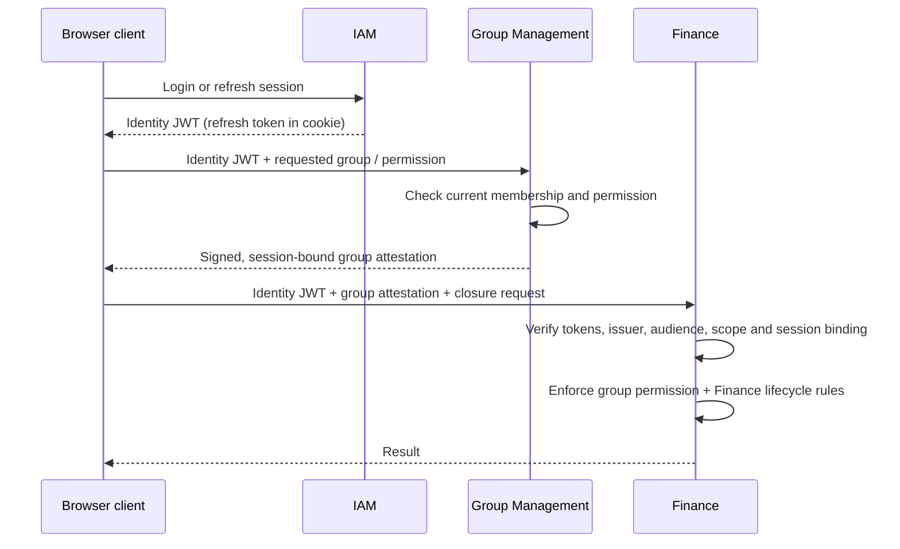

# Identity and authorization architecture

**Status:** Preliminary security architecture, subject to implementation validation. The [application architecture](../architecture.md) defines context ownership; the [domain model](../data-model-design.md) defines business authorization constraints; the [persistence architecture](persistence.md) defines transactional storage. See [security alternatives](security-alternatives.md) for the selection rationale.

**Contents:**

<!-- @import "[TOC]" {cmd="toc" depthFrom=2 depthTo=6 orderedList=false} -->

<!-- code_chunk_output -->

- [Trust and responsibility boundaries](#trust-and-responsibility-boundaries)
- [Credentials, sessions and refresh](#credentials-sessions-and-refresh)
- [Issuing and using domain attestations](#issuing-and-using-domain-attestations)
- [Request routing and framework integration](#request-routing-and-framework-integration)
  - [API boundaries and client behavior](#api-boundaries-and-client-behavior)
- [Revocation, distributed services and verification](#revocation-distributed-services-and-verification)

<!-- /code_chunk_output -->

## Trust and responsibility boundaries

**IAM authenticates principals; domain authorities attest domain-specific permissions; resource-owning contexts authorize operations.** Each authority owns the facts it signs. An IAM access JWT carries identity and session information, not copies of group memberships or financial permissions. Group Management can issue a signed attestation of a caller's group role or permission. Finance can validate that attestation without querying Group Management on every request, while continuing to enforce its own financial invariants.

The trust hierarchy has **two levels**: a primary IAM identity JWT may be used to request subordinate domain attestations; an attestation cannot be used to mint another attestation. Subordinate attestations supplement the primary JWT and never authenticate a caller by themselves. Authorities have independently managed signing keys and explicitly configured trust relationships; this is a logical trust hierarchy, not a derived signing-key chain.

| Owner | Owns | Does not own |
| --- | --- | --- |
| IAM | Accounts, credentials, login sessions, refresh-token families, identity JWTs, global account state | Group membership, financial authorization or file ACLs |
| Domain authority (initially Group Management) | Current domain permissions, attestation eligibility and issuance, optional authoritative revalidation | IAM identity, credentials or refresh sessions |
| Resource consumer (for example Finance) | Verification of trusted assertions, resource-specific authorization and business invariants | Other contexts' identity or permission tables |
| Shared security infrastructure | JWT/JWS profiles, signing and verification adapters, trusted-issuer configuration, session binding and provenance-preserving claim representation | Domain policies or account and membership data |

Within the modulith, published Java authorization capabilities provide immediate authoritative decisions where required, including File Management's resource-access checks. Typed authorization contracts also accept locally verified attestations and remain usable after service extraction. Normal authorization relies on independently verified, short-lived tokens; stronger current-state checks are an optional extension for operations with stricter freshness requirements.

## Credentials, sessions and refresh

IAM issues a **short-lived, signed access JWT** and a **rotating opaque refresh token** after authenticating a user. The refresh token belongs to a server-side login session and is delivered to the browser in a `Secure`, `HttpOnly`, appropriately `SameSite` cookie. The access JWT and any domain attestations are kept in client memory and sent as bearer credentials; they are not stored in browser local storage. The browser's normal `/api/*` requests use the access JWT and, where required, a domain attestation.

IAM owns durable session and refresh-family state in PostgreSQL. Refresh-token verifiers are stored instead of plaintext tokens, and rotation is atomic: concurrent use cannot issue two valid successors, including across backend instances. Reuse of an invalidated token triggers the configured family-revocation policy. Login, refresh, logout, password change, account disablement and credential recovery each have defined transaction outcomes, revocation effects and error behavior. A password change invalidates other refresh sessions and issues a new credential pair under the new session policy. Failed-login counters and lockout state still commit when authentication fails after legitimately updating them.

A login session has independent **idle and absolute expiration** deadlines, enforced against authoritative server-side state when refreshing credentials. Successful refresh extends the idle deadline within the fixed absolute lifetime; ordinary API requests do not silently renew the refresh session. Neither an expired nor a revoked session can issue further tokens, and the refresh cookie cannot outlive the effective server-side deadline. Expired and revoked refresh-family records are cleaned up under a bounded retention policy without making old credentials valid again.

A session has a stable, random **opaque session-binding identifier** (`sid`) that survives refresh-token rotation and independent access-JWT renewal. Domain attestations carry the primary issuer, user ID and an IAM-session-binding claim (illustratively `principal_iss`, `sub`, `principal_sid`). A new login session gets a new binding ID. The binding value is not itself a secret or an authentication credential, and it does **not** bind an attestation to one specific access JWT or its expiration. Consumers require a valid primary JWT **and** match the subject, identity issuer and session binding to each accepted attestation.

The browser serializes **login, refresh, password change and logout** operations that affect shared authentication state through an exclusive same-origin Web Lock, with per-tab single-flight coordination. Each tab reevaluates the need for refresh after acquiring the lock; a failed lock acquisition does not fall back to an uncoordinated refresh. An ambiguous or lost refresh response requires reauthentication rather than retrying a potentially consumed refresh cookie. The server remains authoritative for atomic rotation and replay detection; browser locking prevents benign cross-tab races but does not replace those guarantees. Tabs may signal session changes without persisting bearer tokens outside memory.

**Login and cookie-authenticated refresh/logout use CSRF protection and origin controls.** The static browser application obtains a request token from a safe, anonymous, same-origin endpoint such as `GET /api/iam/v1/csrf`. Spring Security issues a paired `Secure`, `HttpOnly`, host-prefixed CSRF cookie (host-only, path `/`) through its `CookieCsrfTokenRepository`; the non-cacheable response supplies the request token for a configured header on protected requests. `CsrfFilter` and a compatible request handler validate the pair using Spring Security's token machinery, including any masked-token handling. The browser obtains a fresh token before protected authentication operations, including after login/logout invalidate prior CSRF state. Bearer-only API requests are not made cookie-authenticated merely by being hosted on the same origin. Credential and attestation issuance is rate-limited, authentication responses resist account enumeration, and secrets or raw bearer credentials are excluded from logs.

## Issuing and using domain attestations

Domain authorities issue short-lived, signed JWT/JWS **attestations** only after validating a primary IAM token and checking the *current authoritative state they own*. For example, Group Management refuses a new administrator attestation immediately after a role downgrade, even if the caller still has a valid IAM access JWT. No domain token may serve as an input credential for another issuance operation. Attestations have independent lifetimes and refresh by requesting a new attestation, not by using the IAM refresh cookie.

Each attestation has a stable issuer, a distinct protected token type, intended audience, subject/session binding, narrowly scoped resource identifiers and domain claims, issue/validity times, and a unique token ID. An authority signs only claim types it is permitted to assert. Consumers validate signature, trusted issuer/key, allowed algorithm, token type, `aud`, `nbf`/`exp`, clock skew and identity/session binding **before** exposing claims to application code. Key selection uses configured trust relationships; token-supplied URLs cannot introduce trusted authorities. Signing-key management supports rotation, overlapping verification windows and emergency removal.

**Claims retain provenance.** A verified authorization context contains the primary identity and distinct issuer-qualified attestations, rather than flattening every claim into one set of global roles. Duplicate claim names are valid across authorities but never interchangeable. A permission check binds the *issuing authority, claim kind, resource ID and requested operation* together: `ADMIN` for group A must not authorize a mutation in group B, and Group Management cannot overwrite IAM's identity claims. Domain policies use typed verified assertions, not untrusted raw JWT payloads or a global `hasRole('ADMIN')` shortcut.

Group attestations establish **caller authorization**. Finance independently validates group lifecycle, financial state and participant eligibility. Its eventually synchronized `FinancialActor` data does not establish current group-administrator authority. Additional file-specific ACL machinery remains a [separate, unaccepted design](../file-management-acl-proposal.md).

## Request routing and framework integration

The browser loads **static Next.js-generated assets from Nginx** and calls the Spring Boot API through the same origin at `/api/*`. Nginx terminates TLS and routes API requests either directly or through an API gateway. The browser sends bearer credentials to the API and uses IAM’s refresh-cookie endpoint to renew access tokens. Browser requests reach Spring Boot through Nginx without an application-server BFF. Same-origin routing lets IAM scope refresh and CSRF cookies to the API origin without requiring cross-origin browser credentials. A minimal same-origin development proxy supports the initial authenticated browser slice; production static export and Nginx deployment follow later. See the [stack overview](overview.md) for the runtime topology and the [development guide](../development.md) for the currently runnable starter.

Spring Security is the enforcement framework; IAM application services orchestrate its primitives and own account/session workflows. The implementation mapping is:

| Concern | Spring / Java mechanism | Application-owned work |
| --- | --- | --- |
| Password authentication | `AuthenticationManager`, `DaoAuthenticationProvider`, `UserDetailsService`, `PasswordEncoder` (`DelegatingPasswordEncoder`, bcrypt/Argon2 as configured) | Account lookup, policies, registration, recovery, lockout and credential/session transactions |
| HTTP authentication | `SecurityFilterChain`, Resource Server JWT filter, `JwtDecoder` / `NimbusJwtDecoder` from Spring Security OAuth2 Resource Server + JOSE | Trusted issuer, audience, algorithm and custom token-type validation; distinguish public, bearer and cookie-backed routes |
| JWT issuance | Spring Security `JwtEncoder` / `NimbusJwtEncoder` and JOSE primitives | IAM and domain issuance orchestration, keys/JWKS publication, issuance claims and lifetimes; no handwritten cryptography |
| Method and resource authorization | `@EnableMethodSecurity`, `@PreAuthorize`, `AuthorizationManager`, Spring Security `Authentication` / `SecurityContext` | Typed, issuer-qualified verified-authorization context; context-owned resource policies and failure mapping |
| CSRF and cookies | `CsrfFilter`, `CsrfTokenRepository`, cookie/response configuration | Refresh/login/logout CSRF flow, origin rules, refresh-cookie scope and lifecycle |
| Durable session state | Spring-managed transactions and context-owned jOOQ/JPA persistence adapters | Token hashing, refresh rotation, reuse detection, session invalidation and concurrency tests |

IAM owns account and refresh-session orchestration behind Spring Security adapters. `JdbcUserDetailsManager` supports simple JDBC user storage; registration, account recovery and rotating refresh sessions are application-owned. Credential hashing uses Spring Security password encoders, and JWT signing and validation use its JOSE components. Method-security annotations protect Spring-intercepted entry points; application services enforce resource policies and business invariants. Proxy-based method interception does not apply to self-invocation.

The shared security library is a small stateless infrastructure module providing token profiles, issuer-specific decoders/encoders, trusted-authority metadata, session-binding validation, typed verified claims and Spring integration. Domain authorization policies and refresh-token state remain with their owning contexts. Verified claims retain issuer and resource provenance instead of being collected in a mutable global claims bag. The modulith shares this code in-process; extracted services use the same library with independently configured trust keys.

### API boundaries and client behavior

The following illustrative resource paths identify each API responsibility; final wire contracts remain to be defined:

| Capability | Illustrative path | Authentication |
| --- | --- | --- |
| CSRF bootstrap | `GET /api/iam/v1/csrf` | Anonymous, same-origin request; issues cookie/token pair |
| Login / refresh / logout | `POST /api/iam/v1/auth/{login,refresh,logout}` | Login credentials or refresh cookie; CSRF validation on all three |
| Domain attestation issuance | `POST /api/groups/v1/attestations` | Valid primary IAM JWT; authority checks current group state |
| Authorized domain operation | For example `POST /api/finance/v1/groups/{groupId}/close` | Primary JWT + matching group attestation, plus Finance rules |

Other authorities use the same attestation-issuance pattern. Final HTTP schemas, error codes and token transport headers remain implementation decisions.

**Optional extension: authoritative introspection.** If a specific distributed operation requires fresher authorization than token expiry provides, the responsible authority may expose a current-state check such as `POST /api/iam/v1/tokens/introspect` or `POST /api/groups/v1/attestations/introspect`. IAM checks its sessions; Group Management checks its own membership and permissions. Neither endpoint is part of the initial modulith API. Published Java capabilities provide local authoritative checks where needed.

If remote introspection is introduced, its endpoints are private to authenticated, authorized services. Nginx denies public introspection routes, with no publicly reachable backend bypass. Proxy filtering controls exposure; service authentication is required when the endpoint is reachable across processes. mTLS is one possible mechanism. [RFC 7662](https://www.rfc-editor.org/rfc/rfc7662.html) informs the semantics; the example domain endpoint does not assert standards compliance.

Client authentication handling distinguishes expired primary tokens, expired domain attestations and authorization denials. After an applicable `401`, the client refreshes the primary JWT through IAM or requests a new attestation from the owning authority, then retries at most once. Insufficient permissions produce `403` without triggering token refresh. Per-tab single-flight refresh and cross-tab authentication locking coordinate shared-cookie mutations; ambiguous refresh outcomes terminate the automatic renewal attempt and require reauthentication. An uncertain outcome for a non-idempotent business operation is never blindly retried. The client can stop displaying Finance data when Group Management reports membership removal, giving faster UI feedback without changing server authorization semantics.

## Revocation, distributed services and verification

**Token expiry bounds ordinary authorization staleness.** IAM stops issuing or refreshing credentials for revoked sessions and disabled accounts against its authoritative state; domain authorities refuse new attestations for revoked or downgraded permissions. Previously issued JWTs remain locally valid until `exp`, including configured clock skew. Each protected request requires a valid primary JWT and any applicable attestation, so access ceases when either expires without renewal. Lifetimes around **2–5 minutes** are initial candidates; actual values and emergency key-compromise procedures remain to be defined.

**Optional extensions for faster revocation.** A future service may subscribe to versioned IAM-session revocations or domain permission changes through [messaging](messaging.md), maintaining local state that rejects affected credentials before expiry. These events provide best-effort early rejection and are not required for the initial system. Correctness continues to depend on authoritative issuance checks and token expiry even if events are delayed or lost. If implemented, revocation state is idempotently updated, distinguishes newer permission restorations from stale events, and expires or reconciles consistently with token validity. Event propagation has no guaranteed upper latency bound.

More stringent authorization freshness remains a per-operation design decision. The optional introspection contract above provides a point-in-time authority check with additional latency and availability coupling; serializing concurrent changes across contexts would require a separate protocol.

After service extraction, each resource service validates configured issuers and audiences locally, while IAM and each domain authority retain their own state and signing keys. Every accepted token has an explicitly validated audience. Transport identity, internal endpoint authorization, key rotation, gateway forwarding and cross-service timeouts are deployment responsibilities when the corresponding integrations exist. Token exchange ([RFC 8693](https://www.rfc-editor.org/rfc/rfc8693.html)) is a potential standardized issuance protocol; the two-level trust model does not depend on it.

Core validation covers mismatched issuer, token type, audience, resource and session; cross-group role confusion; expired and rotated keys; concurrent refresh and token reuse across tabs and backend instances; lost or reordered refresh responses; idle and absolute session expiration; password changes and session invalidation; permission downgrade with outstanding attestations; CSRF bootstrap, renewal and cross-origin rejection; and bounded request retries. If optional revocation events or introspection are implemented, their tests additionally cover delayed, missing and out-of-order messages, role restoration, route isolation and authenticated remote calls. Unit tests verify policy rules; PostgreSQL concurrency and HTTP/browser integration tests establish stateful and transport guarantees. See [Spring Security password storage](https://docs.spring.io/spring-security/reference/features/authentication/password-storage.html), [JWT resource servers](https://docs.spring.io/spring-security/reference/servlet/oauth2/resource-server/jwt.html), [method authorization](https://docs.spring.io/spring-security/reference/servlet/authorization/method-security.html), [CSRF protection](https://docs.spring.io/spring-security/reference/servlet/exploits/csrf.html), [JWT best practices](https://www.rfc-editor.org/rfc/rfc8725.html) and [Next.js static export constraints](https://nextjs.org/docs/app/guides/static-exports).
